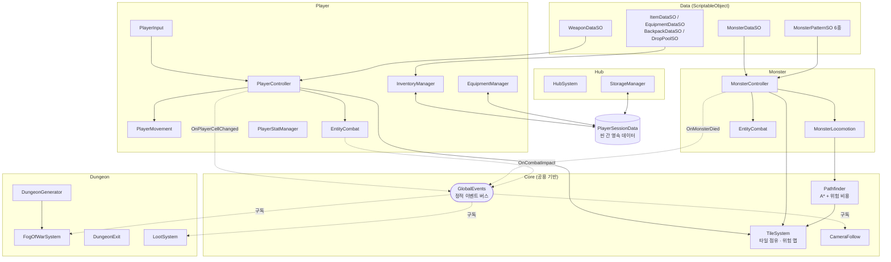
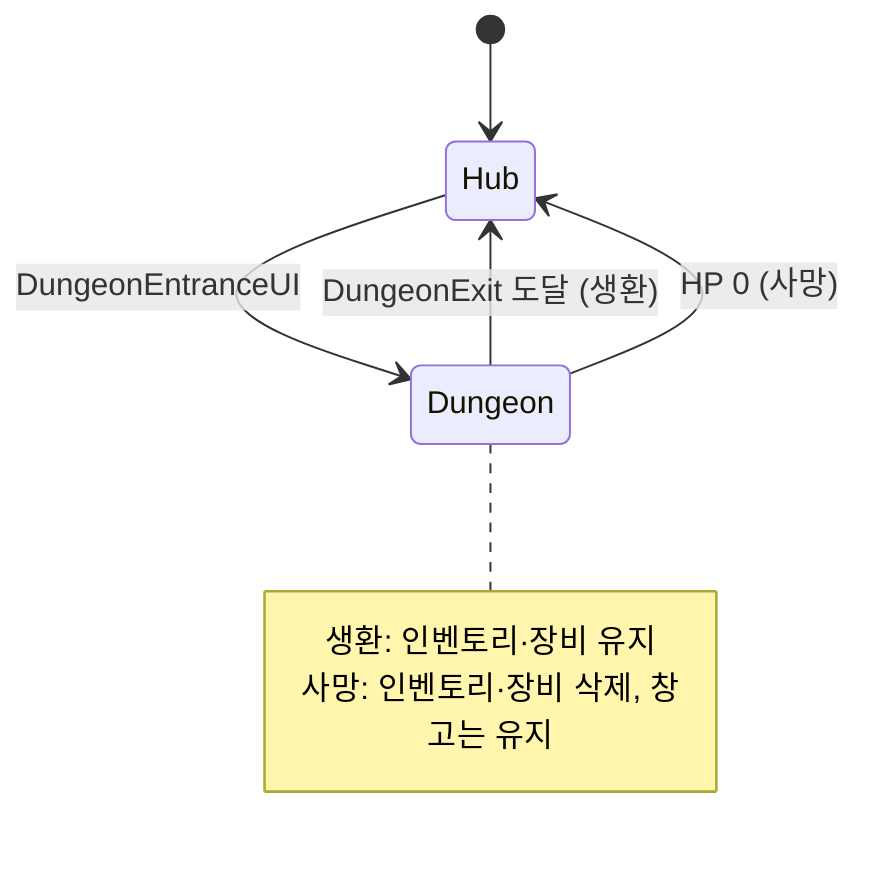
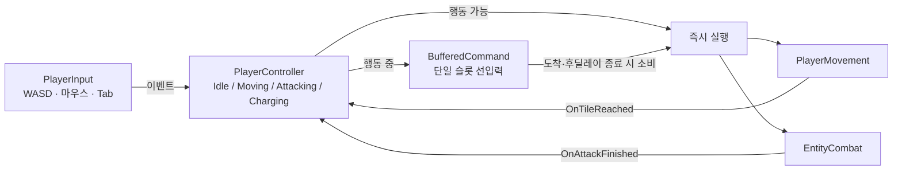
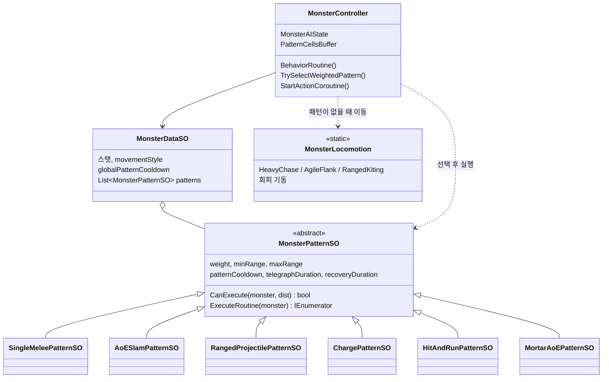
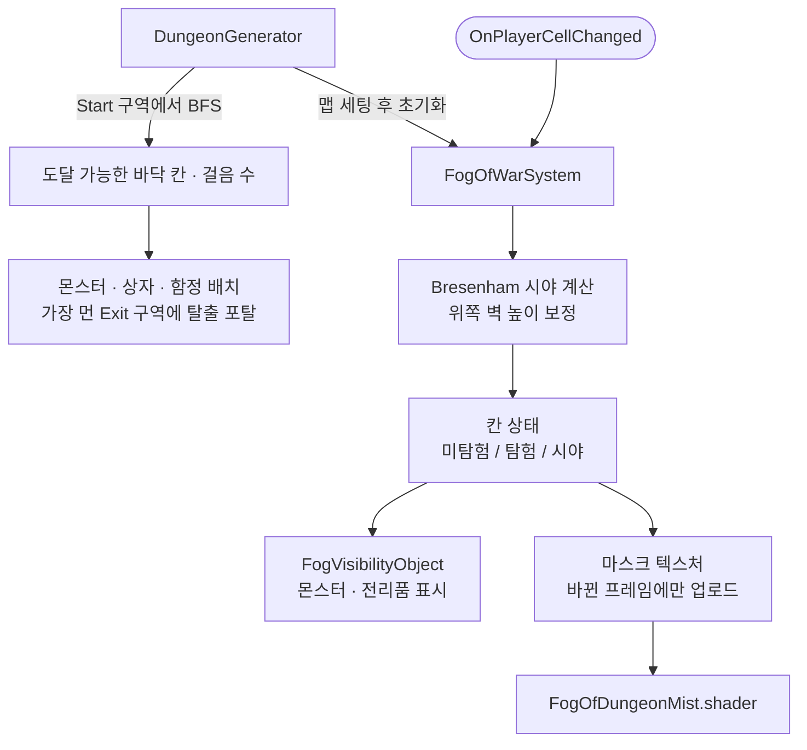

# 100 Bags Back 아키텍처

이 문서는 현재 코드(`Assets/01_Scripts/`) 기준으로 시스템의 구성과 데이터 흐름을 정리합니다.
시스템별 상세 클래스 명세는 [ScriptMaps](Architecture/ScriptMaps/)에 있습니다.

## 1. 한눈에 보기

| 항목 | 내용 |
| --- | --- |
| 씬 | `02_HubScene`(기지) ↔ `03_DungeonScene`(던전) |
| 좌표계 | 모든 이동·판정은 Unity `Grid`의 셀 좌표(`Vector3Int`) 단위 |
| 시스템 간 통신 | 같은 오브젝트 안은 `GetComponent`, 시스템 사이는 정적 이벤트 버스 `GlobalEvents` |
| 데이터 | 정적 데이터는 ScriptableObject, 플레이 중 변하는 값은 런타임 객체(`RuntimeItem`, 각 Controller)에 보관 |
| 씬 간 데이터 | 정적 세션 컨테이너 `PlayerSessionData` |

## 2. 전체 구조

- 실선: 직접 참조(컴포넌트 참조, 싱글톤 호출)
- 점선: `GlobalEvents`를 통한 발행/구독

## 3. 씬 흐름과 데이터 영속성

- 씬은 `LoadSceneMode.Single`로 전환하므로 씬 오브젝트는 매번 새로 만들어집니다.
- `InventoryManager`, `EquipmentManager`, `StorageManager`는 `Awake`에서 `PlayerSessionData`로부터 상태를 복원하고, 변경될 때마다 다시 기록합니다.
- 사망 시 `PlayerStatManager.HandleDeath()` → 인벤토리·장비 초기화 → `PlayerSessionData.ClearPlayerLoadoutOnDeath()` → 기지로 복귀합니다.

## 4. 공용 기반 (Core)

### TileSystem

씬 하나에 하나만 존재하는 셀 상태 저장소입니다.

| 기능 | API | 사용처 |
| --- | --- | --- |
| 타일 점유 | `TryOccupyTile`, `ReleaseTile`, `GetEntityAtTile` | 플레이어·몬스터 이동 시 칸 예약, 공격 대상 탐색 |
| 위험 맵 | `SetDanger(cell, duration)`, `GetDangerCost(cell)` | 공격 예정 칸을 일정 시간 위험으로 표시 |
| 바닥 아이템 | `RegisterItemTile`, `RemoveItemTile` | 밟아서 줍는 전리품 |

위험 맵은 플레이어와 몬스터가 함께 씁니다. 플레이어의 공격 칸이 위험으로 표시되면 몬스터가 회피할 칸을 고를 때와 `Pathfinder`의 경로 비용 계산에 반영됩니다.

### GlobalEvents

| 이벤트 | 발행 | 구독 |
| --- | --- | --- |
| `OnPlayerCellChanged` | `PlayerController` | `FogOfWarSystem` |
| `OnEntityDamaged` | `PlayerStatManager`, `MonsterController` | `CombatFeedbackSystem` (데미지 텍스트, 타격 이펙트) |
| `OnCombatImpact` | `EntityCombat`, `ChargePatternSO` | `CameraFollow` (카메라 셰이크, 히트스톱) |
| `OnMonsterDied` | `MonsterController` | `LootSystem` (드랍 생성) |
| `OnItemDroppedOnGround` | `InventoryManager`, 인벤토리·창고 UI | `LootSystem` |
| `OnItemPickedUpByPlayer` | `LootableItem` | `InventoryManager` (획득 성공 여부 콜백) |
| `OnHubObjectClicked` | `InteractableController` | `HubSystem` |

발행하는 쪽은 누가 구독하는지 모릅니다. 연출(카메라, 이펙트)과 규칙(데미지, 드랍)이 서로를 직접 참조하지 않도록 하기 위한 구조입니다.

## 5. 시스템별 구성

### 5.1 플레이어 · 전투

| 클래스 | 책임 |
| --- | --- |
| `PlayerInput` | 입력을 읽어 이벤트로 전달 (로직 없음) |
| `PlayerController` | 상태 관리, 선입력 버퍼, 3타 콤보·차징 공격, 무기 히트박스 계산 |
| `PlayerMovement` | 셀 단위 이동과 보행 연출(바운스, 틸트, 스쿼시) |
| `EntityCombat` | 공격 판정과 후딜레이. 후딜레이는 `Time.unscaledDeltaTime`으로 계산해 히트스톱 영향을 받지 않음 |
| `PlayerStatManager` | HP/MP, 피격, 사망 처리 |
| `CombatFeedbackSystem` | 데미지 텍스트·타격 이펙트·투사체 오브젝트 풀 |

### 5.2 몬스터 AI

- **상태**: `Patrol` → `Aggro` → (`Evading` / `Stunned` 인터럽트) → `Dead`
- **행동 루프**: 어그로 판정(거리 + 시야) → 쿨타임을 통과한 패턴 중 가중치 랜덤 선택 → 전조(장판·조준선) → 실행 → 후딜레이 → 패턴이 없으면 이동 성향대로 1칸 이동
- **상태 소유 규칙**: 패턴 SO는 여러 몬스터가 공유하므로 설정값과 로직만 가집니다. 좌표 버퍼, 쿨타임 같은 인스턴스별 값은 `MonsterController`가 가집니다.
- **인터럽트**: 행동 루프에서 시작한 하위 코루틴은 `StartActionCoroutine()`으로 추적하고, 회피·기절·사망 시 한꺼번에 중단합니다.
- 새 몬스터는 `MonsterDataSO`에 패턴 SO를 조합해 만들고, 새 패턴은 `MonsterPatternSO`를 상속한 클래스 하나로 추가합니다.

### 5.3 던전 · 전장의 안개

- `DungeonZone`으로 맵 위에 구역(Start / Combat / Chest / Corridor / Exit)을 지정하고, `DungeonGenerator`가 구역별로 스폰합니다.
- 시야 계산은 매 프레임이 아니라 플레이어가 다른 칸으로 이동했을 때만 수행합니다.
- 보조 광원(`FogVisionSource`)도 같은 방식으로 시야에 합쳐집니다.

### 5.4 아이템 · 인벤토리 · 기지

| 클래스 | 책임 |
| --- | --- |
| `ItemDataSO` 계열 | 아이템 원본 데이터 (읽기 전용) |
| `RuntimeItem` | 획득한 아이템 1개. 원본 SO 참조 + 고유 ID + 슬롯 위치 + 개수 |
| `InventoryManager` | 가방 슬롯과 무게 제한. 장착한 가방(`BackpackDataSO`)에 따라 용량 증가 |
| `EquipmentManager` | 부위별 장착 장비 |
| `StorageManager` | 기지 창고 |
| `LootSystem` | 몬스터 사망·아이템 버리기 이벤트를 받아 바닥 아이템 생성 (`DropPoolSO` 기반) |
| `IItemContainerUI` | 인벤토리·창고 UI 사이의 드래그 앤 드롭을 공통 인터페이스로 처리 |

## 6. 폴더와 데이터 위치

| 위치 | 내용 |
| --- | --- |
| `Assets/01_Scripts/` | 코드 (폴더 구조는 [README](../README.md#폴더-구조) 참고) |
| `Assets/Resources/Data_SO/` | ScriptableObject 데이터 에셋 |
| `Assets/Resources/CSV/` | 기획 데이터 CSV (임포터 비활성, [기술 부채](Architecture/04_Refactoring_TODO.md) 참고) |
| `Assets/Resources/Shader/` | 전장의 안개 셰이더 |
| `Docs/Architecture/ScriptMaps/` | 시스템별 상세 클래스 명세 (Player, Dungeon) |
| `Docs/Architecture/04_Refactoring_TODO.md` | 알려진 기술 부채 |
