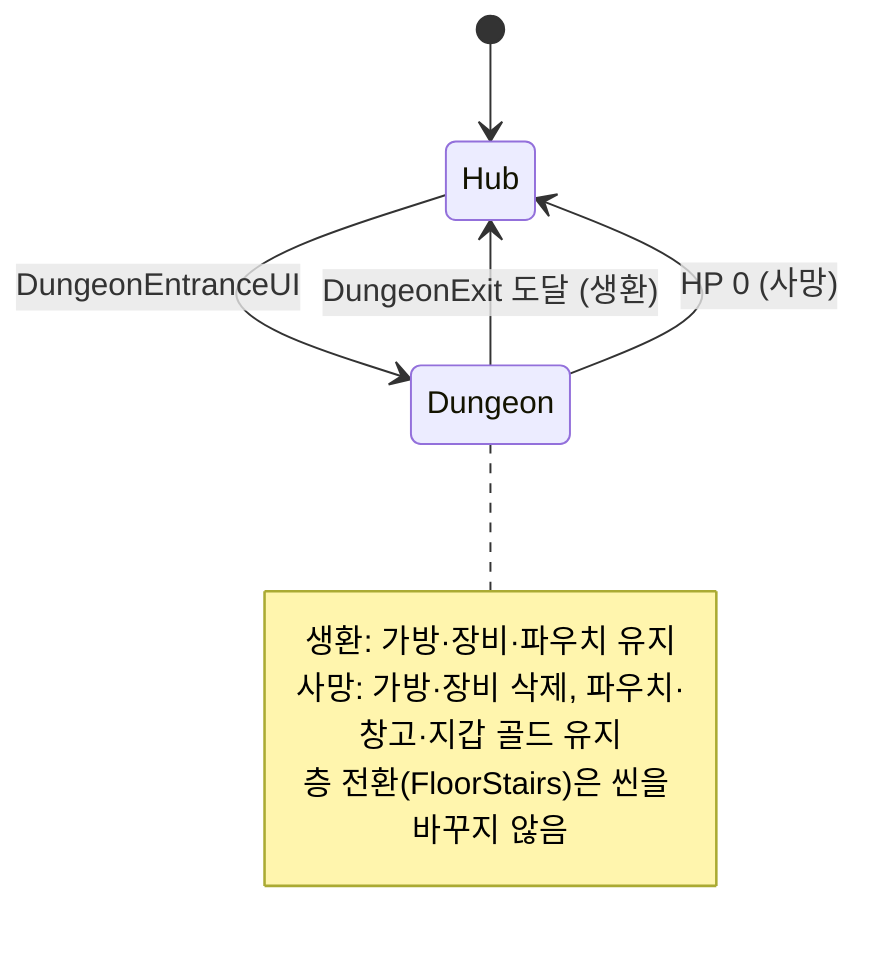
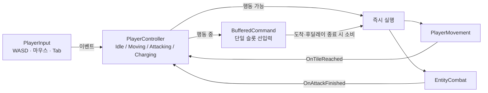
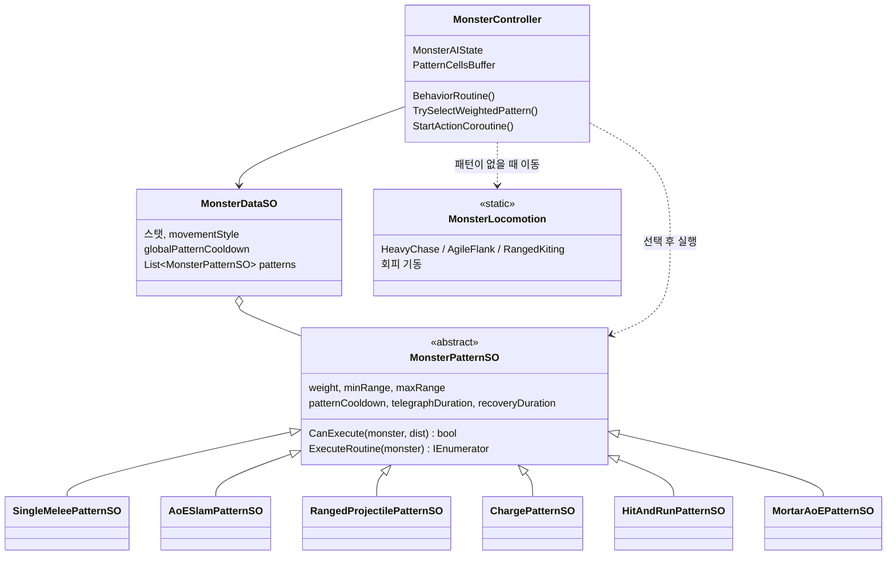
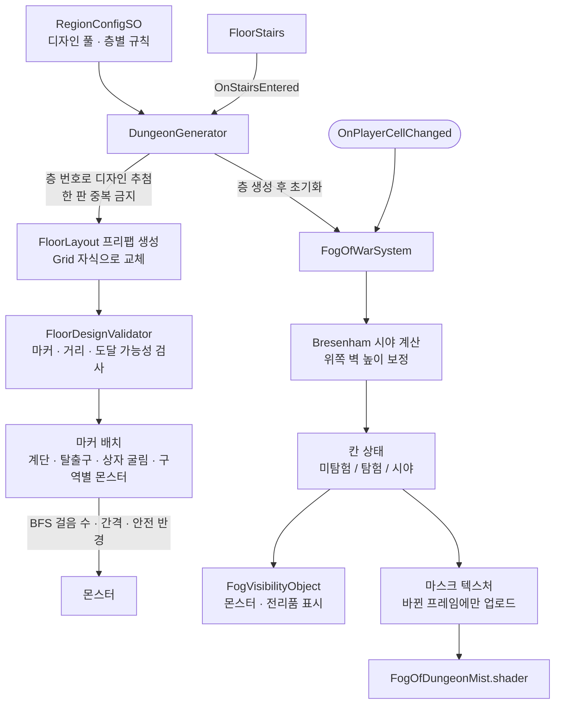

# 100 Bags Back 아키텍처

이 문서는 현재 코드(`Assets/01_Scripts/`) 기준으로 시스템의 구성과 데이터 흐름을 정리합니다.
시스템별 상세 클래스 명세는 [ScriptMaps](Architecture/ScriptMaps/)에 있습니다.

## 1. 한눈에 보기

| 항목 | 내용 |
| --- | --- |
| 씬 | `02_HubScene`(기지) ↔ `03_DungeonScene`(던전) |
| 좌표계 | 모든 이동·판정은 Unity `Grid`의 셀 좌표(`Vector3Int`) 단위 |
| 시스템 간 통신 | 같은 오브젝트 안은 `GetComponent`, 시스템 사이는 정적 이벤트 버스 `GlobalEvents` |
| 데이터 | 정적 데이터는 ScriptableObject, 플레이 중 변하는 값은 런타임 객체(`RuntimeItem`, 각 Controller)에 보관 |
| 씬 간 데이터 | 정적 세션 컨테이너 `PlayerSessionData` (가방·장비·창고·파우치·퀵슬롯·지갑 골드·직전 결과) |
| 공용 enum | `GameEnums` (아이템 분류·장비 부위·등급·몬스터 등급·이동 성향·무기 히트박스 등) |
| 시간 배율 | `Time.timeScale`은 `GamePauseService`만 바꿈 (가방 일시정지와 히트스톱 충돌 방지) |

## 2. 전체 구조

```mermaid
flowchart TB
    subgraph Data["Data (ScriptableObject)"]
        MonsterData[MonsterDataSO]
        PatternSO[MonsterPatternSO 6종]
        WeaponData[WeaponDataSO]
        ItemData["ItemDataSO / EquipmentDataSO<br>BackpackDataSO / DropPoolSO"]
    end

    subgraph Core["Core (공용 기반)"]
        Tile["TileSystem<br>타일 점유 · 위험 맵"]
        Path["Pathfinder<br>A* + 위험 비용"]
        Events(["GlobalEvents<br>정적 이벤트 버스"])
        Cam[CameraFollow]
        Pause[GamePauseService]
        Math[CombatMath]
    end

    subgraph Player
        PInput[PlayerInput] --> PCtrl[PlayerController]
        PCtrl --> PMove[PlayerMovement]
        PCtrl --> PCombat[EntityCombat]
        PStat[PlayerStatManager]
        CState[PlayerCombatState]
        Inv[InventoryManager]
        Equip[EquipmentManager]
        Pouch[SecurePouchManager]
        Quick[QuickSlotManager] --> Cons[ConsumableController]
    end

    subgraph Monster
        MCtrl[MonsterController] --> MLoco[MonsterLocomotion]
        MCtrl --> MCombat[EntityCombat]
    end

    subgraph Dungeon
        Region["RegionConfigSO<br>FloorDesignSO"]
        Gen[DungeonGenerator]
        Stairs[FloorStairs]
        Chest[FloorChest]
        Fog[FogOfWarSystem]
        Exit[DungeonExit]
        Loot[LootSystem]
    end

    subgraph Hub
        HubSys[HubSystem]
        Trade[HubTradeSystem]
        Storage[StorageManager]
    end

    Session[("PlayerSessionData<br>씬 간 영속 데이터")]

    MonsterData --> MCtrl
    PatternSO --> MCtrl
    WeaponData --> PCtrl
    ItemData --> Inv

    PCtrl --> Tile
    MCtrl --> Tile
    MLoco --> Path
    Path --> Tile

    Region --> Gen
    Gen --> Fog
    Stairs -. OnStairsEntered .-> Gen
    Inv <--> Session
    Equip <--> Session
    Storage <--> Session
    Pouch <--> Session
    Trade --> Session
    Exit --> Session

    PCtrl -. OnPlayerCellChanged .-> Events
    MCtrl -. OnMonsterDied .-> Events
    Chest -. OnChestOpened .-> Events
    PCombat -. OnCombatImpact .-> Events
    Events -. 구독 .-> Fog
    Events -. 구독 .-> Loot
    Events -. 구독 .-> Cam
    Events -. 구독 .-> CState
```

- 실선: 직접 참조(컴포넌트 참조, 싱글톤 호출)
- 점선: `GlobalEvents`를 통한 발행/구독

## 3. 씬 흐름과 데이터 영속성

- 씬은 `LoadSceneMode.Single`로 전환하므로 씬 오브젝트는 매번 새로 만들어집니다.
- `InventoryManager`, `EquipmentManager`, `StorageManager`, `SecurePouchManager`, `QuickSlotManager`는 `Awake`에서 `PlayerSessionData`로부터 상태를 복원하고, 변경될 때마다 다시 기록합니다.
- 던전을 나가는 순간 결과(`RunResult`)를 `PlayerSessionData.LastRunResult`에 기록하고, 기지의 `RunResultUI`가 한 번 보여준 뒤 비웁니다.
- 사망 시 `PlayerStatManager.HandleDeath()` → 결과 기록 → 가방·장비 초기화 → `PlayerSessionData.ClearPlayerLoadoutOnDeath()` → 기지로 복귀합니다.
- 기지에는 플레이어 오브젝트가 없으므로 `HubSystem`이 가방·장비·창고·파우치·퀵슬롯 매니저가 존재하도록 보장합니다.

## 4. 공용 기반 (Core)

### TileSystem

씬 하나에 하나만 존재하는 셀 상태 저장소입니다.

| 기능 | API | 사용처 |
| --- | --- | --- |
| 타일 점유 | `TryOccupyTile`, `ReleaseTile`, `GetEntityAtTile` | 플레이어·몬스터 이동 시 칸 예약, 공격 대상 탐색 |
| 위험 맵 | `SetDanger(cell, duration)`, `GetDangerCost(cell)` | 공격 예정 칸을 일정 시간 위험으로 표시 |
| 바닥 아이템 | `RegisterItemTile`, `RemoveItemTile` | 밟아서 줍는 전리품 |

위험 맵은 플레이어와 몬스터가 함께 씁니다. 플레이어의 공격 칸이 위험으로 표시되면 몬스터가 회피할 칸을 고를 때와 `Pathfinder`의 경로 비용 계산에 반영됩니다.

### GlobalEvents

| 이벤트 | 발행 | 구독 |
| --- | --- | --- |
| `OnPlayerCellChanged` | `PlayerController` | `FogOfWarSystem` |
| `OnEntityDamaged` | `PlayerStatManager`, `MonsterController` | `CombatFeedbackSystem` (데미지 텍스트, 타격 이펙트), `PlayerCombatState` (전투 상태 갱신) |
| `OnCombatImpact` | `EntityCombat`, `ChargePatternSO` | `CameraFollow` (카메라 셰이크, 히트스톱 요청) |
| `OnMonsterDied` | `MonsterController` | `LootSystem` (드랍 생성) |
| `OnChestOpened` | `FloorChest` | `LootSystem` (상자 드랍 풀) |
| `OnItemDroppedOnGround` | `InventoryManager`, `EquipmentManager` (가방 축소로 넘친 아이템) | `LootSystem` |
| `OnItemDiscardRequested` | `InventoryManager` (버리기, 성공 여부 콜백) | `LootSystem` (반경 안 빈 칸 탐색) |
| `OnItemPickedUpByPlayer` | `LootableItem` | `InventoryManager` (획득 성공 여부 콜백) |
| `OnFloorTransitionStarted` / `OnFloorEntered` | `DungeonGenerator` | `FloorHUD` (층 표시·배너) |
| `OnFloorCleared` | `DungeonGenerator` (층 번호, 탈출구 열림 여부) | `FloorHUD` (클리어 알림) |
| `OnPlayerCellChanged` (추가 구독) | `PlayerController` | `DungeonGenerator` (마지막 도착 칸), `FloorStairs`, `DungeonExit` (칸 진입 판정) |
| `OnHubObjectClicked` | `InteractableController` | `HubSystem` |

- 정적 이벤트의 구독·발행은 코드 그래프(graphify)에 잡히지 않습니다. 영향 범위를 볼 때는 이 표와 `grep "GlobalEvents.<이벤트>"`를 씁니다.

발행하는 쪽은 누가 구독하는지 모릅니다. 연출(카메라, 이펙트)과 규칙(데미지, 드랍)이 서로를 직접 참조하지 않도록 하기 위한 구조입니다.

## 5. 시스템별 구성

### 5.1 플레이어 · 전투

| 클래스 | 책임 |
| --- | --- |
| `PlayerInput` | 입력을 읽어 이벤트로 전달 (로직 없음) |
| `PlayerController` | 상태 관리, 선입력 버퍼, 3타 콤보·차징 공격, 무기 히트박스 계산 |
| `PlayerMovement` | 셀 단위 이동과 보행 연출(바운스, 틸트, 스쿼시) |
| `EntityCombat` | 공격 판정과 후딜레이. 후딜레이는 `Time.unscaledDeltaTime`으로 계산해 히트스톱 영향을 받지 않음 |
| `PlayerStatManager` | HP/MP, 장비 스탯 합산, 피격(`CombatMath`로 방어력 경감), 사망 처리 |
| `PlayerCombatState` | 마지막 타격·피격 후 5초간 전투 중 판정 |
| `CombatMath` | 방어력 점감·음수 방어력 증폭 공식 (상태 없는 정적 함수) |
| `GamePauseService` | `Time.timeScale` 단일 소유. 일시정지 요청자 집합과 히트스톱을 함께 관리 |
| `CombatFeedbackSystem` | 데미지 텍스트·타격 이펙트·투사체 오브젝트 풀 |
| `Projectile` | 투사체 이동과 적중 판정 (플레이어 `Z` 시험 공격, 몬스터 원거리 패턴) |
| `AttackWarningUI` | 몬스터 공격 예고 장판·조준선 표시 |
| `MovementPreview` | 조준 방향·사거리 칸 미리보기 |

### 5.2 몬스터 AI

- **상태**: `Patrol` → `Aggro` → (`Evading` / `Stunned` 인터럽트) → `Dead`
- **행동 루프**: 어그로 판정(거리 + 시야) → 쿨타임을 통과한 패턴 중 가중치 랜덤 선택 → 전조(장판·조준선) → 실행 → 후딜레이 → 패턴이 없으면 이동 성향대로 1칸 이동
- **상태 소유 규칙**: 패턴 SO는 여러 몬스터가 공유하므로 설정값과 로직만 가집니다. 좌표 버퍼, 쿨타임 같은 인스턴스별 값은 `MonsterController`가 가집니다.
- **인터럽트**: 행동 루프에서 시작한 하위 코루틴은 `StartActionCoroutine()`으로 추적하고, 회피·기절·사망 시 한꺼번에 중단합니다.
- 새 몬스터는 `MonsterDataSO`에 패턴 SO를 조합해 만들고, 새 패턴은 `MonsterPatternSO`를 상속한 클래스 하나로 추가합니다.

### 5.3 던전 · 전장의 안개

| 클래스 | 책임 |
| --- | --- |
| `RegionConfigSO` | 지역 하나의 설정: 초반(1~4층)·후반(6~9층) 디자인 풀, 5층·10층 고정 디자인, 층별 규칙(`FloorRule`: 탈출구 확률, 상자 굴림 횟수·확률, 몬스터 수), 상자 드랍 풀 ID |
| `FloorDesignSO` | 층 디자인 하나: 층 프리팹, 가중치 |
| `FloorLayout` / `FloorMarker` | 층 프리팹 루트(바닥·벽 타일맵, 마커, 구역)와 칸 역할 마커(시작점·위층 계단·탈출구·상자 후보) |
| `DungeonZone` | 몬스터 배치 영역. 1~9층은 층별 규칙의 몬스터 수를 구역 칸 수 비율로 나눠 놓음 (구역 자체 수는 10층만, 함정은 미배치) |
| `DungeonGenerator` | 층 추첨·생성·교체, 마커와 구역 배치, 같은 씬 층 전환, 층 클리어 처리(보스층 정리·안개 해제·계단 열기·탈출구 굴림) |
| `FloorClearTracker` | 현재 층의 살아 있는 몬스터 등록부와 클리어 판정 (POCO, `DungeonGenerator` 소유) |
| `FloorDesignValidator` | 층 규격 검증. 에디터 메뉴(`FloorGrayBoxBuilder`)와 런타임이 함께 씀 |
| `FloorStairs` | 위층 계단. 잠긴 채 생성, 클리어 시 열림. 칸 도착으로 지역 이벤트만 던짐 |
| `FloorChest` | 칸을 막는 상자. 공격(`IAttackInteractable`)을 받으면 열리고 `OnChestOpened` 발행 |
| `DungeonExit` | 탈출 포탈. 클리어 시 확률 생성, 칸 도착 시 탈출 요청 이벤트, 확인되면 결과 기록 후 기지로 전환 |
| `DungeonEntranceUI` | 기지의 던전 입장 버튼 |
| `FloorHUD` | 현재 층 상시 표시와 층 진입 배너 |
| `FogOfWarSystem` / `FogVisibilityObject` / `FogVisionSource` | 전장의 안개, 엔티티 가시성, 보조 광원 |

- 시야 계산은 매 프레임이 아니라 플레이어가 다른 칸으로 이동했을 때만 수행합니다.
- 층 클리어는 살아 있는 몬스터 등록부(`FloorClearTracker`)로 판정합니다. 전리품 이벤트 `OnMonsterDied`에 기대지 않으므로 소환수·보스층 강제 정리·층 전환 파괴를 정확히 셉니다.
- 계단과 탈출구의 진입은 물리 트리거가 아니라 `OnPlayerCellChanged`(타일 도착)의 칸 비교로 판정합니다.

### 5.4 아이템 · 인벤토리

| 클래스 | 책임 |
| --- | --- |
| `ItemDataSO` 계열 | 아이템 원본 데이터 (읽기 전용). `EquipmentDataSO` → `WeaponDataSO`·`ArmorDataSO`·`BackpackDataSO`·`AccessoryDataSO`, `ConsumableDataSO`(회복량, 지속 회복 시간, 공용 쿨타임) |
| `RuntimeItem` | 획득한 아이템 1개. 원본 SO 참조 + 고유 ID + 슬롯 위치 + 개수 |
| `SlotContainer` / `ISlotItemContainer` | 칸 배열·겹치기·이동·크기 변경 공통 로직. 가방·창고·파우치가 같이 씀 |
| `InventoryManager` | 가방. 배낭 장착에 따른 칸 수, 줍기, 버리기 요청 |
| `EquipmentManager` | 8부위 장착 장비. 던전에서는 장착·해제 잠금 |
| `SecurePouchManager` | 보안 파우치(2칸, 장비 불가) |
| `QuickSlotManager` | 퀵슬롯 1·2·3. 아이템 개체가 아니라 itemID에 연결 |
| `ConsumableController` | 포션 사용 규칙(전투 중 지속 회복 + 공용 쿨타임, 비전투 즉시 회복) |
| `LootSystem` | 몬스터 사망·상자 열림·버리기 이벤트를 받아 바닥 아이템 생성 (`DropPoolSO` 기반) |
| `LootableItem` | 바닥 아이템. 밟으면 획득 이벤트 발행 |

### 5.5 기지 · UI

| 클래스 | 책임 |
| --- | --- |
| `HubSystem` | 기지 오브젝트 클릭 분기, 기지용 매니저 보장 |
| `HubTradeSystem` | 대장간 판매(아이템 → 지갑 골드), 잡화상 구매(`ShopCatalogSO`) |
| `StorageManager` | 기지 창고 |
| `InteractableController` / `OutlineEffect` / `HubObjectType` | 기지 오브젝트 클릭·외곽선·종류 |
| `ItemContainerUIBase` / `IItemContainerUI` / `IItemDropTarget` | 가방·창고·파우치 UI의 드래그 앤 드롭 공통 처리 |
| `InventoryUIController` / `StorageUIController` / `SecurePouchUIController` / `EquipmentUIController` | 각 컨테이너 뷰 (`DraggableItemUI`, `EquipmentSlotUI`) |
| `ItemContextMenuUI` / `ItemQuantityDialogUI` / `TrashSlotUI` / `SellSlotUI` | 우클릭 메뉴(버리기·판매), 수량 선택 확인창, 휴지통, 판매 칸 |
| `QuickSlotBarUI` / `QuickSlotSlotUI` | 퀵슬롯 HUD (수량, 쿨타임) |
| `ShopPanelUI` / `GoldDisplayUI` / `RunResultUI` / `UIToast` | 잡화상 목록, 지갑 골드, 결과 화면, 알림 |
| `DungeonUIManager` | 던전 가방 패널 열기·닫기와 일시정지 요청 |
| `ExitConfirmUI` | 탈출 확인창. `DungeonExit.OnExitRequested`를 받아 일시정지·입력 잠금 후 확인/취소를 포탈에 전달 |
| `PlayerStatsUIController` | HP·MP·스탯 텍스트 |
| `UISortingOverride` | UI 정렬 순서 보정 |

### 5.6 사용하지 않거나 데이터만 있는 스크립트

| 스크립트 | 상태 |
| --- | --- |
| `SkillDataSO`, `ItemSkillPoolSO`, `HeatModifierSO`, `NPCQuestSO` | 데이터 정의만 있고 런타임 사용처 없음 ([Roadmap](GDD/Roadmap.md)) |
| `CSVImporterWindow` | 전체 주석 처리 ([기술 부채](Architecture/Tech_Debt.md)) |
| `InventoryDebug` | 디버그용, 본문 주석 처리 |

## 6. 폴더와 데이터 위치

| 위치 | 내용 |
| --- | --- |
| `Assets/01_Scripts/` | 코드 (폴더 구조는 [README](../README.md#폴더-구조) 참고) |
| `Assets/Resources/Data_SO/` | ScriptableObject 데이터 에셋 |
| `Assets/Resources/CSV/` | 기획 데이터 CSV (임포터 비활성, [기술 부채](Architecture/Tech_Debt.md) 참고) |
| `Assets/Resources/Shader/` | 전장의 안개 셰이더 |
| `Docs/GDD/` | 기획 문서 (현재 구현 기준) + 로드맵·아이디어 백로그 |
| `Docs/Architecture/ScriptMaps/` | 시스템별 상세 클래스 명세 (Player·Items, Dungeon) |
| `Docs/Architecture/07_Floor_Based_Dungeon_Design.md` | 층계 던전 기획안 (진행 중) |
| `Docs/Architecture/Tech_Debt.md` | 알려진 기술 부채 |
| `Docs/Agent/` | AI 코딩 에이전트용 개발 지침 |
