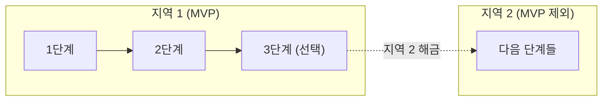

# 제작소 테크트리 기획안 (Crafting Tech Tree)

1차 마일스톤(MVP)의 **정비 → 전투 → 판매/해금 → 정비** 사이클에서 "해금"을 맡는 제작소 기획입니다. **구현 전 문서**이며, 구현되면 규칙은 [Hub.md](../GDD/Hub.md)·[Items.md](../GDD/Items.md)로 옮기고 이 문서에는 결정 기록만 남깁니다. MVP 범위는 [Roadmap.md](../GDD/Roadmap.md) 0절입니다.

## 1. 결정 사항 (유저, 2026-11-17)

| 항목 | 결정 |
| --- | --- |
| 해금 비용 | **전리품 + 골드** |
| 해금 결과 | 해금하는 순간 그 장비 **1개 지급**. 이후 같은 장비는 **재제작**으로 얻음 |
| 재제작 비용 | **골드만** (사망 후 재료 없이도 복구 가능해야 함) |
| 트리 구조 | **단순 티어(단계)**. 지역마다 2~3단계 |
| 잠금 | **지역 단위 잠금만** 있음. 지역 N의 단계는 지역 N이 해금돼야 보임. 지역 안에서는 재료 외 잠금 없음 |
| 카테고리 | 무기 · 방어구 · 배낭. 세 카테고리 모두 같은 단계/지역 조건 |
| 방어구 | 투구·갑옷·신발 **부위별 노드**. 스탯만 오르는 단순 티어 (탐험·방어·기동 3분기는 MVP 제외) |
| 배낭 | 전체 **4단계** |
| 무기 | 단계마다 새 무기를 **해금**(강화가 아님). MVP는 **한 가지 무기 계열**만 구현하고 해금 흐름 확인이 목적. 전투 양상이 다른 무기 3종은 제작소 다음 작업 |
| 재료 수급 | 단계가 오를수록 더 높은 층 몬스터의 전리품을 요구. 예: 1단계 = 1~5층 몬스터 전리품, 2단계 = 3~7층 몬스터 전리품 |
| 몬스터 출현 층 | **몬스터마다 출현 층 범위**를 둠. "n층 전리품" = 그 층에 나오는 몬스터의 전리품 |
| 설계 의도 | 해금할수록 장비가 강해져 사냥 가능한 층이 넓어지고, 다음 단계 재료 수급이 쉬워짐 |
| 시작 상태 | **아무 장비도 없이 시작**. 정식 시작은 튜토리얼이 무기 1단계 해금 아이템을 지급해 시작 무기를 고르는 방식(튜토리얼은 이후 작업) |
| MVP 테스트 | 기본 골드 + **상점에서 해금 재료(전리품)를 사서** 1단계를 해금하는 방식으로 테스트 |
| 해금 상태 저장 | 세션 메모리만 (세이브는 MVP 제외, 07 문서 Q17) |

## 2. 트리 구조

### 2.1 단계와 지역

- 단계는 지역을 넘어 이어지는 번호입니다. 지역 1이 1~3단계를 가지면 지역 2는 4단계부터 시작합니다.
- 지역 1의 단계 수(2 또는 3)는 미정입니다(6절 U1).

### 2.2 노드 (지역 1, MVP)

| 카테고리 | 노드 줄 | 지역 1 노드 |
| --- | --- | --- |
| 무기 | 무기 계열 1개 | 단계마다 무기 1개 (예: 1단계 검 → 2단계 검 → 3단계 검). 이름·수치 미정 |
| 방어구 | 투구 / 갑옷 / 신발 3줄 | 줄마다 단계별 1개 |
| 배낭 | 배낭 1줄 | 4단계 중 지역 1에 배정된 단계 (6절 U2) |

- 지역 1이 3단계면 무기 3 + 방어구 9 + 배낭 1~2 = 노드 약 13~14개입니다.
- 악세서리는 트리에 없습니다. 던전 드랍 전용 그대로입니다(Items.md 2.1절).

### 2.3 노드 상태

| 상태 | 조건 | 할 수 있는 것 |
| --- | --- | --- |
| 숨김 | 노드의 지역이 해금되지 않음 | 없음 (MVP에서는 지역 2 이후 전부) |
| 잠김 | 지역은 열렸지만 아직 해금 안 함 | 필요 재료·골드 확인, 해금 |
| 해금됨 | 해금 완료 | 재제작 |

## 3. 해금과 재제작

| 동작 | 비용 | 결과 |
| --- | --- | --- |
| 해금 | 노드별 전리품 n개 + 골드 n | 해금 상태 기록 + 장비 1개 지급 |
| 재제작 | 노드별 골드 n | 장비 1개 지급 |

- **재료를 꺼내는 곳**: 가방과 창고에서 자동으로 꺼냅니다(6절 U5).
- **지급 위치**: 잡화상 구매와 같은 규칙. 가방 → 가득 차면 창고 → 둘 다 차면 해금·제작 취소(비용 소모 없음).
- **판매가 관계**: 재제작 장비를 팔 수 있다면 판매가는 재제작 골드보다 낮아야 합니다(골드 복제 방지). 제작 장비를 판매 불가로 할지는 6절 U6.
- 사망으로 장비를 잃어도 해금 상태는 그대로입니다.

## 4. 재료 수급: 몬스터 출현 층 범위

- 몬스터 데이터(`MonsterDataSO`)에 출현 층 범위(최소~최대 층)를 둡니다.
- 층을 생성할 때 몬스터 풀에서 그 층 범위에 맞는 몬스터만 고릅니다. 구역 전용 몬스터 풀(`DungeonZone` override)에도 같은 필터를 적용할지는 6절 U4.
- 노드는 "특정 몬스터의 특정 전리품"을 요구합니다. 몬스터마다 전리품이 5종(일반 2·희귀 2·전설 1)이므로, 단계가 오를수록 출현 층이 높은 몬스터의 전리품과 높은 등급을 섞습니다.
- 지금 몬스터는 3종(Heavy Brute, Shadow Spider, Arcane Wizard)과 임시 보스입니다. MVP는 이 3종의 범위를 겹쳐 배치합니다. 예: Brute 1~5층, Spider 3~7층, Wizard 5~10층 (수치 미정). 몬스터 추가는 별도 작업입니다.
- 보스층(5·10층)의 잡몹도 같은 범위 필터를 따릅니다.

## 5. 시작 상태와 테스트 상점

- 새 게임은 장비 없이 시작합니다. 무기가 없어도 맨손 공격(대상 1칸)은 지금 코드에서 동작합니다.
- 잡화상에서 **장비 판매를 뺍니다**(무기·방어구·배낭). 장비 획득 경로는 제작소뿐입니다.
- MVP 테스트용으로 잡화상(또는 별도 테스트 목록)에서 **1단계 해금 재료를 판매**합니다. 정식 시작 흐름(튜토리얼)이 생기면 빼거나 유지할지 다시 정합니다.
- 시작 골드는 지금 1000G입니다. 테스트 재료 가격과 1단계 해금 비용에 맞춰 조정합니다.
- 드랍 풀에서 무기·방어구·배낭을 뺍니다(Items.md 2.1절 획득 경로 확정 사항 적용).

## 6. 미정 사항

| # | 질문 | Claude 추천 |
| --- | --- | --- |
| U1 | 지역 1의 단계 수 (2 또는 3) | 3. 출현 범위 3종(1~5·3~7·5~10층)과 1:1로 맞추기 쉬움 |
| U2 | 배낭 4단계 구성. 지역 1에 몇 단계를 둘지, 기본 배낭도 해금 대상인지 | 기본 배낭(+5)도 지역 1의 1단계 노드. 4단계 = 지역 1~4에 하나씩 |
| U3 | 같은 줄 안의 선행 조건 (2단계는 1단계 해금이 필요한지) | 필요. 줄마다 순서대로 해금 |
| U4 | 구역 전용 몬스터 풀에도 층 범위 필터를 적용할지 | 적용. 범위에 맞는 몬스터가 없으면 전체 풀로 대체하고 경고 로그 |
| U5 | 해금 재료를 어디서 꺼낼지 | 창고 → 가방 순서로 자동 차감 (보안 파우치는 제외) |
| U6 | 제작 장비 판매 | 판매 가능, 판매가는 재제작 골드의 일부(예: 30%) |
| U7 | 제작소 위치 | 대장간에 통합(판매 + 제작 탭). 기지 오브젝트 추가 없음 |
| U8 | MVP 화면 | 열(단계) + 노드 + 연결선만 있는 단순 테크트리. 카테고리 탭(무기·방어구·배낭) |
| U9 | 노드별 재료 개수·골드·재제작 골드 | 층당 기대 가치(약 160G) 기준으로 초안 작성 후 `balance-check` |
| U10 | MP 포션 | MVP 동안 상점·드랍에서 제외 (MP 소모처가 없음) |
| U11 | 무기 계열의 단계별 차이 | 공격력만 상승. 판정 형태(`hitboxPattern`)는 무기 3종 작업 때 |

## 7. 영향 범위 (구현 설계 때 확정)

| 대상 | 변경 |
| --- | --- |
| 새 SO (예: `TechNodeSO`, 지역별 `TechTreeSO`) | 노드: 결과 장비, 단계, 지역, 선행 노드, 해금 재료 목록, 해금 골드, 재제작 골드 |
| `PlayerSessionData` | 해금한 노드 ID 목록 (세션 메모리) |
| 새 제작 로직 (예: `CraftingSystem`) | 비용 확인·차감, 지급, 해금 기록. 재료 차감은 `StorageManager`·`InventoryManager` 경유 |
| `HubSystem`, `HubObjectType` | U7 결정에 따라 대장간 화면에 제작 탭 또는 새 오브젝트 |
| `MonsterDataSO`, `DungeonGenerator` | 출현 층 범위 필드와 풀 필터 |
| `ShopCatalogSO`(`GeneralStoreCatalog`) | 장비 제거, 테스트 재료 추가 |
| `DropPoolSO` 에셋 | 무기·방어구·배낭 제거 |
| `ArmorDataSO`, `WeaponDataSO` 에셋 | 단계별 장비 에셋 추가 (부위 3 × 단계, 무기 × 단계) |
| `BackpackDataSO` 에셋 | 4단계로 재구성 (지금 Basic·Sturdy·Expedition 3개) |
| 시작 장비 | 시작 지급 경로가 있다면 제거 (장비 없이 시작) |

## 8. 구현 단위 초안 (U1~U11 확정 후)

| 단위 | 내용 |
| --- | --- |
| C1 | 몬스터 출현 층 범위 + 풀 필터 |
| C2 | 노드 데이터(SO)와 해금 상태(세션) |
| C3 | 제작 로직: 해금·재제작, 비용 차감, 지급 |
| C4 | 제작 화면(테크트리) |
| C5 | 지역 1 노드 에셋(무기·방어구·배낭)과 비용 초안, 상점·드랍 풀 정리, 시작 상태 |
| C6 | 밸런스 점검(`balance-check`)과 사이클 플레이 테스트 |

## 9. 검토 기록

| # | 등급 | 지적 | 처리 | 반영 위치 |
| --- | --- | --- | --- | --- |
