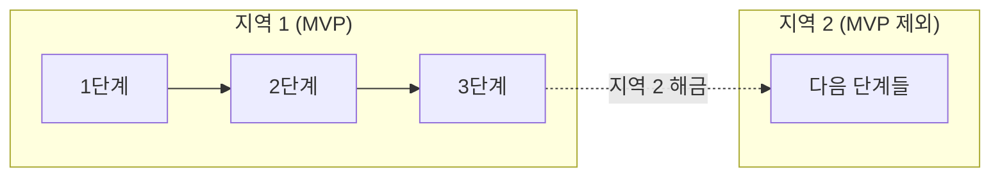

# 제작소 테크트리 기획안 (Crafting Tech Tree)

1차 마일스톤(MVP)의 **정비 → 전투 → 판매/해금 → 정비** 사이클에서 "해금"을 맡는 제작소 기획입니다. **구현 전 문서**이며, 구현되면 규칙은 [Hub.md](../GDD/Hub.md)·[Items.md](../GDD/Items.md)로 옮기고 이 문서에는 결정 기록만 남깁니다. MVP 범위는 [Roadmap.md](../GDD/Roadmap.md) 0절입니다.

## 1. 결정 사항 (유저, 2026-11-17)

| 항목 | 결정 |
| --- | --- |
| 해금 비용 | **전리품 + 골드** |
| 해금 결과 | 해금하는 순간 그 장비 **1개 지급**. 이후 같은 장비는 **재제작**으로 얻음 |
| 재제작 비용 | **골드만** (사망 후 재료 없이도 복구 가능해야 함) |
| 트리 구조 | **단순 티어(단계)**. 무기·방어구는 지역마다 2~3단계, 배낭은 지역마다 1단계(아래 배낭 행) |
| 잠금 | **지역 단위 잠금 + 같은 줄 선행 단계.** 지역 N의 단계는 지역 N이 해금돼야 보임. 같은 줄(무기·투구·갑옷·신발·배낭)에서는 이전 단계를 해금해야 다음 단계를 해금할 수 있음. 그 밖의 시설·층 진행 잠금은 없음 (Gemini 검토 1-1 후 유저 결정) |
| 카테고리 | 무기 · 방어구 · 배낭. 세 카테고리 모두 같은 지역 잠금을 따름. 단계 수는 배낭만 지역당 1단계 |
| 방어구 | 투구·갑옷·신발 **부위별 노드**. 스탯만 오르는 단순 티어 (탐험·방어·기동 3분기는 MVP 제외) |
| 배낭 | 전체 **4단계, 지역당 1단계**. MVP(지역 1)에서는 1단계(기본 배낭) 1노드만 열림 (Gemini 검토 1-2 후 유저 결정) |
| 무기 | 단계마다 새 무기를 **해금**(강화가 아님). MVP는 **한 가지 무기 계열**만 구현하고 해금 흐름 확인이 목적. 전투 양상이 다른 무기 3종은 제작소 다음 작업 |
| 재료 수급 | 단계가 오를수록 더 높은 층 몬스터의 전리품을 요구. 예: 1단계 = 1~5층 몬스터 전리품, 2단계 = 3~7층 몬스터 전리품 |
| 몬스터 출현 층 | **몬스터마다 출현 층 범위**를 둠. "n층 전리품" = 그 층에 나오는 몬스터의 전리품 |
| 설계 의도 | 해금할수록 장비가 강해져 사냥 가능한 층이 넓어지고, 다음 단계 재료 수급이 쉬워짐 |
| 시작 상태 | **아무 장비도 없이 시작**. 정식 시작은 튜토리얼이 무기 1단계 해금 아이템을 지급해 시작 무기를 고르는 방식(튜토리얼은 이후 작업) |
| MVP 테스트 | 기본 골드 + **상점에서 해금 재료(전리품)를 사서** 1단계를 해금하는 방식으로 테스트 |
| 재료 차감 위치 | 기지의 **창고·가방·보안 파우치를 모두 합산**해 차감 (Gemini 검토 1-6 후 유저 결정) |
| 시설 | **대장간 = 제작소.** 대장간은 해금·재제작만 맡고, 지금 대장간의 판매 기능은 **잡화상으로 옮겨** 잡화상이 구매와 판매를 함께 함 (2026-11-17 유저 결정) |
| 제작 장비 판매 | 판매 가능. **판매가 = 재제작 골드의 일부** (비율 미정, 2026-11-17 유저 결정) |
| 해금 상태 저장 | 세션 메모리만 (세이브는 MVP 제외, 07 문서 Q17) |

## 2. 트리 구조

### 2.1 단계와 지역

- 단계는 지역을 넘어 이어지는 번호입니다. 무기·방어구 기준으로 지역 1이 1~3단계를 가지면 지역 2는 4단계부터 시작합니다. 배낭은 지역당 1단계라 지역 N = 배낭 N단계입니다.
- 지역 1은 **3단계**입니다(유저 결정 2026-11-17, 플레이 테스트로 조정 가능).

### 2.2 노드 (지역 1, MVP)

| 카테고리 | 노드 줄 | 지역 1 노드 |
| --- | --- | --- |
| 무기 | 무기 계열 1개 | 단계마다 무기 1개 (예: 1단계 검 → 2단계 검 → 3단계 검). 이름·수치 미정 |
| 방어구 | 투구 / 갑옷 / 신발 3줄 | 줄마다 단계별 1개 |
| 배낭 | 배낭 1줄 | 1단계(기본 배낭) 1개. 2~4단계는 지역 2~4 |

- 지역 1이 3단계면 무기 3 + 방어구 9 + 배낭 1 = 노드 13개입니다.
- 악세서리는 트리에 없습니다. 던전 드랍 전용 그대로입니다(Items.md 2.1절).

### 2.3 노드 상태

| 상태 | 조건 | 할 수 있는 것 |
| --- | --- | --- |
| 숨김 | 노드의 지역이 해금되지 않음 | 없음 (MVP에서는 지역 2 이후 전부) |
| 선행 미충족 | 지역은 열렸지만 같은 줄 이전 단계를 아직 해금 안 함 | 필요 재료·골드와 선행 노드 확인만 (해금 버튼 비활성) |
| 해금 가능 | 선행을 충족했고 아직 해금 안 함 | 필요 재료·골드 확인, 해금 (재료·골드가 모자라면 버튼 비활성) |
| 해금됨 | 해금 완료 | 재제작 |

## 3. 해금과 재제작

| 동작 | 비용 | 결과 |
| --- | --- | --- |
| 해금 | 노드별 전리품 n개 + 골드 n | 해금 상태 기록 + 장비 1개 지급 |
| 재제작 | 노드별 골드 n | 장비 1개 지급 |

- **재료를 꺼내는 곳**: 창고·가방·보안 파우치를 합산하고, 창고 → 가방 → 보안 파우치 순서로 꺼냅니다. 제작은 기지에서만 하므로 파우치도 보관함으로 취급합니다.
- **지급 위치**: 잡화상 구매와 같은 규칙. 가방 → 가득 차면 창고 → 둘 다 차면 해금·제작 취소. **공간 검사는 비용 차감 전에** 하므로 취소되면 재료·골드가 줄지 않습니다.
- **재료 차감은 원자적**으로 합니다. 희귀·전설 재료는 가방 겹침 1이라 여러 칸에 흩어지므로, `itemID` 기준으로 모든 칸을 합산해 충분할 때만 한 번에 차감합니다.
- **판매가 관계**: 제작 장비 판매가는 재제작 골드보다 낮아야 합니다(골드 복제 방지). 판매가를 **재제작 골드 × 비율(1 미만)**로 계산하면 자동으로 지켜집니다(1절, 비율 30%는 6절 U6). 장비 SO의 `baseValue`를 따로 쓰게 되면 에디터 검증(`baseValue < 재제작 골드`)으로 강제합니다.
- 사망으로 장비를 잃어도 해금 상태는 그대로입니다.

## 4. 재료 수급: 몬스터 출현 층 범위

- 몬스터 데이터(`MonsterDataSO`)에 출현 층 범위(최소~최대 층)를 둡니다. **기본값은 1~10층**입니다(필드 추가 시 기존 에셋이 0~0이 되어 전 층 스폰이 막히는 것을 방지).
- 층을 생성할 때 몬스터 풀에서 그 층 범위에 맞는 몬스터만 고릅니다. 구역 전용 몬스터 풀(`DungeonZone` override)에도 같은 필터를 적용합니다(6절 U4).
- 노드는 "특정 몬스터의 특정 전리품"을 요구합니다. 몬스터마다 전리품이 5종(일반 2·희귀 2·전설 1)이므로, 단계가 오를수록 출현 층이 높은 몬스터의 전리품과 높은 등급을 섞습니다.
- 지금 몬스터는 3종(Heavy Brute, Shadow Spider, Arcane Wizard)과 임시 보스입니다. MVP는 이 3종의 범위를 겹쳐 배치합니다. 예: Brute 1~5층, Spider 3~7층, Wizard 5~10층 (수치 미정). 몬스터 추가는 별도 작업입니다.
- 보스층(5·10층)의 잡몹도 같은 범위 필터를 따릅니다. `BossSpawn` 마커의 보스(지역 설정의 보스 프리팹)는 필터 대상이 아닙니다.
- **폴백**: 기본 풀(지금은 `DungeonGenerator`, 위치는 C1에서 확정. 7절)이든 구역 전용 풀이든, 그 층 범위에 맞는 몬스터가 0종이면 필터 없는 같은 풀로 대체하고 경고 로그를 남깁니다(0마리 스폰 → 즉시 클리어 방지).
- **에디터 검증**: `FloorDesignValidator`가 1~10층 각각에 출현 가능한 몬스터가 기본 풀에 1종 이상 있는지 검사합니다.
- 위 예시 범위대로면 1~2층은 Brute만, 8~10층은 원거리 Wizard만 나옵니다. 한 종류로 쏠리는지는 C6 플레이 테스트에서 범위를 조정합니다.

## 5. 시작 상태와 테스트 상점

- 새 게임은 장비 없이 시작합니다. 무기가 없어도 맨손 공격(대상 1칸)은 지금 코드에서 동작합니다.
- 잡화상에서 **장비 판매를 뺍니다**(무기·방어구·배낭). 장비 획득 경로는 제작소뿐입니다.
- MVP 테스트용으로 잡화상(또는 별도 테스트 목록)에서 **1단계 해금 재료를 판매**합니다. 정식 시작 흐름(튜토리얼)이 생기면 빼거나 유지할지 다시 정합니다.
- 시작 골드는 지금 1000G입니다. 테스트 재료 가격과 1단계 해금 비용에 맞춰 조정합니다.
- **테스트 재료 구매가 ≥ 재료 판매가(`baseValue`)**. 사서 바로 팔아 골드가 늘지 않게 합니다.
- **0G·무장비 복구**: 사망으로 장비와 골드가 바닥난 상태에서도 맨손으로 1~4층 전리품을 팔아 재제작 골드를 다시 모을 수 있는지 C6에서 확인합니다. 1~4층에서 탈출구가 안 나오면 5층(귀환석 불가)까지 가야 하는 경로도 함께 봅니다.
- 드랍 풀에서 무기·방어구·배낭을 뺍니다(Items.md 2.1절 획득 경로 확정 사항 적용).
- **상자 드랍 풀 정리**: 지금 상자 풀(`DropPool_Chest_Region1`)에는 지역 1에 나오지 않는 몬스터의 전리품이 섞여 있습니다. 지역 1 출현 몬스터의 전리품으로 제한합니다. U10에 따라 상자 풀과 `FloorGrayBoxBuilder`의 상자 보너스 아이템에서 MP 포션도 뺍니다.

## 6. 세부 결정 (유저, 2026-11-17)

1차 초안의 미정 사항 U1~U11을 모두 정했습니다. U2·U4·U6~U11은 Claude 추천안을 유저가 채택했습니다.

| # | 항목 | 결정 |
| --- | --- | --- |
| U1 | 지역 1의 단계 수 | **3단계** (플레이 테스트로 조정) |
| U2 | 배낭 칸 수 | 지역당 1단계로 시작. **1단계 +5 고정**(지역 1 가방 상한 30칸). 2~4단계 칸 수는 MVP에서 쓰지 않으므로 이후 지역 작업 때 지금 +8·+10을 참고해 정함. 07 문서 상한 35칸도 그때 다시 정함. 플레이 테스트로 조정 |
| U3 | 같은 줄 선행 조건 | **필요** (1절 잠금) |
| U4 | 구역 전용 풀 층 범위 필터 | **적용**(안전장치). 범위에 맞는 몬스터가 0종이면 필터 없는 같은 풀로 대체하고 경고 로그 (4절 폴백과 같음) |
| U5 | 재료 차감 위치 | **창고·가방·보안 파우치 합산** (1절, 3절) |
| U6 | 제작 장비 판매가 비율 | **재제작 골드의 30%** |
| U7 | 제작소 위치 | **대장간 = 제작소, 판매는 잡화상으로 이동** (1절). 대장간을 열면 테크트리 패널과 가방·장비 패널을 함께 띄움(재료 확인, 제작 직후 장착). 잡화상은 구매 목록 + 판매 칸. `HubSystem`의 `Tab` 토글 규칙과 토스트 배치는 C4에서 정함 (Gemini 검토 2-2, 3-4) |
| U8 | MVP 화면 | 열(단계) + 노드 + 연결선만 있는 **단순 테크트리**. 카테고리 탭(무기·방어구·배낭) |
| U9 | 비용 수치 | 층당 기대 가치(약 160G) 기준으로 Claude가 초안을 만들고 `balance-check`로 점검 (C5·C6) |
| U10 | MP 포션 | MVP 동안 **상점·드랍에서 제외** (MP 소모처가 없음) |
| U11 | 무기 단계별 차이 | **공격력만 상승**. 판정 형태(`hitboxPattern`)는 무기 3종 작업 때 |

## 7. 영향 범위 (구현 설계 때 확정)

| 대상 | 변경 |
| --- | --- |
| 새 SO (예: `TechNodeSO`, 지역별 `TechTreeSO`) | 노드: 결과 장비, 단계, 지역, 선행 노드, 해금 재료 목록, 해금 골드, 재제작 골드 |
| `PlayerSessionData` | 해금한 노드 ID 목록, 해금한 지역 판정(기본 지역 1 해금) (세션 메모리) |
| 새 제작 로직 (예: `CraftingSystem`) | 비용 확인·차감, 지급, 해금 기록. 재료 차감은 `StorageManager`·`InventoryManager`·`SecurePouchManager` 경유. 한 번의 해금·재제작에서 컨테이너별 변경 알림은 1회만 |
| `SlotContainer` (가방·창고·보안 파우치 공용) | `itemID` 기준 여러 칸 합산 조회와 원자적 차감 API |
| `HubSystem`, `HubObjectType` | 대장간 클릭 시 판매 패널 대신 테크트리 패널을 엶(오브젝트 추가 없음). 사이드 패널과 `Tab` 토글 규칙, 토스트 배치 |
| `HubTradeSystem`, `SellSlotUI`, `ShopPanelUI` | 판매 칸을 대장간 패널에서 잡화상 패널로 이동, 잡화상에서 구매·판매. 제작 장비 판매가 = 재제작 골드 × 비율(U6) |
| `MonsterDataSO`, `DungeonGenerator`, `FloorDesignValidator`, `RegionConfigSO` | 출현 층 범위 필드(기본 1~10, 최소 ≤ 최대 검증), 풀 필터와 폴백, 층별 출현 몬스터 검증. 기본 몬스터 풀은 지금 씬의 `DungeonGenerator`에 있어 씬 없이 도는 지역 검증이 읽을 수 없으므로, **기본 풀을 `RegionConfigSO`로 옮기는 것을 추천** (지역마다 몬스터가 다르므로 자연스러움). C1 설계에서 확정 (Gemini 검토 2-1) |
| `ShopCatalogSO`(`GeneralStoreCatalog`) | 장비 제거, 테스트 재료 추가 |
| `DropPoolSO` 에셋, `FloorGrayBoxBuilder` | 무기·방어구·배낭 제거, 상자 풀을 지역 1 출현 몬스터 전리품으로 제한, MP 포션 제거(U10). 상자 풀은 `FloorGrayBoxBuilder.CreateOrUpdateChestDropPool()`이 `LootSO` 폴더 전체를 모아 만들므로 **빌더 코드에도 재료 필터**를 넣고, MP 포션을 빼면 보너스 가중치를 정수 나눗셈 손실 없이 재분배 |
| `ArmorDataSO`, `WeaponDataSO` 에셋 | 단계별 장비 에셋 추가 (부위 3 × 단계, 무기 × 단계). 무기 `baseAttackSpeed`는 맨손 공속 1.82 이상(기본값 1을 그대로 두면 맨손보다 느려짐) |
| `BackpackDataSO` 에셋 | 4단계로 재구성 (지금 Basic·Sturdy·Expedition 3개). MVP는 1단계만 노드로 연결 |
| `SecurePouchManager` | 재료 합산·차감 대상에 포함 |
| 시작 장비 | 시작 지급 경로가 있다면 제거 (장비 없이 시작) |

## 8. 구현 단위 초안

| 단위 | 내용 |
| --- | --- |
| C1 | 몬스터 출현 층 범위 + 풀 필터 |
| C2 | 노드 데이터(SO)와 해금 상태(세션) |
| C3 | 제작 로직: 해금·재제작, 비용 차감, 지급 |
| C4 | 제작 화면(테크트리) |
| C5 | 지역 1 노드 에셋(무기·방어구·배낭)과 비용 초안, 상점·드랍 풀 정리, 시작 상태 |
| C6 | 밸런스 점검(`balance-check`)과 사이클 플레이 테스트 (0G·무장비 복구, 층별 몬스터 쏠림 포함) |
| C7 | GDD·구조 문서 동기화: Hub.md(대장간 = 제작소, 판매를 잡화상으로 이동, MP 포션 제외), Items.md(배낭 표·획득 경로, MP 포션 제외), Combat.md 스탯 표(MP 회복 문구), UI_Direction.md 4절(재제작 비용·배낭 위치), Roadmap.md(방어구 3분기 줄), 07 문서 6절·Q26(배낭 3단계·상한 35칸), ARCHITECTURE.md·스크립트 맵 |

## 10. 구현 설계 (코드)

8절 구현 단위를 코드 수준으로 정리합니다. 커밋은 단위마다 나누고, 각 커밋은 컴파일되는 상태를 유지합니다. 단위 사이 의존: C1은 독립, C2 → C3 → C4, C5는 C1~C4 이후.

### 10.1 C1 몬스터 출현 층 범위

| 대상 | 변경 |
| --- | --- |
| `MonsterDataSO` | `[Min(1)] minFloor = 1`, `[Min(1)] maxFloor = 10` 필드와 `CanAppearOnFloor(int floor)`. `OnValidate`에서 `maxFloor < minFloor`이면 맞춤 |
| `RegionConfigSO` | 기본 몬스터 풀 `[SerializeField] private List<GameObject> _monsterPool` 추가(`IReadOnlyList<GameObject> MonsterPool` 노출). 지금 `03_DungeonScene`의 `DungeonGenerator._monsterPrefabPool` 값(3종)을 `Region1Config`로 옮김. `EditorInitialize`와 `FloorGrayBoxBuilder.CreateGrayBoxFloors`가 지역 설정을 다시 만들 때 기존 풀을 보존하고, 비어 있으면 기본 몬스터 프리팹 3종을 넣음 (Gemini 코드 검토 1-3) |
| `DungeonGenerator` | `_monsterPrefabPool` 필드 삭제, `_regionConfig.MonsterPool` 사용. `GetZoneMonsterPool(zone)` → `GetFloorMonsterPool(zone, floor)`: 구역 전용 풀이 있으면 그것, 없으면 지역 풀을 기준으로 `CanAppearOnFloor`인 프리팹만 재사용 버퍼 `List<GameObject> _floorMonsterBuffer`에 담아 반환. 0종이면 **필터 없는 같은 풀을 그 버퍼에 복사**해 반환하고 `Debug.LogWarning`. 반환 타입은 항상 `List<GameObject>`라 `SpawnEntitiesInCells`의 매개변수를 바꾸지 않음. 호출부 2곳(구역별 배분, 층별 규칙이 없는 층의 구역 수 사용 분기) 모두 교체. 층 생성 때만 호출(Update 아님) |
| `FloorDesignValidator.ValidateRegion` | 지역 풀이 비었으면 오류. 1~10층마다 지역 풀에 출현 가능한 몬스터가 1종 이상인지 검사(없으면 오류). 층 디자인의 구역 전용 풀은 그 디자인이 쓰이는 층(초반 1~4, 중간 보스 5, 후반 6~9, 보스 10)에서 0종이면 경고. 몬스터 데이터는 프리팹의 `MonsterController.Data`로 읽음 |
| 데이터 | Heavy Brute 1~5층, Shadow Spider 3~7층, Arcane Wizard 5~10층 (초기값) |

### 10.2 C2 노드 데이터와 해금 상태

| 대상 | 변경 |
| --- | --- |
| 새 `TechNodeSO` (`Data/Models`) | 필드는 모두 `[SerializeField] private` + 읽기 전용 프로퍼티(가이드라인 4절). `string nodeId`(고유), `EquipmentDataSO resultItem`, `int tier`, `int regionId`, `TechNodeSO prerequisite`(첫 단계는 null), `List<MaterialCost> materials`(`ItemDataSO item`, `int amount`), `int unlockGold`, `int recraftGold`. 줄(무기·투구·갑옷·신발·배낭)은 `resultItem.equipType`으로 구분하므로 별도 enum을 두지 않음. **노드 자체 검증도 `TechNodeSO.OnValidate`**: 같은 재료 중복, 수량 0 이하, 재료·결과 장비 null, 자기 자신을 선행으로 지정 (Gemini 코드 검토 1-6) |
| 새 `TechTreeSO` (`Data/Models`) | `[SerializeField] private` 필드 + 프로퍼티. `List<TechNodeSO> nodes`, `[Range(0,0.99)] float craftedSellRatio = 0.3f`. `GetSellPrice(TechNodeSO) = floor(recraftGold × ratio)`. 에디터 검증(`OnValidate`): `nodeId` 중복, 선행 노드의 `equipType`이 같고 `tier`가 낮은지, `resultItem` 중복, **결과 장비의 `baseValue`가 노드 판매가와 다르면 경고**. 에디터 메뉴 `BagBack100/Tech/Sync Crafted Sell Prices`가 결과 장비 SO의 `baseValue`를 노드 판매가로 맞추고 저장. 판매가를 `baseValue` 하나로 두므로 `HubTradeSystem`과 결과 화면(`RunResult.SumValue`)이 같은 값을 씀 (Gemini 코드 검토 1-5) |
| `PlayerSessionData` | `HashSet<string>` 해금 노드 ID, `IsNodeUnlocked(string)`, `MarkNodeUnlocked(string)`. 지역 해금: `UnlockedRegionCount = 1`, `IsRegionUnlocked(int regionId)`(MVP는 지역 1만 true, 설정 API는 F8 때). 세션 메모리 |

### 10.3 C3 제작 로직

| 대상 | 변경 |
| --- | --- |
| `SlotContainer` | `CountByItemId(int itemID)`, `RemoveByItemId(int itemID, int amount)`: 슬롯 순서대로 여러 묶음에서 덜어냄. 합계가 모자라면 아무것도 바꾸지 않고 false |
| `ISlotItemContainer` + 구현 3곳(`InventoryManager`·`StorageManager`·`SecurePouchManager`) | `int CountItemId(int itemID)`, `bool RemoveItemIdAmount(int itemID, int amount)`, `void BeginBulkChange()`, `void EndBulkChange()` 추가. `BeginBulkChange`~`EndBulkChange` 사이에서는 변경 알림·세션 저장을 미루고, 끝날 때 바뀐 것이 있으면 **1회만** 발행(중첩 카운터). `InventoryManager`의 기존 `CountItems(itemID)`는 `CountItemId`와 같은 `SlotContainer.CountByItemId`에 위임해 중복 로직을 없앰(기존 호출처 유지). `StorageManager`·`SecurePouchManager`에도 `_container == null` 가드 추가 (Gemini 코드 검토 1-1, 1-2, 1-7) |
| 새 `CraftingSystem` (`Hub`, 2계층 System) | 허브 씬 컴포넌트. 참조: `TechTreeSO`(인스펙터), 매니저 3개(`Start`에서 한 번 탐색, `HubTradeSystem`과 같은 방식). 매니저 3개는 **지연 캐싱**(쓸 때 null이면 탐색). `SecurePouchManager`는 `HubSystem.Awake`가 동적으로 붙이므로 각 매니저의 `OnManagerCreated` 정적 이벤트도 구독해 늦게 생겨도 받음. 매니저 3개의 `OnContainerChanged`와 `PlayerSessionData.OnGoldChanged`를 `CraftingSystem`이 구독해 `OnTechTreeChanged`로 중계(UI는 `CraftingSystem`만 구독). 모든 구독은 `OnEnable`/`OnDisable` 짝. 이벤트(시스템 지역 이벤트, `GlobalEvents` 아님): `OnCraftFailed(string)`, `OnCraftCompleted(string)`, `OnTechTreeChanged`. API: `GetState(node)` → `Hidden`/`PrerequisiteLocked`/`Unlockable`/`Unlocked`, `GetOwnedAmount(ItemDataSO)`(창고+가방+파우치), `TryUnlock(node)`, `TryRecraft(node)` |
| 해금 순서 (`TryUnlock`) | ① 상태가 `Unlockable` ② 골드 ≥ `unlockGold` ③ 재료마다 보유 합계 ≥ 필요 ④ 새 `RuntimeItem(resultItem)`이 가방 또는 창고에 들어가는지 검사 ⑤ **`MarkNodeUnlocked`를 먼저 기록**(이후 알림을 받는 UI가 중간 상태를 보지 않게) ⑥ 컨테이너 3개 `BeginBulkChange` ⑦ 아이템 추가(가방 → 창고) ⑧ 재료 차감(창고 → 가방 → 파우치, 재료별로 남은 수량을 다음 컨테이너로 넘김) ⑨ `finally`에서 `EndBulkChange`(컨테이너별 알림 1회) ⑩ 골드 차감 ⑪ `OnCraftCompleted`. ③④까지 통과하면 ⑦⑧⑩은 실패하지 않음(단일 스레드, 결과 장비와 재료는 itemID가 다름). 만약 ⑦이 실패하면 해금 기록을 되돌리고 실패 처리. `HubTradeSystem.TryBuy`와 같은 "먼저 넣고 나중에 차감" 방식 (Gemini 코드 검토 1-1) |
| 재제작 (`TryRecraft`) | `Unlocked` 확인 → 골드 ≥ `recraftGold` → 공간 검사 → 추가 → 골드 차감 → 이벤트 |
| `HubTradeSystem` | **로직 변경 없음.** 제작 장비의 판매가는 `baseValue`에 동기화되므로(10.2) 기존 `baseValue × 수량` 계산을 그대로 씀. 클래스 주석의 "대장간 판매"만 "잡화상 판매"로 |

### 10.4 C4 제작 화면과 판매 이동

| 대상 | 변경 |
| --- | --- |
| 새 `TechTreePanelUI` (`UI`) | 대장간 패널 안. 카테고리 탭 3개(무기 / 방어구 / 배낭). 방어구 탭은 투구·갑옷·신발 3줄. 열 = 단계, 노드 = 버튼(아이콘·이름, 상태별 색). 같은 줄의 노드 사이에 연결선(가로 막대 `Image`). 노드를 누르면 상세: 결과 장비 스탯, 재료별 `보유/필요`, 골드, 버튼 하나(`Unlock` / `Craft`, 상태·비용에 따라 `interactable`). 노드 행은 `OnEnable`·탭 전환 때만 다시 만듦. 구독: `CraftingSystem` 이벤트 3개만(OnEnable/OnDisable 짝). `OnTechTreeChanged`를 받으면 갱신 플래그만 켜고 `LateUpdate`에서 플래그가 켜져 있을 때 1회 갱신(한 번의 해금에서 컨테이너·골드 알림이 여러 번 와도 화면 갱신은 1회, 할당 없음). UI는 계산하지 않고 `CraftingSystem`에 묻기만 함 (Gemini 코드 검토 1-1, 1-2) |
| `HubSystem` | 로직 변경 없음. 대장간 클릭 → `_blacksmithPanel` + 가방 패널(지금과 같음). `Tab` 토글도 창고·잡화상과 같은 규칙 유지(3-4 IDEA는 일관성 쪽으로 정리). `_blacksmithPanel` 툴팁 문구만 "제작(테크트리)"로 |
| 허브 씬 (`02_HubScene`) | `SellSlot`과 판매 안내 `Hint`를 대장간 패널에서 잡화상 패널 하단으로 이동(인스펙터 참조 유지). 잡화상 구매 목록 `ShopPanel/Background/Rows`의 하단 여백을 늘려 판매 칸(180×180)과 겹치지 않게 함. 대장간 패널 제목 `Blacksmith - Sell` → `Blacksmith - Craft`, 잡화상 제목에 판매 표시. 대장간 패널에 `TechTreePanelUI` 구성, 씬에 `CraftingSystem` 추가. unityMCP로 적용하고 `MarkSceneDirty` 후 저장 (Gemini 코드 검토 1-4) |
| `SellSlotUI` | 주석의 "대장간 판매 칸" → "잡화상 판매 칸". `IsAvailable` 조건은 그대로(잡화상이 열렸을 때만 가방 우클릭 `판매` 표시) |
| `RunResultUI` | 생환 결과 안내 `(sell at the Blacksmith)` → `(sell at the General Store)` (Gemini 코드 검토 1-5) |

### 10.5 C5 지역 1 에셋과 상점·드랍 정리

| 대상 | 변경 |
| --- | --- |
| 1단계 장비 | 기존 기본 장비 재사용: Basic Sword(21), Basic Helmet(13), Basic Armor(11), Basic Boots(16), Basic Backpack(12, +5칸) |
| 2·3단계 장비 | 새 에셋. itemID 301~ (무기 302·303, 투구 312·313, 갑옷 322·323, 신발 332·333). 스탯은 1단계 기준 단계마다 상승(공격력 또는 방어·HP만). 무기 `baseAttackSpeed`는 0(맨손 공속 1.82 유지) 또는 1.82 이상 |
| 노드 | `TechTree_Region1.asset` + 노드 13개(무기 3, 투구·갑옷·신발 각 3, 배낭 1). 만든 뒤 `Sync Crafted Sell Prices`로 결과 장비 `baseValue`를 판매가에 맞춤 |
| 비용 초안 | 아래 표. 재료는 1단계 Brute(1~5층), 2단계 Spider(3~7층), 3단계 Wizard(5~10층) 전리품 중심. 같은 단계의 노드끼리 재료 종류를 나눠 한 재료에 몰리지 않게 함. C6에서 `balance-check` |
| 잡화상 (`GeneralStoreCatalog`) | 무기·방어구·배낭 3단계와 MP 포션 제거. HP 포션·귀환석 유지. 테스트 재료: Brute 일반 전리품 2종(101·102)을 판매가의 2배(40G)로 추가 |
| 상자 풀 (`FloorGrayBoxBuilder`) | 재료 수집을 `LootSO` 폴더 전체 대신 **`Region1Config` 몬스터 풀의 몬스터 드랍 풀**에 있는 하위 등급 전리품으로 제한. 보너스 아이템에서 MP 포션(3) 제거, 가중치는 합 30이 정확히 되도록 나머지를 앞 항목부터 1씩 분배. 메뉴 재실행으로 `DropPool_Chest_Region1` 갱신 |
| 몬스터 드랍 풀 | 지금 장비가 들어 있지 않아 변경 없음(확인함) |
| 시작 상태 | 지금도 새 세션은 장비 없이 시작(시작 지급 경로 없음, 확인함). 시작 골드 1000G 유지 |

**비용 초안 (노드 1개 기준)**

| 단계 | 재료 | 해금 골드 | 재제작 골드 | 판매가(30%) |
| --- | --- | --- | --- | --- |
| 1 | Brute 일반 ×3 | 150G | 100G | 30G |
| 2 | Spider 일반 ×3 + Brute 희귀 ×1 | 400G | 250G | 75G |
| 3 | Wizard 일반 ×3 + Spider 희귀 ×1 + Wizard 희귀 ×1 | 900G | 500G | 150G |

- 1단계 5노드를 모두 열려면 골드 750G + Brute 일반 15개입니다. 시작 1000G로는 일부만 열 수 있어 "무엇부터 열지" 고르게 됩니다(튜토리얼의 시작 무기 선택과 같은 방향).
- 층당 기대 가치 약 160G 기준으로 1단계 1노드 ≈ 1~2층, 3단계 1노드 ≈ 6~8층 분량입니다.

### 10.6 C7 문서

8절 C7 목록과 함께 **Monsters.md(몬스터별 출현 층)·Dungeon.md(2절 배치 규칙의 층 범위 필터)**도 갱신합니다 (Gemini 코드 검토 1-7). 새 클래스(`TechNodeSO`, `TechTreeSO`, `CraftingSystem`, `TechTreePanelUI`)는 `ARCHITECTURE.md`와 스크립트 맵(허브 쪽은 새 `Hub_System_Map.md` 또는 기존 맵 확장)에 추가합니다.

### 10.7 영향 범위 근거

- graphify: `HubTradeSystem` ← `SellSlotUI`, `ShopPanelUI`. `SellSlotUI` ← `InventoryUIController.TryOpenItemMenu`(우클릭 `판매` 표시). `MonsterDataSO` ← `MonsterController`. `RegionConfigSO` ← `DungeonGenerator`, `LootSystem`, `FloorDesignValidator`, `FloorGrayBoxBuilder`.
- `ISlotItemContainer` 구현체는 `InventoryManager`·`StorageManager`·`SecurePouchManager` 3개뿐(grep). 인터페이스에 메서드를 추가해도 다른 구현체는 없음.
- 인스펙터 연결: `DungeonGenerator._monsterPrefabPool`(던전 씬 YAML 1413줄, 프리팹 3개), `HubTradeSystem._generalStoreCatalog`, `SellSlotUI` 참조(허브 씬). C1·C4에서 unityMCP로 다시 연결합니다.
- `SecurePouchManager`는 허브 씬에 직렬화돼 있지 않고 `HubSystem.Awake`가 동적으로 붙입니다(그래서 `CraftingSystem`은 지연 캐싱 + `OnManagerCreated` 구독).
- `baseValue` 사용처: `HubTradeSystem.GetSellPrice`, `RunResult.SumValue`(결과 화면 가치). 제작 장비는 `baseValue`를 판매가에 동기화해 두 곳이 같은 값을 씁니다.
- 새 전역 이벤트 없음. 제작 이벤트는 `CraftingSystem` 지역 이벤트이고 UI만 구독합니다.

## 9. 검토 기록

| # | 등급 | 지적 | 처리 | 반영 위치 |
| --- | --- | --- | --- | --- |
| 1-1 | CRITICAL | 1절 "지역 안 잠금 없음"과 2.1절 연결선·U3(선행 필요)·7절 선행 노드가 모순. 선행이 없으면 1단계를 건너뛸 수 있음 | 유저 결정: 같은 줄 선행 필요 | 1절, U3 |
| 1-2 | MAJOR | 배낭 전체 4단계와 "지역당 2~3단계·같은 조건"이 안 맞음. 지역 1 배정 수와 칸 수(상한 35칸) 결정 필요 | 유저 결정: 지역당 1단계, MVP는 기본 배낭 1노드. 칸 수는 U2에 남김 | 1절, 2.2절, U2 |
| 1-3 | MAJOR | 판매가·재제작 골드 복제 방지 검증, 테스트 재료 구매가 ≥ 판매가, 0G·무장비 복구 테스트 누락 | 수용 | 3절, 5절, C6 |
| 1-4 | MAJOR | 층 범위 필터의 기본 풀 폴백·층별 검증, 필드 기본값 1~10, `BossSpawn` 예외, 몬스터 쏠림 | 수용 | 4절, 7절, C6 |
| 1-5 | MAJOR | 상자 풀의 지역 1 외 전리품·MP 포션 정리 누락 | 수용 | 5절, 7절 |
| 1-6 | MAJOR | 보안 파우치를 차감 대상에 넣을지, 차감 전 공간 검사, 여러 칸 합산 차감 API, 지역 해금 판정 누락 | 공간 검사·API·지역 판정 수용, 유저 결정: 파우치도 차감 | 1절, 3절, 7절, U5 |
| 1-7 | MAJOR | 대장간 탭 전환 시 패널 처리, `HubTradeSystem`, 문서 동기화 단위 누락 | 수용 | U7, 7절, C7 |
| 1-8 | MINOR | U3 채택 시 "선행 미충족"과 "해금 가능" 상태 구분 필요 | 수용 | 2.3절 |
| 1-9 | MINOR | 새 무기 `baseAttackSpeed` 기본값 1이면 맨손(1.82)보다 느림 | 수용 | 7절 |
| 1-10 | IDEA | 테스트 재료를 별도 디버그 카탈로그로 분리 | 유저에게 제안 | - |
| 1-11 | IDEA | 노드 상세에 보유 재료를 창고·가방·파우치별로 표시 | 유저에게 제안 | - |
| 2-1 | MAJOR | 기본 몬스터 풀이 씬의 `DungeonGenerator`에 있어 씬 없는 지역 검증이 읽을 수 없음 | 수용: 풀을 `RegionConfigSO`로 옮기는 것을 추천, C1에서 확정 | 7절 |
| 2-2 | MAJOR | 제작 탭에서 가방 패널을 숨기면 `Tab` 토글·장비창·토스트와 충돌 | 수용: 가방·장비 패널 유지, `Tab` 규칙과 토스트 배치 명시 | U7, 7절 |
| 2-3 | MINOR | 상자 풀 빌더가 `LootSO` 전체를 모아 재실행하면 정리가 되돌아감, 가중치 정수 나눗셈 | 수용 | 7절 |
| 2-4 | MINOR | U2 1단계 +5 고정 여부 모호, C7에 07 문서·MP 포션 표기 누락 | 수용 | U2, C7 |
| 2-5 | MINOR | 1절 단계 수·카테고리 문구와 7절 파우치 표기가 1차 반영과 안 맞음 | 수용 | 1절, 7절 |
| 2-6 | IDEA | 재료 구매가·노드 ID·재료 중복·층 범위 최소≤최대 에디터 검증, 차감 알림 1회 | 층 범위 검증·알림 1회는 수용(구현 품질), 나머지는 유저에게 제안 | 7절 |
| 3-1 | MINOR | 4절 폴백 문구의 기본 풀 위치가 7절 추천과 엇갈림 | 수용 | 4절 |
| 3-2 | MINOR | C7에 Combat.md MP 포션 문구 누락 | 수용 | C7 |
| 3-3 | MINOR | 2.1절 단계 번호가 배낭과 다르게 읽힘 | 수용 | 2.1절 |
| 3-4 | IDEA | `Tab` 토글 예외를 대장간만 둘지 모든 사이드 패널에 둘지 | C4 설계 때 정함 | - |

3차 판정: **APPROVED** (2026-11-17, gemini-4-hydrogen-xhigh)

**코드 설계 검토 (gemini-4-argon-medium)**

| # | 등급 | 지적 | 처리 | 반영 위치 |
| --- | --- | --- | --- | --- |
| 코드 1-1 | MAJOR | 재료별 차감마다 알림이 나가 UI가 중간 상태로 여러 번 갱신, 해금 기록이 차감 뒤 | 수용: 일괄 변경(Begin/EndBulkChange), 해금 기록 먼저, UI 갱신 플래그 | 10.3, 10.4 |
| 코드 1-2 | MAJOR | 동적 추가되는 `SecurePouchManager`를 `Start`에서만 찾으면 null, 구독 누락 | 수용: 지연 캐싱 + `OnManagerCreated`, 구독은 `CraftingSystem`이 중계, null 가드 | 10.3 |
| 코드 1-3 | MAJOR | 빌더·`EditorInitialize`가 지역 몬스터 풀을 보존·주입하지 않음, 풀 타입 불일치, 호출부 2곳 | 수용 | 10.1 |
| 코드 1-4 | MAJOR | 잡화상 구매 목록과 판매 칸이 겹침, 대장간 제목·안내 정리 누락 | 수용 | 10.4 |
| 코드 1-5 | MINOR | 결과 화면 문구, `RunResult.SumValue`의 `baseValue`와 노드 판매가 불일치 | 수용: 판매가를 `baseValue`에 동기화(`HubTradeSystem` 로직 변경 없음) | 10.2~10.5 |
| 코드 1-6 | MINOR | 새 SO의 `public` 필드, 노드 단위 검증 누락 | 수용 | 10.2 |
| 코드 1-7 | MINOR | `CountItems`와 중복 메서드, C7에 Monsters.md·Dungeon.md 누락 | 수용 | 10.3, 10.6 |
| 코드 1-8 | IDEA | 재료가 빠지며 빈칸이 생기는 경우는 만석이어도 제작 허용 | 유저에게 제안 (지금은 기획 3절대로 거절) | - |
