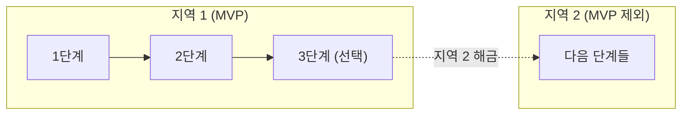

# 제작소 테크트리 기획안 (Crafting Tech Tree)

1차 마일스톤(MVP)의 **정비 → 전투 → 판매/해금 → 정비** 사이클에서 "해금"을 맡는 제작소 기획입니다. **구현 전 문서**이며, 구현되면 규칙은 [Hub.md](../GDD/Hub.md)·[Items.md](../GDD/Items.md)로 옮기고 이 문서에는 결정 기록만 남깁니다. MVP 범위는 [Roadmap.md](../GDD/Roadmap.md) 0절입니다.

## 1. 결정 사항 (유저, 2026-11-17)

| 항목 | 결정 |
| --- | --- |
| 해금 비용 | **전리품 + 골드** |
| 해금 결과 | 해금하는 순간 그 장비 **1개 지급**. 이후 같은 장비는 **재제작**으로 얻음 |
| 재제작 비용 | **골드만** (사망 후 재료 없이도 복구 가능해야 함) |
| 트리 구조 | **단순 티어(단계)**. 무기·방어구는 지역마다 2~3단계, 배낭은 지역마다 1단계(아래 배낭 행) |
| 잠금 | **지역 단위 잠금 + 같은 줄 선행 단계.** 지역 N의 단계는 지역 N이 해금돼야 보임. 같은 줄(무기·투구·갑옷·신발·배낭)에서는 이전 단계를 해금해야 다음 단계를 해금할 수 있음. 그 밖의 시설·층 진행 잠금은 없음 (Gemini 검토 1-1 후 유저 결정) |
| 카테고리 | 무기 · 방어구 · 배낭. 세 카테고리 모두 같은 지역 잠금을 따름. 단계 수는 배낭만 지역당 1단계 |
| 방어구 | 투구·갑옷·신발 **부위별 노드**. 스탯만 오르는 단순 티어 (탐험·방어·기동 3분기는 MVP 제외) |
| 배낭 | 전체 **4단계, 지역당 1단계**. MVP(지역 1)에서는 1단계(기본 배낭) 1노드만 열림 (Gemini 검토 1-2 후 유저 결정) |
| 무기 | 단계마다 새 무기를 **해금**(강화가 아님). MVP는 **한 가지 무기 계열**만 구현하고 해금 흐름 확인이 목적. 전투 양상이 다른 무기 3종은 제작소 다음 작업 |
| 재료 수급 | 단계가 오를수록 더 높은 층 몬스터의 전리품을 요구. 예: 1단계 = 1~5층 몬스터 전리품, 2단계 = 3~7층 몬스터 전리품 |
| 몬스터 출현 층 | **몬스터마다 출현 층 범위**를 둠. "n층 전리품" = 그 층에 나오는 몬스터의 전리품 |
| 설계 의도 | 해금할수록 장비가 강해져 사냥 가능한 층이 넓어지고, 다음 단계 재료 수급이 쉬워짐 |
| 시작 상태 | **아무 장비도 없이 시작**. 정식 시작은 튜토리얼이 무기 1단계 해금 아이템을 지급해 시작 무기를 고르는 방식(튜토리얼은 이후 작업) |
| MVP 테스트 | 기본 골드 + **상점에서 해금 재료(전리품)를 사서** 1단계를 해금하는 방식으로 테스트 |
| 재료 차감 위치 | 기지의 **창고·가방·보안 파우치를 모두 합산**해 차감 (Gemini 검토 1-6 후 유저 결정) |
| 해금 상태 저장 | 세션 메모리만 (세이브는 MVP 제외, 07 문서 Q17) |

## 2. 트리 구조

### 2.1 단계와 지역

- 단계는 지역을 넘어 이어지는 번호입니다. 무기·방어구 기준으로 지역 1이 1~3단계를 가지면 지역 2는 4단계부터 시작합니다. 배낭은 지역당 1단계라 지역 N = 배낭 N단계입니다.
- 지역 1의 단계 수(2 또는 3)는 미정입니다(6절 U1).

### 2.2 노드 (지역 1, MVP)

| 카테고리 | 노드 줄 | 지역 1 노드 |
| --- | --- | --- |
| 무기 | 무기 계열 1개 | 단계마다 무기 1개 (예: 1단계 검 → 2단계 검 → 3단계 검). 이름·수치 미정 |
| 방어구 | 투구 / 갑옷 / 신발 3줄 | 줄마다 단계별 1개 |
| 배낭 | 배낭 1줄 | 1단계(기본 배낭) 1개. 2~4단계는 지역 2~4 |

- 지역 1이 3단계면 무기 3 + 방어구 9 + 배낭 1 = 노드 13개입니다.
- 악세서리는 트리에 없습니다. 던전 드랍 전용 그대로입니다(Items.md 2.1절).

### 2.3 노드 상태

| 상태 | 조건 | 할 수 있는 것 |
| --- | --- | --- |
| 숨김 | 노드의 지역이 해금되지 않음 | 없음 (MVP에서는 지역 2 이후 전부) |
| 선행 미충족 | 지역은 열렸지만 같은 줄 이전 단계를 아직 해금 안 함 | 필요 재료·골드와 선행 노드 확인만 (해금 버튼 비활성) |
| 해금 가능 | 선행을 충족했고 아직 해금 안 함 | 필요 재료·골드 확인, 해금 (재료·골드가 모자라면 버튼 비활성) |
| 해금됨 | 해금 완료 | 재제작 |

## 3. 해금과 재제작

| 동작 | 비용 | 결과 |
| --- | --- | --- |
| 해금 | 노드별 전리품 n개 + 골드 n | 해금 상태 기록 + 장비 1개 지급 |
| 재제작 | 노드별 골드 n | 장비 1개 지급 |

- **재료를 꺼내는 곳**: 창고·가방·보안 파우치를 합산하고, 창고 → 가방 → 보안 파우치 순서로 꺼냅니다. 제작은 기지에서만 하므로 파우치도 보관함으로 취급합니다.
- **지급 위치**: 잡화상 구매와 같은 규칙. 가방 → 가득 차면 창고 → 둘 다 차면 해금·제작 취소. **공간 검사는 비용 차감 전에** 하므로 취소되면 재료·골드가 줄지 않습니다.
- **재료 차감은 원자적**으로 합니다. 희귀·전설 재료는 가방 겹침 1이라 여러 칸에 흩어지므로, `itemID` 기준으로 모든 칸을 합산해 충분할 때만 한 번에 차감합니다.
- **판매가 관계**: 재제작 장비를 팔 수 있다면 판매가(`baseValue`)는 재제작 골드보다 낮아야 합니다(골드 복제 방지). 두 값이 다른 SO에 있으므로 에디터 검증(`baseValue < 재제작 골드`)으로 강제합니다. 제작 장비를 판매 불가로 할지는 6절 U6.
- 사망으로 장비를 잃어도 해금 상태는 그대로입니다.

## 4. 재료 수급: 몬스터 출현 층 범위

- 몬스터 데이터(`MonsterDataSO`)에 출현 층 범위(최소~최대 층)를 둡니다. **기본값은 1~10층**입니다(필드 추가 시 기존 에셋이 0~0이 되어 전 층 스폰이 막히는 것을 방지).
- 층을 생성할 때 몬스터 풀에서 그 층 범위에 맞는 몬스터만 고릅니다. 구역 전용 몬스터 풀(`DungeonZone` override)에도 같은 필터를 적용할지는 6절 U4.
- 노드는 "특정 몬스터의 특정 전리품"을 요구합니다. 몬스터마다 전리품이 5종(일반 2·희귀 2·전설 1)이므로, 단계가 오를수록 출현 층이 높은 몬스터의 전리품과 높은 등급을 섞습니다.
- 지금 몬스터는 3종(Heavy Brute, Shadow Spider, Arcane Wizard)과 임시 보스입니다. MVP는 이 3종의 범위를 겹쳐 배치합니다. 예: Brute 1~5층, Spider 3~7층, Wizard 5~10층 (수치 미정). 몬스터 추가는 별도 작업입니다.
- 보스층(5·10층)의 잡몹도 같은 범위 필터를 따릅니다. `BossSpawn` 마커의 보스(지역 설정의 보스 프리팹)는 필터 대상이 아닙니다.
- **폴백**: 기본 풀(지금은 `DungeonGenerator`, 위치는 C1에서 확정. 7절)이든 구역 전용 풀이든, 그 층 범위에 맞는 몬스터가 0종이면 필터 없는 같은 풀로 대체하고 경고 로그를 남깁니다(0마리 스폰 → 즉시 클리어 방지).
- **에디터 검증**: `FloorDesignValidator`가 1~10층 각각에 출현 가능한 몬스터가 기본 풀에 1종 이상 있는지 검사합니다.
- 위 예시 범위대로면 1~2층은 Brute만, 8~10층은 원거리 Wizard만 나옵니다. 한 종류로 쏠리는지는 C6 플레이 테스트에서 범위를 조정합니다.

## 5. 시작 상태와 테스트 상점

- 새 게임은 장비 없이 시작합니다. 무기가 없어도 맨손 공격(대상 1칸)은 지금 코드에서 동작합니다.
- 잡화상에서 **장비 판매를 뺍니다**(무기·방어구·배낭). 장비 획득 경로는 제작소뿐입니다.
- MVP 테스트용으로 잡화상(또는 별도 테스트 목록)에서 **1단계 해금 재료를 판매**합니다. 정식 시작 흐름(튜토리얼)이 생기면 빼거나 유지할지 다시 정합니다.
- 시작 골드는 지금 1000G입니다. 테스트 재료 가격과 1단계 해금 비용에 맞춰 조정합니다.
- **테스트 재료 구매가 ≥ 재료 판매가(`baseValue`)**. 사서 바로 팔아 골드가 늘지 않게 합니다.
- **0G·무장비 복구**: 사망으로 장비와 골드가 바닥난 상태에서도 맨손으로 1~4층 전리품을 팔아 재제작 골드를 다시 모을 수 있는지 C6에서 확인합니다. 1~4층에서 탈출구가 안 나오면 5층(귀환석 불가)까지 가야 하는 경로도 함께 봅니다.
- 드랍 풀에서 무기·방어구·배낭을 뺍니다(Items.md 2.1절 획득 경로 확정 사항 적용).
- **상자 드랍 풀 정리**: 지금 상자 풀(`DropPool_Chest_Region1`)에는 지역 1에 나오지 않는 몬스터의 전리품이 섞여 있습니다. 지역 1 출현 몬스터의 전리품으로 제한합니다. U10을 채택하면 상자 풀과 `FloorGrayBoxBuilder`의 상자 보너스 아이템에서 MP 포션도 뺍니다.

## 6. 미정 사항

| # | 질문 | Claude 추천 |
| --- | --- | --- |
| U1 | 지역 1의 단계 수 (2 또는 3) | 3. 출현 범위 3종(1~5·3~7·5~10층)과 1:1로 맞추기 쉬움 |
| U2 | 배낭 4단계의 칸 수 (지역당 1단계는 확정) | **1단계 +5 고정**(지역 1 가방 상한 30칸). 2~4단계 값은 지금 +8·+10을 참고해 다시 정함. 07 문서 상한 35칸은 이후 지역 기준으로 다시 정함 |
| U3 | ~~같은 줄 안의 선행 조건~~ | **확정: 필요** (1절 잠금) |
| U4 | 구역 전용 몬스터 풀에도 층 범위 필터를 적용할지 | 적용. 범위에 맞는 몬스터가 없으면 전체 풀로 대체하고 경고 로그 |
| U5 | ~~해금 재료를 어디서 꺼낼지~~ | **확정: 창고·가방·파우치 합산** (1절, 3절) |
| U6 | 제작 장비 판매 | 판매 가능, 판매가는 재제작 골드의 일부(예: 30%) |
| U7 | 제작소 위치 | 대장간에 통합(판매 + 제작 탭). 기지 오브젝트 추가 없음. 제작 탭에서도 **가방·장비 패널은 그대로 보임**(재료 확인, 제작 직후 장착). 판매 칸만 숨기고, 탭을 바꾸거나 닫으면 열려 있던 수량 창·우클릭 메뉴를 닫음. `HubSystem`의 `Tab` 토글은 대장간이 열려 있으면 대장간 패널을 닫지 않게 하고, 토스트는 대장간·가방 패널 밖에 둠 (Gemini 검토 2-2) |
| U8 | MVP 화면 | 열(단계) + 노드 + 연결선만 있는 단순 테크트리. 카테고리 탭(무기·방어구·배낭) |
| U9 | 노드별 재료 개수·골드·재제작 골드 | 층당 기대 가치(약 160G) 기준으로 초안 작성 후 `balance-check` |
| U10 | MP 포션 | MVP 동안 상점·드랍에서 제외 (MP 소모처가 없음) |
| U11 | 무기 계열의 단계별 차이 | 공격력만 상승. 판정 형태(`hitboxPattern`)는 무기 3종 작업 때 |

## 7. 영향 범위 (구현 설계 때 확정)

| 대상 | 변경 |
| --- | --- |
| 새 SO (예: `TechNodeSO`, 지역별 `TechTreeSO`) | 노드: 결과 장비, 단계, 지역, 선행 노드, 해금 재료 목록, 해금 골드, 재제작 골드 |
| `PlayerSessionData` | 해금한 노드 ID 목록, 해금한 지역 판정(기본 지역 1 해금) (세션 메모리) |
| 새 제작 로직 (예: `CraftingSystem`) | 비용 확인·차감, 지급, 해금 기록. 재료 차감은 `StorageManager`·`InventoryManager`·`SecurePouchManager` 경유. 한 번의 해금·재제작에서 컨테이너별 변경 알림은 1회만 |
| `SlotContainer` (가방·창고·보안 파우치 공용) | `itemID` 기준 여러 칸 합산 조회와 원자적 차감 API |
| `HubSystem`, `HubObjectType` | U7 결정에 따라 대장간 화면에 제작 탭 또는 새 오브젝트. `Tab` 토글과 사이드 패널 열기 규칙(대장간이 열린 상태에서 가방 토글 시 대장간 유지), 토스트 배치 |
| `HubTradeSystem`, `SellSlotUI` | 제작 탭 전환 시 판매 칸 비활성, U6 결정 반영 |
| `MonsterDataSO`, `DungeonGenerator`, `FloorDesignValidator`, `RegionConfigSO` | 출현 층 범위 필드(기본 1~10, 최소 ≤ 최대 검증), 풀 필터와 폴백, 층별 출현 몬스터 검증. 기본 몬스터 풀은 지금 씬의 `DungeonGenerator`에 있어 씬 없이 도는 지역 검증이 읽을 수 없으므로, **기본 풀을 `RegionConfigSO`로 옮기는 것을 추천** (지역마다 몬스터가 다르므로 자연스러움). C1 설계에서 확정 (Gemini 검토 2-1) |
| `ShopCatalogSO`(`GeneralStoreCatalog`) | 장비 제거, 테스트 재료 추가 |
| `DropPoolSO` 에셋, `FloorGrayBoxBuilder` | 무기·방어구·배낭 제거, 상자 풀을 지역 1 출현 몬스터 전리품으로 제한, (U10) MP 포션 제거. 상자 풀은 `FloorGrayBoxBuilder.CreateOrUpdateChestDropPool()`이 `LootSO` 폴더 전체를 모아 만들므로 **빌더 코드에도 재료 필터**를 넣고, MP 포션을 빼면 보너스 가중치를 정수 나눗셈 손실 없이 재분배 |
| `ArmorDataSO`, `WeaponDataSO` 에셋 | 단계별 장비 에셋 추가 (부위 3 × 단계, 무기 × 단계). 무기 `baseAttackSpeed`는 맨손 공속 1.82 이상(기본값 1을 그대로 두면 맨손보다 느려짐) |
| `BackpackDataSO` 에셋 | 4단계로 재구성 (지금 Basic·Sturdy·Expedition 3개). MVP는 1단계만 노드로 연결 |
| `SecurePouchManager` | 재료 합산·차감 대상에 포함 |
| 시작 장비 | 시작 지급 경로가 있다면 제거 (장비 없이 시작) |

## 8. 구현 단위 초안 (U1~U11 확정 후)

| 단위 | 내용 |
| --- | --- |
| C1 | 몬스터 출현 층 범위 + 풀 필터 |
| C2 | 노드 데이터(SO)와 해금 상태(세션) |
| C3 | 제작 로직: 해금·재제작, 비용 차감, 지급 |
| C4 | 제작 화면(테크트리) |
| C5 | 지역 1 노드 에셋(무기·방어구·배낭)과 비용 초안, 상점·드랍 풀 정리, 시작 상태 |
| C6 | 밸런스 점검(`balance-check`)과 사이클 플레이 테스트 (0G·무장비 복구, 층별 몬스터 쏠림 포함) |
| C7 | GDD·구조 문서 동기화: Hub.md(대장간·잡화상, U10이면 MP 포션 제외), Items.md(배낭 표·획득 경로, U10이면 MP 포션), Combat.md 스탯 표(U10이면 MP 회복 문구), UI_Direction.md 4절(재제작 비용·배낭 위치), Roadmap.md(방어구 3분기 줄), 07 문서 6절·Q26(배낭 3단계·상한 35칸), ARCHITECTURE.md·스크립트 맵 |

## 9. 검토 기록

| # | 등급 | 지적 | 처리 | 반영 위치 |
| --- | --- | --- | --- | --- |
| 1-1 | CRITICAL | 1절 "지역 안 잠금 없음"과 2.1절 연결선·U3(선행 필요)·7절 선행 노드가 모순. 선행이 없으면 1단계를 건너뛸 수 있음 | 유저 결정: 같은 줄 선행 필요 | 1절, U3 |
| 1-2 | MAJOR | 배낭 전체 4단계와 "지역당 2~3단계·같은 조건"이 안 맞음. 지역 1 배정 수와 칸 수(상한 35칸) 결정 필요 | 유저 결정: 지역당 1단계, MVP는 기본 배낭 1노드. 칸 수는 U2에 남김 | 1절, 2.2절, U2 |
| 1-3 | MAJOR | 판매가·재제작 골드 복제 방지 검증, 테스트 재료 구매가 ≥ 판매가, 0G·무장비 복구 테스트 누락 | 수용 | 3절, 5절, C6 |
| 1-4 | MAJOR | 층 범위 필터의 기본 풀 폴백·층별 검증, 필드 기본값 1~10, `BossSpawn` 예외, 몬스터 쏠림 | 수용 | 4절, 7절, C6 |
| 1-5 | MAJOR | 상자 풀의 지역 1 외 전리품·MP 포션 정리 누락 | 수용 | 5절, 7절 |
| 1-6 | MAJOR | 보안 파우치를 차감 대상에 넣을지, 차감 전 공간 검사, 여러 칸 합산 차감 API, 지역 해금 판정 누락 | 공간 검사·API·지역 판정 수용, 유저 결정: 파우치도 차감 | 1절, 3절, 7절, U5 |
| 1-7 | MAJOR | 대장간 탭 전환 시 패널 처리, `HubTradeSystem`, 문서 동기화 단위 누락 | 수용 | U7, 7절, C7 |
| 1-8 | MINOR | U3 채택 시 "선행 미충족"과 "해금 가능" 상태 구분 필요 | 수용 | 2.3절 |
| 1-9 | MINOR | 새 무기 `baseAttackSpeed` 기본값 1이면 맨손(1.82)보다 느림 | 수용 | 7절 |
| 1-10 | IDEA | 테스트 재료를 별도 디버그 카탈로그로 분리 | 유저에게 제안 | - |
| 1-11 | IDEA | 노드 상세에 보유 재료를 창고·가방·파우치별로 표시 | 유저에게 제안 | - |
| 2-1 | MAJOR | 기본 몬스터 풀이 씬의 `DungeonGenerator`에 있어 씬 없는 지역 검증이 읽을 수 없음 | 수용: 풀을 `RegionConfigSO`로 옮기는 것을 추천, C1에서 확정 | 7절 |
| 2-2 | MAJOR | 제작 탭에서 가방 패널을 숨기면 `Tab` 토글·장비창·토스트와 충돌 | 수용: 가방·장비 패널 유지, `Tab` 규칙과 토스트 배치 명시 | U7, 7절 |
| 2-3 | MINOR | 상자 풀 빌더가 `LootSO` 전체를 모아 재실행하면 정리가 되돌아감, 가중치 정수 나눗셈 | 수용 | 7절 |
| 2-4 | MINOR | U2 1단계 +5 고정 여부 모호, C7에 07 문서·MP 포션 표기 누락 | 수용 | U2, C7 |
| 2-5 | MINOR | 1절 단계 수·카테고리 문구와 7절 파우치 표기가 1차 반영과 안 맞음 | 수용 | 1절, 7절 |
| 2-6 | IDEA | 재료 구매가·노드 ID·재료 중복·층 범위 최소≤최대 에디터 검증, 차감 알림 1회 | 층 범위 검증·알림 1회는 수용(구현 품질), 나머지는 유저에게 제안 | 7절 |
| 3-1 | MINOR | 4절 폴백 문구의 기본 풀 위치가 7절 추천과 엇갈림 | 수용 | 4절 |
| 3-2 | MINOR | C7에 Combat.md MP 포션 문구 누락 | 수용 | C7 |
| 3-3 | MINOR | 2.1절 단계 번호가 배낭과 다르게 읽힘 | 수용 | 2.1절 |
| 3-4 | IDEA | `Tab` 토글 예외를 대장간만 둘지 모든 사이드 패널에 둘지 | C4 설계 때 정함 | - |

3차 판정: **APPROVED** (2026-11-17, gemini-4-hydrogen-xhigh)
