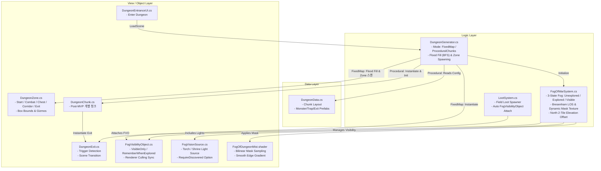

# 던전 시스템 (Dungeon System) 구조도

던전 생성, 플로우, 탈출에 이르는 전반적인 시스템의 클래스/데이터 구조 맵입니다.

## 1. 아키텍처 다이어그램 (Architecture Diagram)

## 2. 핵심 클래스 역할 명세 (Class Roles)

### 2.1. `DungeonGenerator` (`MonoBehaviour`)
*   **역할**: 던전 씬 진입 시 맵 생성 및 엔티티 스폰을 전담하는 메인 매니저.
*   **지원 모드**:
    1.  `FixedMap` (MVP 현행 - 구역 & Flood Fill 기반):
        *   `Start` 구역에서 플레이어를 스폰한 뒤, 해당 타일로부터 **4방향 BFS(Flood Fill)**를 수행하여 벽 안쪽의 실제 도달 가능한 바닥 타일(`FloorTilemap` 있음 & `WallTilemap` 없음 & 장애물 없음)과 이동 걸음 수를 산출. (벽 뒤의 빈 공간 100% 배제)
        *   실제 미로 이동 걸음 수가 가장 먼 `Exit` 구역 후보 중 1곳에 탈출 포탈 생성.
        *   `Chest`, `Combat`, `Corridor` 구역 및 구역 미지정 일반 복도에 최소 간격(`_minMonsterSpacing`)과 출발 안전 반경(`_startSafeStepRadius`)을 준수하여 상자/몬스터/함정 비중복 스폰.
        *   맵 세팅 직후 `FogOfWarSystem`을 자동 초기화하여 플레이어 시작 위치 기준으로 시야를 개방.
    2.  `ProceduralChunks` (Post-MVP): `DungeonData`를 읽어 2x2 또는 3x3으로 청크 프리팹들을 절차적으로 조립 배치.

### 2.2. `FogOfWarSystem` (`MonoBehaviour`)
*   **역할**: 플레이어의 타일 이동 이벤트(`GlobalEvents.OnPlayerCellChanged`) 및 시야원들을 추적하여 3단계 전장의 안개(`Unexplored`, `Explored`, `Visible`)와 엔티티 가시성을 총괄 제어하는 코어 비전 매니저.
*   **특징**:
    *   **동적 텍스처 마스크 생성 & 셰이더 연동**: 타일 단위 계단식 깨짐을 없애기 위해 런타임에 `Texture2D`(`FilterMode.Bilinear`)를 생성하고 `FogOfDungeonMist.shader`를 입힌 풀스크린/오버레이 쿼드에 바인딩하여 부드러운 안개 그라데이션 제공.
    *   **Bresenham 직선 시야(LOS)**: 광원에서 방사되는 광선을 타일 단위로 추적하여, 벽면 타일까지는 밝혀주되 벽 너머 복도나 숨겨진 방은 시야선 차단.
    *   **2.5D 탑다운 북쪽 2타일 수직 보정**: 탑다운 뷰에서 북쪽 벽면이 2타일 높이로 표현되는 특성을 고려하여, 북쪽 벽면 2칸까지 자연스럽게 시야에 포함하는 수직 오프셋 보정(`_wallVerticalElevation`).
    *   **멀티 광원(Multi Vision Sources)**: 플레이어 기본 시야 외에 `FogVisionSource` 컴포넌트가 붙은 오브젝트(횃불, 제단)를 등록받아 통합 시야 맵을 합성.
    *   **오브젝트 가시성 중앙 관리**: `FogVisibilityObject` 컴포넌트를 등록하여 현재 시야 밖의 몬스터 및 드롭 아이템을 즉각 은폐.

### 2.3. `FogVisibilityObject` (`MonoBehaviour`)
*   **역할**: 안개 상태에 따라 자신의 렌더러(Renderer) 활성화/비활성화를 제어하는 컴포넌트.
*   **동작 모드**:
    *   `VisibleOnly`: 몬스터 및 드롭 아이템에 적용. 현재 시야(`Visible`) 내에 있을 때만 렌더러가 켜지며, 탐험된 안개(`Explored`)나 미탐험(`Unexplored`) 영역에 진입하면 즉시 은폐.
    *   `RememberWhenExplored`: 상자, 제단, 정적 상호작용물에 적용. 한 번이라도 플레이어가 밝힌 영역(`Explored` 이상)에 위치하면 계속해서 모습이 유지됨.

### 2.4. `FogVisionSource` (`MonoBehaviour`)
*   **역할**: 맵 내에 배치되는 독립적인 보조 광원(횃불, 신비한 제단, 마법 수정 등).
*   **주요 옵션**:
    *   `visionRadius`: 광원이 비추는 타일 반경.
    *   `requireDiscoveredToEmit`: 활성화 시 플레이어가 해당 광원에 직접 도달하거나 탐험하기 전에는 빛을 내지 않다가, 탐험 완료 후 영구적으로 주변을 밝힘.

### 2.5. `FogOfDungeonMist.shader` (Shader)
*   **역할**: 안개 마스크 텍스처(`_FogTex`)를 샘플링하여 미탐험 색상(`_UnexploredColor`, 완전 흑색), 기탐험 색상(`_ExploredColor`, 반투명 흑색), 가시 영역(투명)을 블렌딩하는 전용 셰이더.

### 2.6. `DungeonZone` (`MonoBehaviour`)
*   **역할**: 통짜 미로 맵 위에 사각형 영역(`_size` 또는 `BoxCollider2D`)으로 배치되어 구역의 성격(`Start`, `Combat`, `Chest`, `Corridor`, `Exit`)과 스폰 수량을 정의.
*   **특징**:
    *   에디터 씬 뷰에서 구역 타입별 색상 반투명 기즈모(Gizmo) 렌더링.
    *   런타임 시 `BoxCollider2D`가 붙어 있으면 자동으로 비활성화하여 물리 충돌 간섭 방지.

### 2.7. `DungeonChunk` (`MonoBehaviour`)
*   **역할**: 절차적 생성(Post-MVP) 시 개별 분할 청크의 내부 스폰 지점 관리 (또는 레거시 통짜맵 폴백).

### 2.8. `DungeonData` (`ScriptableObject`)
*   **역할**: 맵 생성 규칙과 기본 프리팹들의 정적 데이터 보관.

### 2.9. `DungeonExit` (`MonoBehaviour`)
*   **역할**: 탈출구(포탈)의 상호작용 및 씬 전환 처리 (`LoadSceneMode.Single`).
