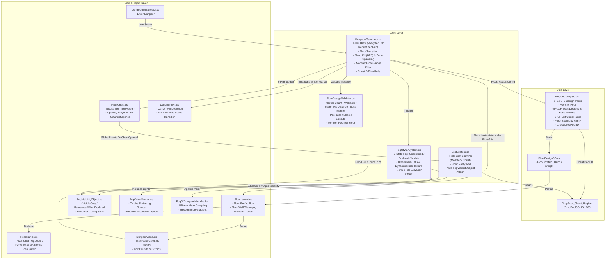

# 던전 시스템 (Dungeon System) 구조도

던전 생성, 플로우, 탈출에 이르는 전반적인 시스템의 클래스/데이터 구조 맵입니다.

## 1. 아키텍처 다이어그램 (Architecture Diagram)

## 2. 핵심 클래스 역할 명세 (Class Roles)

### 2.1. `DungeonGenerator` (`MonoBehaviour`)
*   **역할**: 던전 씬 진입 시 맵 생성 및 엔티티 스폰을 전담하는 메인 매니저. 층계 던전 전용(`_regionConfig` 필수, 통맵·청크 경로는 T3에서 삭제).
*   **층 경로**: 기획 `07_Floor_Based_Dungeon_Design.md`.
    *   `Awake`: 씬의 영속 `FloorGrid`(Grid) 아래 원점에 층 프리팹(`FloorLayout`)을 생성하고 `_floorTilemap`/`_wallTilemap`을 층 타일맵으로 바인딩, `Physics2D.SyncTransforms()` 후 `FloorDesignValidator`로 인스턴스 검증. Grid를 층 프리팹에 두지 않는 이유: 플레이어·몬스터가 `FindObjectOfType<Grid>()`로 Grid를 캐싱하므로 층 교체(T2) 때 Grid가 바뀌면 안 된다.
    *   `Start`: `PlayerStart` 마커에 플레이어 스폰 → BFS → `Exit`·`UpStairs` 마커 반경 `_markerSafeRadius`(체비쇼프) 및 `ChestCandidate` 칸을 스폰 금지로 예약 → 탈출구·계단 마커 반경 `_noDropRadius` 칸을 `TileSystem` 드랍 금지 칸으로 등록(계단은 10층 미만만) → 잠긴 `FloorStairs` 생성·`Initialize(칸)` → 상자 B안(`SpawnChests`) → `Exit` 마커 칸만 기억(탈출구는 클리어 시 굴림) → `Combat`/`Corridor` 구역과 구역 밖 복도에 몬스터·함정 → 안개 초기화 → `OnFloorEntered` → `FloorClearTracker.Arm()`. 스폰물은 층 루트 아래 `Spawned`에 모은다.
    *   **층 추첨(T3, Q13)**: 1~4층 Early 풀·6~9층 Late 풀에서 `Weight` 가중치 추첨, 5층·10층 보스 디자인 고정. 한 판 안에서 같은 층 프리팹 재사용 금지(SO가 아닌 프리팹 기준, `_usedLayouts`). `DebugAllowDuplicateDesigns`면 무시. 후보가 0장이면 LogError 후 중복 허용으로 진행.
    *   **상자 B안(T3, Q30)**: `FloorRule.ChestRolls`만큼 `ChestChance` 판정 → 당첨마다 남은 `ChestCandidate` 중 무작위 1곳에 `FloorChest`(지역 상자 드랍 풀 ID 주입). 보스층은 규칙 0.
    *   **층 전환(T2)**: `UpStairs` 마커에 `FloorStairs`(10층 제외)를 두고, 밟히면 `FloorStairs.OnStairsEntered` → `AscendRoutine`: `GamePauseService.Request` + `PlayerInput.IsInputLocked` → `GlobalEvents.OnFloorTransitionStarted(fade)` → 페이드 시간 대기(실시간) → `ClearFloor()`(투사체·예고 장판 `ReleaseAll`, 이전 층 루트 비활성·분리·파괴, `Physics2D.SyncTransforms`, `TileSystem.ClearAll`로 점유·위험 칸·바닥 아이템 정리) → 다음 층 `BuildFloor`/`SetupFloorLayout` → `GlobalEvents.OnFloorEntered` → 페이드 시간 대기 → 잠금 해제.
    *   플레이어는 1층에서만 생성하고 2층부터는 `PlayerController.ResetForFloorTransition`(이동 코루틴·차징·선입력 정지, 위치 이동, 타일 등록, 카메라 `SnapToTarget`)으로 재사용한다 → HP·MP·쿨타임·HoT 유지.
    *   현재 층은 `PlayerSessionData.CurrentRegionId/CurrentFloor`에 기록(결과 화면 지역·층 표시, 07 문서 F7용).
    *   **층 클리어(T4, F3)**: `FloorClearTracker`(POCO)를 층 생명주기에 연결 — 플레이어 스폰 직전 `Begin(보스층 여부)`, 층 진입 알림 뒤 `Arm()`, `ClearFloor` 맨 앞에서 `End()`(이전 층 몬스터 파괴가 클리어를 띄우지 않게). 클리어 콜백 `HandleFloorCleared`: 보스층이면 남은 몬스터 `DespawnWithoutLoot` + 투사체·예고 장판 `ReleaseAll` + `PlayerStatManager.SetInvincible(true)`(`ClearFloor`에서 해제) → `FogOfWarSystem.RevealAll` → `PlayerCombatState.ExitCombat` → 계단 `Unlock(마지막 도착 칸)` → `TryOpenExit`(보스층 100%, 그 외 `FloorRule.ExitChance`, 성공 시 포탈 생성·`Activate(칸, 마지막 도착 칸)`) → `GlobalEvents.OnFloorCleared(층, 탈출구 열림)`.
    *   플레이어의 마지막 도착 칸은 `OnPlayerCellChanged`로 추적하고, 1층은 `PlayerController.Start`보다 배치가 먼저라 `SpawnPlayerAtCell`에서 직접 넣는다(겹침 가드 기준).

    *   **보스층 공통(F6a)**: `SetupFloorLayout`에서 잡몹보다 먼저 `SpawnBoss`(`BossSpawn` 마커 + `RegionConfigSO.GetBossPrefab`. 몸 크기 `MonsterController.GetFootprint(prefab)`, 좌하단 = `GetAnchorFromMarker`(마커 - (N-1)/2), 몸 모든 칸이 도달 가능·시작 5걸음 초과·예약 칸 아님이어야 하고 생성 위치는 `GetBodyCenterWorld`. 칸을 쓸 수 없으면 경고 후 전원 처치 규칙), 안개 초기화 뒤 `RevealAll(immediate: true)`(층 전환 일시정지 중에는 페이드가 돌지 않으므로 즉시 반영).

    *   **몬스터 종류(10 기획안 C1)**: 몬스터 스폰은 `GetFloorMonsterPool(zone)`이 고른 풀에서 균등 추첨. 구역 전용 풀(`DungeonZone.OverrideMonsterPool`)이 있으면 그것, 없으면 `RegionConfigSO.MonsterPool`을 `MonsterDataSO.CanAppearOnFloor(현재 층)`로 걸러 재사용 버퍼(`_floorMonsterBuffer`)에 담는다. 0종이면 범위를 무시한 같은 풀(유효한 몬스터 프리팹만)로 대신하고 경고, 풀이 비면 오류. `MonsterController`·데이터가 없는 프리팹은 `TryGetMonsterData`로 건너뜀. 보스 스폰에는 적용하지 않음.

    *   **층 배율(F4)**: `SpawnEntity`가 몬스터 생성 직후 `ApplyFloorScaling(GetHpMultiplier, GetAtkMultiplier)` 적용. 드랍 등급 비율은 `LootSystem`이 드랍 순간 `PlayerSessionData.CurrentRegionId/CurrentFloor`로 `RegionConfigSO.GetRarityWeights`를 조회한다(System 간 직접 참조 없음).

### 2.1b. `MonsterFacingVisual` / `SpriteAnimSetSO` / `DirectionalSpriteSO` (`MonoBehaviour` Visual / `ScriptableObject`)
*   **역할**: 몬스터 SpriteRenderer의 4방향(S/W/E/N) 스프라이트만 교체(색·스케일·안개 표시 여부는 `MonsterController`·안개 쪽 그대로). 마지막 행동 기준: 이동 중(`MonsterController.IsMovingToTile`) = `CurrentMoveDirection`, 패턴 시작(`ActionCount` 증가) = 그 순간 플레이어 쪽(`LastActionDirection`), 그 외에는 유지. `MonsterController`가 패턴·기본 근접 시작 직전에 `MarkActionTowardPlayer`로 기록. 방향 변환은 `DirectionalSpriteSO.FromVector`(대각선은 좌우 우선, 빈 칸은 S 이미지).
*   **애니메이션**: `SpriteAnimSetSO`의 대기(`_idle`, 이동 중에도 재생)·공격 프레임. 공격 = 예고 구간 + 타격 구간. `MonsterController.OnAttackWindup(예고 시간)`(패턴 SO 6종·기본 근접이 예고 시간 계산 직후 `NotifyAttackWindup` 호출, AoESlam 퍼지는 마름모는 +0.15초) 수신 → 예고 구간을 예고 시간에 맞춰 늘려 재생 → 타격 구간을 `_attackFps`로 1회(`_loopStrikeWhileExecuting`이면 패턴 실행 중 반복) → 대기. 예고 구간 = `_attackWindup`(있으면, 고슴도치 curl) 또는 `_attack[0.._attackHitFrame-1]`, 타격 구간 = 나머지. 공격 동작 중에는 이동해도 방향 고정. `CurrentState`가 Stunned·Evading·Dead면 즉시 대기. `_animSet`이 없거나 대기 프레임이 빈 방향은 `_sprites`(정지 이미지). 패턴별 공격 애니: 예고 시작 때 `MonsterController.CurrentPattern`(행동 루프가 패턴 실행 동안만 설정, 중단·강제 제거 때 null)으로 `SpriteAnimSetSO.FindPatternAttack`을 찾아 이번 공격의 예고·타격·타격 번호·반복을 고정, 없으면 기본 공격. 이동 프레임(`Move`)이 있는 몬스터는 `IsMovingToTile` 동안 `_moveFps`로 반복(칸 사이 대기에도 위상 유지), 없으면 대기 프레임.
*   **연결**: Monster_Dummy(Bramble Hog)·AgileMonster(Leaf Mantis)·Wizard(Pinecone Owl)·Monster_Snail(Amber Snail) 프리팹 → `Data_SO/AnimSO/Monster_<이름>_Anim.asset`(애니, 타격 프레임 5, 고슴도치는 curl/roll + 반복) + `Monster_<이름>_Dir.asset`(정지 이미지 대체용). 보스 Monster_MossBoar(3×3 이동)·Monster_AmberTreant(5×5 고정) → `Monster_MossBoar_Anim`(기본 attack 타격 4, `_patternAttacks`: Pattern_LinearCharge → 예고 attack 0~3·타격 charge 반복)·`Monster_AmberTreant_Anim`(이동 walk, 기본 slam 타격 4), 데이터 `MossBoarBoss`·`AmberTreantBoss`, `Region1Config` 5층·10층 보스. 보스 프레임은 72px·104px, PPU 18.67·16(몸 칸에 맞춰 키움, 2026-11-23), W = E 반전 PNG. 임시 보스(`Monster_TempBoss`)는 연결 해제, 파일 유지. 프레임은 `Assets/Art/Characters/Monsters/<종류>/mon_<id>_<idle|attack|curl|roll>_<방향>_01~09.png`(40px, PPU 36, 방향별 발끝 기준점). 원본은 `Desktop/Art/100BagBack/mon_<id>/final/*_sheet.png`(aseprite 태그 순서 W·E·S·N).

### 2.1c. 여러 칸 몬스터 몸 (`MonsterController` · `MonsterLocomotion` · `Pathfinder` · `TileSystem`)
*   **기준**: `MonsterDataSO.footprint` N(1~5), `isStationary`(고정형). 규칙: 5 = 고정형, 3·4 = 이동형. anchor = 몸 좌하단 칸, transform = 몸 중심. `MonsterController._occupiedAnchor`에 점유 중인 anchor를 기억하고 `GetCurrentCell()`이 이를 돌려준다(이동 중 보간·2×2 중심의 칸 경계 때문에 위치 역산을 쓰지 않음). 등록 전에만 `GetAnchorFromCenterWorld`.
*   **점유**: 몬스터의 모든 칸 이동은 `TryMoveBody(newAnchor)`. 1칸은 `TileSystem.TryOccupyFootprint`(옛 칸 해제 + 새 칸 등록, 원자적). N>1은 `TryOccupyFootprintKeepOld`로 새 칸만 추가하고 옛 anchor를 `_pendingReleaseAnchor`에 남겨, 미끄러지는 동안 옛 몸 + 새 몸을 모두 막는다. 뒷줄 해제는 `FlushPendingRelease`(`ReleaseFootprintExcept`) 한 곳: `MoveToTileRoutine` 도착, `StopActionCoroutines`(무조건), 다음 `TryMoveBody`. 스폰 `RegisterBody`, 사망·자폭·강제 제거·파괴 `ReleaseBody`(남은 뒷줄 포함). `FinalizeDeath`는 `OnMonsterDied` 발행 전에 `ReleaseBody`(전리품이 자기 몸 칸에도 놓이도록). `LootSystem.GetNearestEmptyItemTile`은 몬스터가 점유한 칸을 건너뜀(`IsMonsterCell`, 플레이어 칸은 허용). 고정형은 `TryMoveBody`가 항상 false.
*   **발밑 표시**: `MonsterFootprintIndicator`(View, 보스 프리팹). `OnBodyCellsChanged`·`OnFogVisibilityChanged`(지역 이벤트) 구독, `TryGetOccupiedCellBounds`(이동 중 합집합)로 9-slice 테두리(`ui_footprint_outline.png`, PPU 16, border 1) 크기·위치를 맞춘다. 렌더러는 몬스터의 형제 오브젝트로 Start에서 만들어 몸 이동에 끌려가지 않고 안개 렌더러 목록(`_renderers`)에도 들어가지 않는다. `_visible`로 끄고 켬, **기본 꺼짐**(유저 결정, 디버깅용). 스프라이트는 Sliced 표시라 Mesh Type Full Rect.
*   **거리·헬퍼**: `GetBodyChebyshevDistance`/`GetBodyManhattanDistance`(몸 사각형–칸), `IsBodyCell`, `GetCenterCell`(드랍·자폭 중심), `GetBodyCenterWorld`, `IsAnyBodyCellVisible`(안개), 정적 `GetFootprint(prefab)`·`GetAnchorFromMarker`. 콜라이더는 N>1이면 `(N-0.1)`, offset 0(`FitColliderToFootprint`, `Awake`·`Initialize`).
*   **이동**: N>1이면 `MonsterLocomotion.HeavyChaseBodyStepRoutine` → `Pathfinder.TryFindNextBodyStep`(노드 = anchor, 몸 칸 장애물 검사, 목표 = 몸–플레이어 맨해튼 1, 첫 걸음은 `CanPlaceBody`로 다른 엔티티도 피함). 순찰도 `CanPlaceBody`. 회피 스텝·피격 탈출·HitAndRun 백스텝은 N>1에서 생략. 고정형(`isStationary`)은 행동 루프에서 이동 스텝 대신 0.1초 대기.
*   **패턴**: `MonsterPatternSO.CanExecute` 몸 거리. `AoESlamPatternSO` 범위 = 몸 사각형 기준(N>1은 몸 안 제외), ForwardBox 폭 = N+2. `ChargePatternSO`는 `PatternAnchorsBuffer`(스텝 anchor)와 `PatternCellsBuffer`(앞쪽 가장자리 예고 칸)를 나눠 쓰고, 스텝마다 앞줄에 플레이어 → 피해 후 정지, 장애물 → 벽 기절, 점유 실패(다른 몬스터) → 기절 없이 정지. 고정형은 `CanExecute`에서 돌진 거부. `PatternCellsBuffer` 용량 128(5×5 둘레 반경 3), 자폭 범위도 이 버퍼 재사용.
*   **검증**: `FloorDesignValidator.CheckBossPrefab` 경고: N>1 이동형 비HeavyChase, 5×5 이상 이동형, 고정형인데 돌진·치고 빠지기 패턴.

### 2.2. `FogOfWarSystem` (`MonoBehaviour`)
*   **역할**: 플레이어의 타일 이동 이벤트(`GlobalEvents.OnPlayerCellChanged`) 및 시야원들을 추적하여 3단계 전장의 안개(`Unexplored`, `Explored`, `Visible`)와 엔티티 가시성을 총괄 제어하는 코어 비전 매니저.
*   **특징**:
    *   **동적 텍스처 마스크 생성 & 셰이더 연동**: 타일 단위 계단식 깨짐을 없애기 위해 런타임에 `Texture2D`(`FilterMode.Bilinear`)를 생성하고 `FogOfDungeonMist.shader`를 입힌 풀스크린/오버레이 쿼드에 바인딩하여 부드러운 안개 그라데이션 제공.
    *   **Bresenham 직선 시야(LOS)**: 광원에서 방사되는 광선을 타일 단위로 추적하여, 벽면 타일까지는 밝혀주되 벽 너머 복도나 숨겨진 방은 시야선 차단.
    *   **2.5D 탑다운 북쪽 2타일 수직 보정**: 탑다운 뷰에서 북쪽 벽면이 2타일 높이로 표현되는 특성을 고려하여, 북쪽 벽면 2칸까지 자연스럽게 시야에 포함하는 수직 오프셋 보정(`_wallVerticalElevation`).
    *   **멀티 광원(Multi Vision Sources)**: 플레이어 기본 시야 외에 `FogVisionSource` 컴포넌트가 붙은 오브젝트(횃불, 제단)를 등록받아 통합 시야 맵을 합성.
    *   **오브젝트 가시성 중앙 관리**: `FogVisibilityObject` 컴포넌트를 등록하여 현재 시야 밖의 몬스터 및 드롭 아이템을 즉각 은폐.

### 2.3. `FogVisibilityObject` (`MonoBehaviour`)
*   **역할**: 안개 상태에 따라 자신의 렌더러(Renderer) 활성화/비활성화를 제어하는 컴포넌트.
*   **동작 모드**:
    *   `VisibleOnly`: 몬스터에 적용. 현재 시야(`Visible`) 내에 있을 때만 렌더러가 켜지며, 탐험된 안개(`Explored`)나 미탐험(`Unexplored`) 영역에 진입하면 즉시 은폐.
    *   `RememberWhenExplored`: 상자, 제단, 정적 상호작용물에 적용. 한 번이라도 플레이어가 밝힌 영역(`Explored` 이상)에 위치하면 계속해서 모습이 유지됨.
    *   드롭 아이템은 `LootSystem._droppedItemFogMode`로 정한다. 현재 `RememberWhenExplored`(코드 기본값과 `03_DungeonScene` 값 모두). `VisibleOnly`로 바꿀지는 결정 보류(Roadmap 8절).

### 2.4. `FogVisionSource` (`MonoBehaviour`)
*   **역할**: 맵 내에 배치되는 독립적인 보조 광원(횃불, 신비한 제단, 마법 수정 등).
*   **주요 옵션**:
    *   `visionRadius`: 광원이 비추는 타일 반경.
    *   `requireDiscoveredToEmit`: 활성화 시 플레이어가 해당 광원에 직접 도달하거나 탐험하기 전에는 빛을 내지 않다가, 탐험 완료 후 영구적으로 주변을 밝힘.

### 2.5. `FogOfDungeonMist.shader` (Shader)
*   **역할**: 안개 마스크 텍스처(`_FogTex`)를 샘플링하여 미탐험 색상(`_UnexploredColor`, 완전 흑색), 기탐험 색상(`_ExploredColor`, 반투명 흑색), 가시 영역(투명)을 블렌딩하는 전용 셰이더.

### 2.6. `DungeonZone` (`MonoBehaviour`)
*   **역할**: 층 프리팹 안에 사각형 영역(`_size` 또는 `BoxCollider2D`)으로 배치되어 몬스터·함정 스폰 구역(`Combat`, `Corridor`)과 수량을 정의. 시작점·탈출구·상자 후보는 `FloorMarker`가 맡는다.
*   **enum 값**: `Combat = 1`, `Corridor = 3`(삭제한 Start·Chest·Exit의 예전 번호와 직렬화 값을 맞추려고 유지).
*   **특징**:
    *   에디터 씬 뷰에서 구역 타입별 색상 반투명 기즈모(Gizmo) 렌더링.
    *   런타임 시 `BoxCollider2D`가 붙어 있으면 자동으로 비활성화하여 물리 충돌 간섭 방지.

### 2.7. `FloorChest` (`MonoBehaviour`, Controller)
*   **역할**: 층 상자. 생성 시 자기 칸을 `TileSystem` 점유로 등록해 플레이어·몬스터 이동을 막는다(열린 뒤에도 유지). `IAttackInteractable`을 구현해 플레이어의 근접·차지 공격(`EntityCombat`이 피해 대신 `OnAttacked` 호출)을 받으면 1회 열림(색 변경) → `GlobalEvents.OnChestOpened(위치, 드랍 풀 ID)`만 던진다. 몬스터 공격·투사체로는 열리지 않는다.
*   `LootSystem`이 구독해 몬스터와 같은 드랍 처리(`DropFromPool`)를 쓰되, 상자 칸은 건너뛰고 주변 칸부터 놓는다(열린 상자와 겹침·발밑 자동 습득 방지).
*   몬스터 사망 이벤트와 분리한 이유: 층 클리어 카운터(07 문서 F3)가 `OnMonsterDied`만 세야 한다.
*   내용물 `DropPool_Chest_Region1`(ID 1000): 재료(전리품 하위 등급) 2회 + 장비(악세서리)·포션 30% / 꽝 70%. 기획 5절 [추천] 값, 플레이 테스트로 조정.

### 2.8. `DungeonExit` (`MonoBehaviour`, Controller)
*   **역할**: 탈출 포탈. 층 클리어 시 확률로 생성되고 `Activate(칸, 마지막 도착 칸)`로 켜진다. 진입은 물리 트리거가 아니라 `OnPlayerCellChanged`의 칸 비교(포탈 1×1·플레이어 0.8×1 콜라이더가 위아래 인접 칸에서 닿아 오발동하던 문제 방지). 도착하면 정적 지역 이벤트 `OnExitRequested(this)`만 던지고, `ExitConfirmUI`가 확인창을 띄워 `ConfirmExit`(결과 기록 + 허브 `LoadSceneMode.Single`) 또는 `CancelExit`을 부른다.
*   **겹침 가드**: 생성 순간·취소 직후 포탈 칸에 서 있으면 다른 칸에 도착했다가 다시 밟아야 재요청. 확인창 UI 구독자가 없으면 바로 탈출. 구독 해제는 `OnDisable`(층 정리 시 즉시 비활성).

### 2.8b. `FloorClearTracker` (POCO)
*   **역할**: 현재 층의 살아 있는 몬스터 집합(`MonsterController.OnSpawned`/`OnRemoved`)으로 클리어 판정. 일반층은 소환수 포함 전부, 보스층은 `IsBoss` 전부(0마리면 일반층 규칙). 보스·소환 여부는 `Awake` 시점에 미주입이라 `Arm`·제거 시점에 조회.
*   클리어 시 판정을 먼저 끄고 남은 개체를 버퍼에 복사해 넘긴다(정리 중 `OnRemoved` 재진입으로 인한 컬렉션 변경·중복 클리어 방지).
*   `OnMonsterDied`(전리품 이벤트, 개체 정보 없음)는 쓰지 않는다. 소환수는 `OnMonsterDied`를 발행하지 않아 전리품이 없다.

### 2.9. `FloorLayout` / `FloorMarker` (`MonoBehaviour`)
*   **`FloorLayout`**: 층 프리팹 루트. `Floor`·`Wall` 타일맵 참조, 마커·구역 수집(지연 캐싱, Edit Mode에서는 매번 재수집), 루트 기준 칸 좌표(`GetLocalCell`, 셀 크기 1).
*   **`FloorMarker`**: `PlayerStart` / `UpStairs` / `Exit` / `ChestCandidate` / `BossSpawn`. 칸 중앙(+0.5)에 둔다.
*   **층 프리팹 규격**: 루트(`FloorLayout`, Grid 없음) 아래 `Floor`, `Wall`(레이어 Wall, `TilemapCollider2D`), `Markers`, `Zones`. 타일맵은 루트 기준 위치·회전 0, 스케일 1.
*   **숲 맵(A4a)**: 바닥은 `Floor` 타일맵에 그림 타일(풀·흙 변형, Wang 16)을 Tile Palette `Forest_Floor`로 직접 칠한다(그림이 곧 보행 판정). 벽도 타일이다: 32×32 한 칸 = 타일 하나. 고유 타일 78종(`wall_forest_sheet.png`, 8열 시트를 `wall_forest_00`~`77`로 슬라이스)을 팔레트 `Forest_Walls`에 원본 배치(ㅁ 고리, 가로 벽 2종, 세로 줄기 2종, ㄇ, ㅜ)대로 두고, 필요한 모양을 골라 칠한다. 가로 벽은 2줄(윗면 + 앞면), 세로 줄기는 1칸 폭, 아래 외곽 벽은 3줄(윗머리 + 몸통 + 앞면).
    *   벽 타일맵 3장(모두 `Wall` 레이어 + `TilemapCollider2D`, `tileAnchor` (0.5, 0.75)): `WallBack`(외곽 위·좌·우, 순서 0), `WallFront`(아래 외곽 벽 3줄 전부, 순서 2 → 윗머리·몸통 칸에 선 캐릭터를 가림), `WallInner`(방 안 벽, 순서 1, 렌더 모드 Individual → 캐릭터와 Y 정렬). 기존 1칸 `Wall` 타일맵은 비워 두고 참조만 유지(회색 박스 층 호환).
    *   벽 스프라이트 기준점 (0.5, 0.75) = tileAnchor: 그림 위치는 그대로, Individual 정렬 기준(칸 + 앵커)이 칸 위 0.75가 되어 같은 줄 캐릭터(칸 중심 0.5)는 항상 벽 앞, 윗줄 캐릭터는 벽 뒤.
    *   충돌은 Tile 에셋의 `colliderType`(Grid = 막힘, None = 이동 가능). Tile `Forest_Wall_00`~`77` 한 세트: 가로 벽은 윗면·앞면 두 줄 모두 막힘, 세로 줄기 막힘, 세로 줄기 끝 어두운 앞면 이동 가능. 아래 외곽 벽은 윗머리 줄만 이동 가능(벽 뒤로 가려짐), 몸통 줄과 맨 아래 앞면 줄은 막힘(2026-11-22 유저가 Tile 값 직접 조정). 이동 가능 Tile 번호: 42~45, 56, 72~74, 76, 77(나머지는 막힘). 캐릭터 크기에 맞춰 유저가 수시로 조정하는 값이다. 타일맵 칸은 칠할 때 충돌 종류를 복사하므로, Tile 에셋 값을 바꾸면 해당 벽을 다시 칠하거나 타일맵 Refresh가 필요하다.
    *   아트 교체: `Art/Tiles/Forest/Wall/wall_forest_sheet.png`를 같은 이름·같은 칸 배치(256×320, 8열)로 덮어쓰면 슬라이스와 Tile 참조가 유지된다. 원본은 `Desktop/Art/100BagBack/obj_forest-bush-wall/work/obj_forest-bush-wall_32x32_unique.png`(고유 타일)·`_palette.png`(팔레트 배치).
    *   런타임 판정은 `Pathfinder.IsObstacle`·`DungeonGenerator.IsTileWalkable`·`FogOfWarSystem.IsSightBlockedAtCell`의 `Physics2D.OverlapPoint(칸 중심, Wall)`가 벽 타일맵 콜라이더를 본다(코드 변경 없음).
    *   편집: 층 루트에는 Grid가 없어 프리팹 모드에서 팔레트를 쓸 수 없다. 씬의 `FloorGrid` 아래에 층 프리팹을 놓고 칠한 뒤 Apply(층 안에 Grid를 두면 `FindObjectOfType<Grid>()`가 엇갈린다).
    *   시험 층 `Floor_Forest_Test01`(28×20, 지역 풀에는 없음).
    *   지역 1 층(A4b, 2026-11-22): `Floor_GrayBox_Normal01`·`Normal02`·`Boss01`을 회색 박스 칸 배치 그대로 숲 타일로 바꿨다(이름은 유지, 디자인 SO 참조 그대로). 바닥 = 벽 칸 포함 사각형 전체에 풀 4종, 벽 = 회색 박스 1칸 벽을 규칙으로 옮김: 가로 벽 칸은 윗면 타일 + 바로 아래 바닥 칸에 앞면 타일(이동 가능), 세로 벽은 줄기 + 끝 아래 바닥 칸에 끝 앞면, 위 외곽은 벽 칸에 고리 앞면(막힘) + 한 칸 위(맵 밖)에 고리 윗면, 아래 외곽은 벽 칸에 앞면(막힘) + 위 바닥 칸에 몸통(이동 가능, 가려짐) + 그 위 바닥 칸에 윗머리(모두 `WallFront`), 2칸 두께 덩어리는 둥근 윗모서리 + 몸통 모서리(아래 앞면 없음). 막힘/이동 가능 칸은 Tile 충돌 값을 따르므로, 회색 박스에서 걸을 수 있던 가로 벽 앞면 칸·아래 외곽 몸통 칸이 막힌다(층마다 22~42칸). 이음새(벽이 만나는 칸)는 근사 타일이라 손으로 다듬을 수 있다.
    *   주의: 메뉴 `Create Gray Box Floors`를 다시 실행하면 이 세 층이 회색 박스로 덮어써진다.
*   **`FloorLayout.IsLocalCellWalkable`**: 바닥 타일 있음 + Wall 타일 없음 + `RefreshBlockedCells`가 모은 막힌 칸이 아님. 막힌 칸 = Wall 레이어 벽 타일맵(`TilemapCollider2D`, `GetColliderType(칸) != None`) + Wall 레이어 `BoxCollider2D`가 칸 중심을 덮는 칸(방 안 1칸 장애물 오브젝트 대비). 물리 없이 계산해 프리팹 에셋에서도 동작하고, 활성 여부는 층 루트까지 `activeSelf`로 본다(에셋은 `activeInHierarchy`가 항상 false). 칸 경계 비정렬 BoxCollider2D, 지원 안 하는 콜라이더, Geometry Type이 Outlines인 CompositeCollider2D는 `ColliderIssues`로 모은다.

### 2.10. `FloorDesignSO` / `RegionConfigSO` (`ScriptableObject`)
*   **`FloorDesignSO`**: 층 프리팹, 구간(`Early` 1~5 / `Late` 6~9 / `Boss`), 가중치.
*   **`RegionConfigSO`**: 지역 번호·이름, 1~5 풀, 6~9 풀, 일반 몬스터 풀(`MonsterPool`), 5층·10층 보스 디자인과 보스 프리팹, 층 배율(`_hpPerFloor`, `_atkPerFloor`, 1층·9층 `RarityWeights`), 1~9층 규칙(`FloorRule`: 탈출구 확률, 상자 굴림 횟수·확률), 상자 드랍 풀 ID, 디버그 "디자인 중복 허용".

### 2.11. `FloorDesignValidator` (static)
*   **역할**: 런타임·에디터 공용 규격 검증. 시작점 1, 탈출구 1, 계단 1(10층 보스층은 0~1), 마커 칸 보행 가능·중복 없음, 계단–탈출구 체비쇼프 거리 ≥ 3, 상자 후보 ≥ 구간 최대 굴림 횟수, 풀 구간 일치. `BossSpawn`은 보스층 1개·일반층 0개, 시작점 5걸음 초과, 계단·탈출구와 3칸 이상. 지역 검증은 보스 프리팹 누락·비 Boss 데이터를 경고. 크기 2 이상 보스는 `CheckBossFootprint`로 5·10층 디자인의 마커 기준 몸 모든 칸을 런타임 `SpawnBoss`와 같은 조건(보행 가능, 상자 후보 아님, 상자가 막혀도 도달·시작 5걸음 초과, 계단·탈출구 `MarkerSafeRadius` 1칸 밖)으로 오류 검사, `HeavyChase`가 아닌 이동 스타일은 경고.
*   **벽 타일·오브젝트(A4a)**: `ValidateLayout` 시작에서 `layout.RefreshBlockedCells()` → 마커 보행·도달성·고립 칸 검사가 벽 타일 충돌과 장애물 콜라이더를 반영. 층 안 모든 타일맵이 루트 기준 위치 0·회전 0·스케일 1인지도 검사. 지역 검증(에디터 메뉴만)은 `ColliderIssues`(칸 경계 비정렬, 지원 안 하는 콜라이더)를 경고(`CheckColliderIssues`). 런타임은 막지 않는다.
*   **풀 장수(T3)**: 구간 고유 프리팹 수 < 구간 층 수(4) → 오류, = 4 → 경고(추천 6장 이상). 1~5 풀과 6~9 풀이 같은 프리팹을 쓰면 오류(6~9층 후보 부족 방지). 디버그 중복 허용이면 오류 대신 경고. 경고는 별도 목록으로 에디터 메뉴가 LogWarning.
*   **몬스터 풀(10 기획안 C1, `CheckMonsterPool`)**: 지역 몬스터 풀이 비면 오류, 1~10층마다 출현 가능한 몬스터 0종이면 오류. 구역 전용 풀은 그 디자인의 층 범위(초반 1~4, 5, 후반 6~9, 10)에서 0종이면 경고. 풀의 빈 칸·데이터 없는 프리팹은 경고(`CheckInvalidPrefabs`).

### 2.12. `FloorStairs` (`MonoBehaviour`, Controller)
*   **역할**: 위층 계단. 잠긴 채(어두운 색) 생성되고 층 클리어 시 `Unlock(마지막 도착 칸)`. 진입은 `OnPlayerCellChanged` 칸 비교로 판정하고, 열린 계단 칸에 도착하면 정적 지역 이벤트 `OnStairsEntered`만 던지고 1회 후 비활성. 잠금이 풀리는 순간 계단 위에 서 있었다면 한 번 벗어나야 발동.

### 2.13. `FloorHUD` (`MonoBehaviour`, UI)
*   **역할**: 현재 층 상시 표시(우측 상단), 층 진입 배너(상단 중앙), 층 전환 암전. `GlobalEvents.OnFloorTransitionStarted`/`OnFloorEntered`/`OnFloorCleared` 구독(OnEnable/OnDisable), 클리어 시 `UIToast`로 알림(탈출구 열림 여부 포함), 연출은 unscaled time. 서식 `{0}` 지역 번호, `{1}` 층, `{2}` 지역 이름.

### 2.14. `FloorGrayBoxBuilder` (Editor)
*   메뉴 `BagBack100/Floor/Create Gray Box Floors`: 회색 박스 층 3장(일반 2 + 보스 1)과 `Region1Config`·`FloorDesignSO` 생성 후 검증. 템플릿은 `Floor_GrayBox_Normal01.prefab`의 Floor·Wall(먼저 복제 후 템플릿을 닫고 저장). A4b 이후 세 층은 숲 타일로 칠해져 있어 다시 실행하면 덮어써진다.
*   메뉴 `BagBack100/Floor/Create Region1 Chest Drop Pool`: 상자 드랍 풀(`DropPool_Chest_Region1`) 생성. 재료 그룹은 `Region1Config` 몬스터 풀 → 몬스터 드랍 풀의 `Material`·`Common` 아이템(itemID 0 꽝 제외), 보너스 그룹은 악세서리 3종 + HP 포션(가중치 합 30) + 꽝 70.
*   메뉴 `BagBack100/Floor/Setup Chest Prefab`: 회색 박스 상자 프리팹(`FloorChest_GrayBox`) 생성·`DungeonGenerator._chestPrefab` 연결.
*   메뉴 `BagBack100/Floor/Validate Region Configs`: 모든 `RegionConfigSO` 검증.
*   팔레트(`Assets/Art/Tiles/Palettes/`): `Forest_Floor`(풀 4·흙 4·Wang 16, Tile 에셋은 `Data_SO/TileSO/Forest/`), `Forest_Walls`(벽 Tile 78종, 원본 팔레트 그림과 같은 16×11 배치). 벽 Tile 에셋은 `Data_SO/TileSO/Forest/Walls/`, 팔레트 타일맵도 tileAnchor 0.75.

### 2.15. `FloorCheckerOverlay` (`MonoBehaviour`, Visual)
*   **역할**: `GlobalEvents.OnFloorEntered`(OnEnable/OnDisable)마다 현재 층 루트 아래 `Checker` 타일맵을 만들어 (x+y) 짝수 바닥 칸에 체크 타일을 깐다(색 `#00061E` 알파 0.08, 순서 -19, 인스펙터 값). 층과 함께 파괴. 던전 씬 `DungeonManager` 오브젝트에 붙어 있다.

### 2.16. 정렬 순서 규칙
*   Graphics `Transparency Sort Mode = Custom Axis (0,1,0)`. 바닥 타일맵 -20, 체크무늬 -19, 바닥에 붙은 것(계단·함정) -10, 외곽 벽 타일맵 0(`WallBack`)/2(`WallFront`), 서 있는 것(플레이어·몬스터·상자·귀환 포털·바닥 전리품) 1 + `spriteSortPoint = Pivot`(기준점 = 서 있는 칸 중심), 방 안 벽 `WallInner` 1 + Individual(앵커 0.75), 이동 미리보기 3·경고 장판 5·조준선 9·공격 이펙트 11·타격 플래시 45·피해 숫자 60, 안개 50.
*   한계: Y 정렬은 칸 이동 홉 높이를 포함해 몬스터(홉 0.5칸)가 위아래로 움직이는 순간 옆 줄과 앞뒤가 잠깐 바뀔 수 있다.
*   메뉴 `BagBack100/Floor/Setup Stairs And Floor HUD`: 회색 박스 계단 프리팹(`FloorStairs_GrayBox`) 생성·`DungeonGenerator._stairsPrefab` 연결, 켜진 Overlay 캔버스 아래 `FloorHUD` 생성 후 저장.
*   메뉴 `BagBack100/Floor/Setup Dungeon Scene For Floors`: `FloorGrid` 생성, `DungeonGenerator._regionConfig` 연결, 함정 풀이 비어 있으면 `Hazard_Spike` 지정 후 저장.
