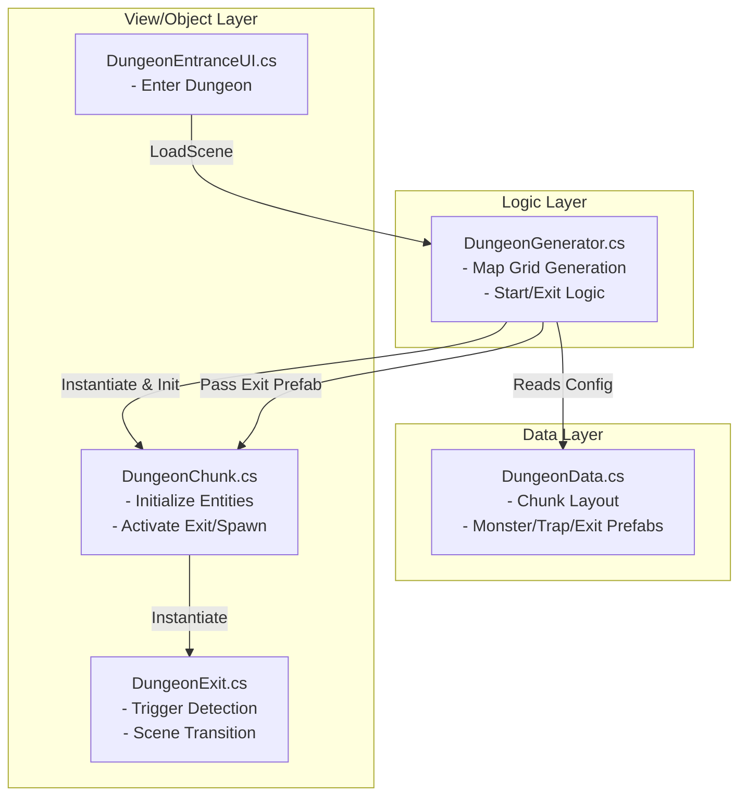

# 던전 시스템 (Dungeon System) 구조도

던전 생성, 플로우, 탈출에 이르는 전반적인 시스템의 클래스/데이터 구조 맵입니다.

## 1. 아키텍처 다이어그램 (Architecture Diagram)

## 2. 핵심 클래스 역할 명세 (Class Roles)

### 2.1. `DungeonData` (`ScriptableObject`)
*   **역할**: 맵 생성 규칙과 스폰될 프리팹들의 정적 데이터 보관.
*   **주요 속성**: 
    *   `gridWidth`, `gridHeight`, `chunkOffset`: 전체 맵 그리드 설정.
    *   `chunkSlots`: 각 위치별 등장할 수 있는 청크 프리팹 후보군.
    *   `monsterPrefab`, `trapPrefab`, **`exitPrefab`**: 런타임에 동적으로 생성(Instantiate)할 오브젝트 원본.

### 2.2. `DungeonGenerator` (`MonoBehaviour`)
*   **역할**: `DungeonScene` 진입 시 초기화를 담당하는 메인 매니저.
*   **핵심 로직**:
    1.  `DungeonData`를 기반으로 청크 그리드 생성 및 배치 (`GenerateDungeon`).
    2.  생성된 청크 중 랜덤 1곳을 플레이어 시작 위치로 지정 및 플레이어 스폰.
    3.  시작 위치와 가장 거리가 먼 3개의 청크 후보군 중 랜덤 1곳을 탈출구로 선정 (`DetermineStartAndExit`).

### 2.3. `DungeonChunk` (`MonoBehaviour`)
*   **역할**: 개별 청크 단위의 내부 스폰 포인트 관리.
*   **핵심 로직**:
    *   `Initialize()`: 몬스터와 함정을 지정된 `Transform` 위치 배열 중 랜덤하게 골라 인스턴스화.
    *   `ActivateExitPoint()`: `DungeonData`로부터 전달받은 `exitPrefab`을 자신의 `_exitPoint` 위치에 생성.

### 2.4. `DungeonExit` (`MonoBehaviour`)
*   **역할**: 탈출구(포탈)의 상호작용 및 씬 전환 처리.
*   **특징 (제약 조건 준수)**:
    *   `OnTriggerEnter2D`에서 `TryGetComponent<PlayerController>`를 사용하여 대상이 플레이어인지 확인 (Magic String 방지).
    *   `SceneManager.LoadScene(..., LoadSceneMode.Single)`를 통해 허브 씬으로 전환하여, 이전 던전 씬의 모든 동적 생성 데이터를 확실하게 메모리에서 파괴 및 초기화 (메모리 누수 원천 차단).
