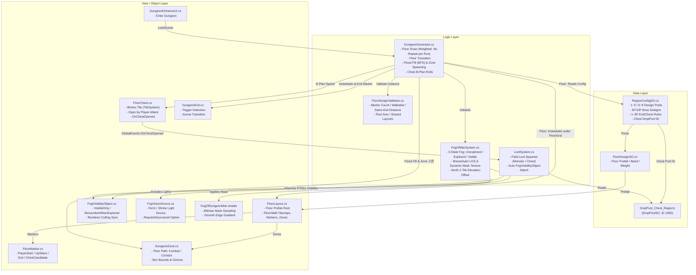

# 던전 시스템 (Dungeon System) 구조도

던전 생성, 플로우, 탈출에 이르는 전반적인 시스템의 클래스/데이터 구조 맵입니다.

## 1. 아키텍처 다이어그램 (Architecture Diagram)

## 2. 핵심 클래스 역할 명세 (Class Roles)

### 2.1. `DungeonGenerator` (`MonoBehaviour`)
*   **역할**: 던전 씬 진입 시 맵 생성 및 엔티티 스폰을 전담하는 메인 매니저. 층계 던전 전용(`_regionConfig` 필수, 통맵·청크 경로는 T3에서 삭제).
*   **층 경로**: 기획 `07_Floor_Based_Dungeon_Design.md`.
    *   `Awake`: 씬의 영속 `FloorGrid`(Grid) 아래 원점에 층 프리팹(`FloorLayout`)을 생성하고 `_floorTilemap`/`_wallTilemap`을 층 타일맵으로 바인딩, `Physics2D.SyncTransforms()` 후 `FloorDesignValidator`로 인스턴스 검증. Grid를 층 프리팹에 두지 않는 이유: 플레이어·몬스터가 `FindObjectOfType<Grid>()`로 Grid를 캐싱하므로 층 교체(T2) 때 Grid가 바뀌면 안 된다.
    *   `Start`: `PlayerStart` 마커에 플레이어 스폰 → BFS → `Exit`·`UpStairs` 마커 반경 `_markerSafeRadius`(체비쇼프) 및 `ChestCandidate` 칸을 스폰 금지로 예약 → 상자 B안(`SpawnChests`) → `Exit` 마커에 탈출 포탈(F3 전까지 항상) → `Combat`/`Corridor` 구역과 구역 밖 복도에 몬스터·함정 → 안개 초기화. 스폰물은 층 루트 아래 `Spawned`에 모은다.
    *   **층 추첨(T3, Q13)**: 1~4층 Early 풀·6~9층 Late 풀에서 `Weight` 가중치 추첨, 5층·10층 보스 디자인 고정. 한 판 안에서 같은 층 프리팹 재사용 금지(SO가 아닌 프리팹 기준, `_usedLayouts`). `DebugAllowDuplicateDesigns`면 무시. 후보가 0장이면 LogError 후 중복 허용으로 진행.
    *   **상자 B안(T3, Q30)**: `FloorRule.ChestRolls`만큼 `ChestChance` 판정 → 당첨마다 남은 `ChestCandidate` 중 무작위 1곳에 `FloorChest`(지역 상자 드랍 풀 ID 주입). 보스층은 규칙 0.
    *   **층 전환(T2)**: `UpStairs` 마커에 `FloorStairs`(10층 제외)를 두고, 밟히면 `FloorStairs.OnStairsEntered` → `AscendRoutine`: `GamePauseService.Request` + `PlayerInput.IsInputLocked` → `GlobalEvents.OnFloorTransitionStarted(fade)` → 페이드 시간 대기(실시간) → `ClearFloor()`(투사체·예고 장판 `ReleaseAll`, 이전 층 루트 비활성·분리·파괴, `Physics2D.SyncTransforms`, `TileSystem.ClearAll`로 점유·위험 칸·바닥 아이템 정리) → 다음 층 `BuildFloor`/`SetupFloorLayout` → `GlobalEvents.OnFloorEntered` → 페이드 시간 대기 → 잠금 해제.
    *   플레이어는 1층에서만 생성하고 2층부터는 `PlayerController.ResetForFloorTransition`(이동 코루틴·차징·선입력 정지, 위치 이동, 타일 등록, 카메라 `SnapToTarget`)으로 재사용한다 → HP·MP·쿨타임·HoT 유지.
    *   현재 층은 `PlayerSessionData.CurrentRegionId/CurrentFloor`에 기록(결과 화면 지역·층 표시, 07 문서 F7용). 계단 잠금·클리어 판정은 F3.

### 2.2. `FogOfWarSystem` (`MonoBehaviour`)
*   **역할**: 플레이어의 타일 이동 이벤트(`GlobalEvents.OnPlayerCellChanged`) 및 시야원들을 추적하여 3단계 전장의 안개(`Unexplored`, `Explored`, `Visible`)와 엔티티 가시성을 총괄 제어하는 코어 비전 매니저.
*   **특징**:
    *   **동적 텍스처 마스크 생성 & 셰이더 연동**: 타일 단위 계단식 깨짐을 없애기 위해 런타임에 `Texture2D`(`FilterMode.Bilinear`)를 생성하고 `FogOfDungeonMist.shader`를 입힌 풀스크린/오버레이 쿼드에 바인딩하여 부드러운 안개 그라데이션 제공.
    *   **Bresenham 직선 시야(LOS)**: 광원에서 방사되는 광선을 타일 단위로 추적하여, 벽면 타일까지는 밝혀주되 벽 너머 복도나 숨겨진 방은 시야선 차단.
    *   **2.5D 탑다운 북쪽 2타일 수직 보정**: 탑다운 뷰에서 북쪽 벽면이 2타일 높이로 표현되는 특성을 고려하여, 북쪽 벽면 2칸까지 자연스럽게 시야에 포함하는 수직 오프셋 보정(`_wallVerticalElevation`).
    *   **멀티 광원(Multi Vision Sources)**: 플레이어 기본 시야 외에 `FogVisionSource` 컴포넌트가 붙은 오브젝트(횃불, 제단)를 등록받아 통합 시야 맵을 합성.
    *   **오브젝트 가시성 중앙 관리**: `FogVisibilityObject` 컴포넌트를 등록하여 현재 시야 밖의 몬스터 및 드롭 아이템을 즉각 은폐.

### 2.3. `FogVisibilityObject` (`MonoBehaviour`)
*   **역할**: 안개 상태에 따라 자신의 렌더러(Renderer) 활성화/비활성화를 제어하는 컴포넌트.
*   **동작 모드**:
    *   `VisibleOnly`: 몬스터에 적용. 현재 시야(`Visible`) 내에 있을 때만 렌더러가 켜지며, 탐험된 안개(`Explored`)나 미탐험(`Unexplored`) 영역에 진입하면 즉시 은폐.
    *   `RememberWhenExplored`: 상자, 제단, 정적 상호작용물에 적용. 한 번이라도 플레이어가 밝힌 영역(`Explored` 이상)에 위치하면 계속해서 모습이 유지됨.
    *   드롭 아이템은 `LootSystem._droppedItemFogMode`로 정한다. 현재 `RememberWhenExplored`(코드 기본값과 `03_DungeonScene` 값 모두). `VisibleOnly`로 바꿀지는 결정 보류(Roadmap 8절).

### 2.4. `FogVisionSource` (`MonoBehaviour`)
*   **역할**: 맵 내에 배치되는 독립적인 보조 광원(횃불, 신비한 제단, 마법 수정 등).
*   **주요 옵션**:
    *   `visionRadius`: 광원이 비추는 타일 반경.
    *   `requireDiscoveredToEmit`: 활성화 시 플레이어가 해당 광원에 직접 도달하거나 탐험하기 전에는 빛을 내지 않다가, 탐험 완료 후 영구적으로 주변을 밝힘.

### 2.5. `FogOfDungeonMist.shader` (Shader)
*   **역할**: 안개 마스크 텍스처(`_FogTex`)를 샘플링하여 미탐험 색상(`_UnexploredColor`, 완전 흑색), 기탐험 색상(`_ExploredColor`, 반투명 흑색), 가시 영역(투명)을 블렌딩하는 전용 셰이더.

### 2.6. `DungeonZone` (`MonoBehaviour`)
*   **역할**: 층 프리팹 안에 사각형 영역(`_size` 또는 `BoxCollider2D`)으로 배치되어 몬스터·함정 스폰 구역(`Combat`, `Corridor`)과 수량을 정의. 시작점·탈출구·상자 후보는 `FloorMarker`가 맡는다.
*   **enum 값**: `Combat = 1`, `Corridor = 3`(삭제한 Start·Chest·Exit의 예전 번호와 직렬화 값을 맞추려고 유지).
*   **특징**:
    *   에디터 씬 뷰에서 구역 타입별 색상 반투명 기즈모(Gizmo) 렌더링.
    *   런타임 시 `BoxCollider2D`가 붙어 있으면 자동으로 비활성화하여 물리 충돌 간섭 방지.

### 2.7. `FloorChest` (`MonoBehaviour`, Controller)
*   **역할**: 층 상자. 생성 시 자기 칸을 `TileSystem` 점유로 등록해 플레이어·몬스터 이동을 막는다(열린 뒤에도 유지). `IAttackInteractable`을 구현해 플레이어의 근접·차지 공격(`EntityCombat`이 피해 대신 `OnAttacked` 호출)을 받으면 1회 열림(색 변경) → `GlobalEvents.OnChestOpened(위치, 드랍 풀 ID)`만 던진다. 몬스터 공격·투사체로는 열리지 않는다.
*   `LootSystem`이 구독해 몬스터와 같은 드랍 처리(`DropFromPool`)를 쓰되, 상자 칸은 건너뛰고 주변 칸부터 놓는다(열린 상자와 겹침·발밑 자동 습득 방지).
*   몬스터 사망 이벤트와 분리한 이유: 층 클리어 카운터(07 문서 F3)가 `OnMonsterDied`만 세야 한다.
*   내용물 `DropPool_Chest_Region1`(ID 1000): 재료(전리품 하위 등급) 2회 + 장비(악세서리)·포션 30% / 꽝 70%. 기획 5절 [추천] 값, 플레이 테스트로 조정.

### 2.8. `DungeonExit` (`MonoBehaviour`)
*   **역할**: 탈출구(포탈)의 상호작용 및 씬 전환 처리 (`LoadSceneMode.Single`).

### 2.9. `FloorLayout` / `FloorMarker` (`MonoBehaviour`)
*   **`FloorLayout`**: 층 프리팹 루트. `Floor`·`Wall` 타일맵 참조, 마커·구역 수집(지연 캐싱, Edit Mode에서는 매번 재수집), 루트 기준 칸 좌표(`GetLocalCell`, 셀 크기 1).
*   **`FloorMarker`**: `PlayerStart` / `UpStairs` / `Exit` / `ChestCandidate`. 칸 중앙(+0.5)에 둔다.
*   **층 프리팹 규격**: 루트(`FloorLayout`, Grid 없음) 아래 `Floor`, `Wall`(레이어 Wall, `TilemapCollider2D`), `Markers`, `Zones`. 타일맵은 루트 기준 위치·회전 0, 스케일 1.

### 2.10. `FloorDesignSO` / `RegionConfigSO` (`ScriptableObject`)
*   **`FloorDesignSO`**: 층 프리팹, 구간(`Early` 1~5 / `Late` 6~9 / `Boss`), 가중치.
*   **`RegionConfigSO`**: 지역 번호·이름, 1~5 풀, 6~9 풀, 5층·10층 보스 디자인, 1~9층 규칙(`FloorRule`: 탈출구 확률, 상자 굴림 횟수·확률), 상자 드랍 풀 ID, 디버그 "디자인 중복 허용".

### 2.11. `FloorDesignValidator` (static)
*   **역할**: 런타임·에디터 공용 규격 검증. 시작점 1, 탈출구 1, 계단 1(10층 보스층은 0~1), 마커 칸 보행 가능·중복 없음, 계단–탈출구 체비쇼프 거리 ≥ 3, 상자 후보 ≥ 구간 최대 굴림 횟수, 풀 구간 일치.
*   **풀 장수(T3)**: 구간 고유 프리팹 수 < 구간 층 수(4) → 오류, = 4 → 경고(추천 6장 이상). 1~5 풀과 6~9 풀이 같은 프리팹을 쓰면 오류(6~9층 후보 부족 방지). 디버그 중복 허용이면 오류 대신 경고. 경고는 별도 목록으로 에디터 메뉴가 LogWarning.

### 2.12. `FloorStairs` (`MonoBehaviour`, Controller)
*   **역할**: 위층 계단 트리거. 플레이어가 밟으면 정적 지역 이벤트 `OnStairsEntered`만 던지고 1회 후 비활성. T2는 항상 열림, 잠금·겹침 가드는 F3.

### 2.13. `FloorHUD` (`MonoBehaviour`, UI)
*   **역할**: 현재 층 상시 표시(우측 상단), 층 진입 배너(상단 중앙), 층 전환 암전. `GlobalEvents.OnFloorTransitionStarted`/`OnFloorEntered`만 구독(OnEnable/OnDisable), 연출은 unscaled time. 서식 `{0}` 지역 번호, `{1}` 층, `{2}` 지역 이름.

### 2.14. `FloorGrayBoxBuilder` (Editor)
*   메뉴 `BagBack100/Floor/Create Gray Box Floors`: 회색 박스 층 3장(일반 2 + 보스 1)과 `Region1Config`·`FloorDesignSO` 생성 후 검증. 템플릿은 `Floor_GrayBox_Normal01.prefab`의 Floor·Wall(먼저 복제 후 템플릿을 닫고 저장).
*   메뉴 `BagBack100/Floor/Create Region1 Chest Drop Pool`: 상자 드랍 풀(`DropPool_Chest_Region1`) 생성.
*   메뉴 `BagBack100/Floor/Setup Chest Prefab`: 회색 박스 상자 프리팹(`FloorChest_GrayBox`) 생성·`DungeonGenerator._chestPrefab` 연결.
*   메뉴 `BagBack100/Floor/Validate Region Configs`: 모든 `RegionConfigSO` 검증.
*   메뉴 `BagBack100/Floor/Setup Stairs And Floor HUD`: 회색 박스 계단 프리팹(`FloorStairs_GrayBox`) 생성·`DungeonGenerator._stairsPrefab` 연결, 켜진 Overlay 캔버스 아래 `FloorHUD` 생성 후 저장.
*   메뉴 `BagBack100/Floor/Setup Dungeon Scene For Floors`: `FloorGrid` 생성, `DungeonGenerator._regionConfig` 연결, 함정 풀이 비어 있으면 `Hazard_Spike` 지정 후 저장.
