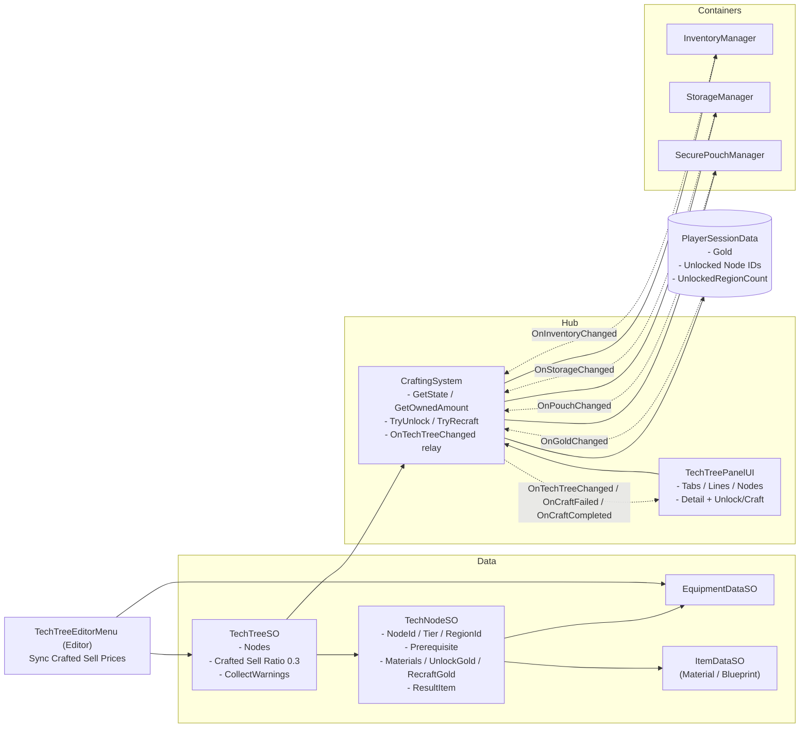

# 스크립트 종속성 맵: 기지 제작소 (Hub · Crafting)

기지 제작소(대장간) 테크트리의 데이터, 해금·재제작 처리, 화면을 담당하는 스크립트 지도입니다. 기지의 다른 스크립트(`HubSystem`, `HubTradeSystem`, `StorageManager`)와 가방·파우치는 [Player_System_Map.md](Player_System_Map.md) 4절, 기획은 [10 제작소 기획안](../10_Crafting_TechTree_Design.md)을 참고하세요.

## 1. 구조

- 실선: 직접 참조, 점선: 지역 이벤트(`GlobalEvents`는 쓰지 않음)
- 매니저 3개는 인스펙터 연결이 아니라 `Start`의 탐색 + 지연 캐싱 + 각 매니저의 정적 `OnManagerCreated`로 받습니다. `SecurePouchManager`는 `HubSystem.Awake`가 동적으로 붙이기 때문입니다.

## 2. 데이터 — `Data/Models/`, `Data/Core/`

| 스크립트 | 역할 |
| --- | --- |
| `TechNodeSO.cs` (+ `MaterialCost` 구조체) | 노드 1개. 결과 장비, 단계, 필요 지역, 같은 줄 선행 노드, 해금 재료(아이템 + 수량)·골드, 재제작 골드. 줄은 결과 장비의 `equipType`으로 구분(별도 enum 없음). `OnValidate`: ID·결과 장비 비어 있음, 자기 선행, 재료 칸 비어 있음·중복 경고 |
| `TechTreeSO.cs` | 노드 목록, 제작 장비 판매 비율(0.3). `GetSellPrice(node)` = floor(재제작 골드 × 비율), `GetNode(id)`. `CollectWarnings`: 노드 칸 비어 있음, 같은 노드 중복, ID 중복, 결과 장비 중복, 선행이 트리에 없음·다른 줄·단계가 같거나 높음, 2단계 이상인데 선행 없음, 결과 장비 `baseValue` ≠ 판매가 |
| `SaveData.cs` (`PlayerSessionData`) | 해금 노드 ID(`HashSet<string>`, `IsNodeUnlocked`·`MarkNodeUnlocked`), 지역 진행도(`UnlockedRegionCount` = 1, `IsRegionUnlocked`). 세션 메모리만(세이브는 MVP 밖) |
| `GameEnums.cs` | `ItemCategory.Blueprint`: 무기 설계도. 해금 재료로 쓰이고, 장비가 아니라 보안 파우치에 넣을 수 있음 |

## 3. 처리 — `Hub/CraftingSystem.cs` (2계층 System)

| 항목 | 내용 |
| --- | --- |
| 상태 `GetState` | 지역 잠김 → `Hidden`, 해금됨 → `Unlocked`, 선행 미해금 → `PrerequisiteLocked`, 그 외 `Unlockable` |
| 조회 | `GetOwnedAmount(item)` = 창고 + 가방 + 파우치 합계. `CanAffordUnlock`·`CanAffordRecraft` = 골드·재료만(공간 검사 없음, 할당 없음, UI 버튼용) |
| `TryUnlock` | 상태 → 결과 장비 → 골드 → 재료 → 공간(가방 또는 창고) 검사. 통과하면 컨테이너 3개 `BeginBulkChange` → 장비 추가(가방 → 창고, 실패 시 차감 없이 종료) → 재료 차감(창고 → 가방 → 파우치, 모자란 수량은 다음 컨테이너로) → `MarkNodeUnlocked` → `finally`에서 `EndBulkChange`(컨테이너별 알림 1회) → 골드 차감 → `OnCraftCompleted(nodeId)` |
| `TryRecraft` | 해금됨 → 골드 → 공간 → 장비 추가 성공 시에만 골드 차감 |
| 이벤트 | `OnCraftFailed(reason)`(영어 UI 문구), `OnCraftCompleted(nodeId)`, `OnTechTreeChanged`(매니저 3개 변경·골드 변경 중계) |
| 구독 관리 | 활성 상태일 때만 매니저 이벤트 구독(`SetListening`). `Bind*`는 참조가 바뀌면 이전 인스턴스 구독을 먼저 끊음. 파괴된 매니저(Unity null)는 재료 원본 배열에서 걸러 냄 |

## 4. 화면 — `UI/TechTreePanelUI.cs`

| 항목 | 내용 |
| --- | --- |
| 탭 | 인스펙터 배열 `TabDef`(버튼 + `EquipType[]` 줄 목록). 씬: 무기 `[Weapon]`, 방어구 `[Helmet, Armor, Boots, Backpack]` |
| 줄·노드 | 탭 전환·패널 열기 때만 생성. 줄마다 결과 장비 `equipType`이 같은 노드를 지역 → 단계 순으로 놓고 사이에 연결선 |
| 상세 | 노드 선택 때 이름·단계·스탯 문자열과 재료 행 생성(해금 전만) |
| 갱신 | `OnTechTreeChanged` → 갱신 플래그 → `LateUpdate`에서 1회. 상태 색, 숨김 노드 `???`·아이콘 숨김, 재료 `SetText("{0}/{1}")`·부족 시 빨강, 골드, 버튼 문구(`Unlock`/`Craft`/`Locked`)와 활성화. 할당 없음 |
| 알림 | `UIToast`로 실패 사유, `Unlocked X` / `Crafted X` |

## 5. 에디터 — `Editor/TechTreeEditorMenu.cs`

*   메뉴 `BagBack100/Tech/Sync Crafted Sell Prices`: 모든 `TechTreeSO`의 결과 장비 `baseValue`를 노드 판매가로 맞춤(`Undo.RecordObject` + `SetDirty` + `SaveAssets`). 같은 장비가 트리마다 다른 판매가를 요구하면 오류 후 중단. 설계도 판매가는 노드 결과물이 아니라서 다루지 않음(설계도 SO에 직접 입력).

## 6. 씬·데이터 연결

| 위치 | 연결 |
| --- | --- |
| `02_HubScene` `HubSystem` 오브젝트 | `CraftingSystem._techTree` = `Assets/Resources/Data_SO/TechTreeSO/TechTree_Region1.asset` |
| `Canvas/StorageUIPanel/BlacksmithPanel/Background/TechTree` | `TechTreePanelUI` (탭, `Lines`, 템플릿 3종, `Detail`, 토스트 = `InventoryPanel/Toast`) |
| `Canvas/StorageUIPanel/ShopPanel/Background` | `RowsViewport`(ScrollRect + RectMask2D) 안의 `Rows`, 하단 `SellSlot`·`Hint` |
| 노드 에셋 | `TechTreeSO/Region1/Node_R1_<줄>_T<단계>.asset` 13개 |
| 설계도 | `ItemSO/BlueprintSO/` 401·402. 무기 2·3단계 노드 재료, 몬스터·임시 보스 드랍 풀의 `설계도` 그룹 |
