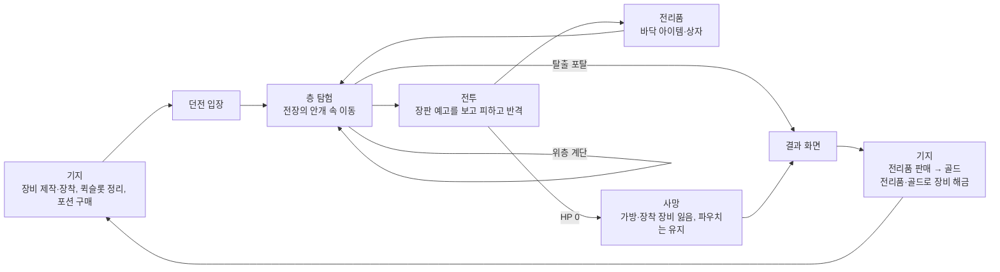

# 100 Bags Back 게임 기획서 (GDD)

> 이 폴더의 문서는 **현재 구현된 게임**을 기준으로 작성합니다.
> 아직 구현하지 않은 기획은 [Roadmap.md](Roadmap.md)에, 확정됐지만 진행 중인 큰 기획은 `Docs/Architecture/`의 기획안(예: [07 층계 던전](../Architecture/07_Floor_Based_Dungeon_Design.md))에 둡니다.

## 1. 개요

| 항목 | 내용 |
| --- | --- |
| 장르 | 익스트랙션 실시간 타일 액션 RPG |
| 플랫폼 | PC (Unity 2D) |
| 조작 | 키보드 이동(WASD) + 마우스 조준·공격 |
| 개발 단계 | 1인 개발. 1차 마일스톤(MVP) 진행 중: 층계 던전 지역 1 + 제작소까지 포함한 정비 → 전투 → 판매/해금 사이클. 범위는 [Roadmap.md](Roadmap.md) 0절 |

## 2. 핵심 루프

- 던전은 1층부터 10층까지 올라가는 층계 구조입니다. 위층일수록 위험하지만 가방은 점점 찹니다.
- 던전에서 죽으면 가방과 장착 장비를 모두 잃습니다. 창고, 보안 파우치(2칸), 지갑 골드는 남습니다.
- 가방은 칸 수가 제한되어 있어, 무엇을 챙기고 언제 나갈지 판단하는 것이 핵심입니다.
- 던전에서 얻는 것은 전리품이고, 기지에서 팔아야 골드가 됩니다.

## 3. 핵심 규칙 요약

| 영역 | 규칙 | 상세 문서 |
| --- | --- | --- |
| 이동 | 타일 1칸씩 4방향 이동 | [Combat.md](Combat.md) |
| 전투 | 마우스 8방향 조준, 3타 콤보와 차징. 이동 중에는 공격 불가, 행동 중 누른 입력은 선입력으로 이어짐. 방어력은 점감 공식으로 피해 경감 | [Combat.md](Combat.md) |
| 몬스터 | 모든 공격을 바닥 장판·조준선으로 먼저 예고하고, 공격 후 후딜레이(반격 타이밍)를 보장 | [Monsters.md](Monsters.md), [Monster_AI.md](Monster_AI.md) |
| 던전 | 지역 × 10층. 층마다 디자인 풀에서 1장, 한 판 중복 없음. 위층 계단으로 상승, 상자는 공격으로 염 | [Dungeon.md](Dungeon.md) |
| 시야 | 3단계 전장의 안개. 벽 너머는 보이지 않음 | [Dungeon.md](Dungeon.md) |
| 아이템 | 1아이템 1칸, 칸 수만 제한. 장비 8부위, 포션과 퀵슬롯, 보안 파우치 | [Items.md](Items.md) |
| 기지 | 걸어 다니지 않고 오브젝트를 클릭하는 로비. 창고, 제작소(테크트리 해금·재제작), 잡화상(구매·판매), 결과 화면. 무기·방어구·배낭은 제작소에서만 얻음(악세서리는 던전 드랍) | [Hub.md](Hub.md) |

## 4. 문서 목록

| 문서 | 내용 |
| --- | --- |
| [Combat.md](Combat.md) | 조작, 플레이어 전투 규칙, 피해 공식, 스탯 |
| [Monsters.md](Monsters.md) | 몬스터 등급, 감지·어그로, 특성, 구현된 몬스터 목록 |
| [Monster_AI.md](Monster_AI.md) | 몬스터 행동 루프, 이동 성향, 공격 패턴 명세 |
| [Dungeon.md](Dungeon.md) | 층계 구조, 배치 규칙, 상자, 전장의 안개, 탈출과 사망 |
| [Items.md](Items.md) | 가방, 아이템 분류, 장비, 획득·버리기, 소모품, 골드, 보안 파우치 |
| [Hub.md](Hub.md) | 기지 구성, 제작소, 판매·구매, 창고 |
| [UI_Direction.md](UI_Direction.md) | 창고·상점·툴팁·테크트리 화면의 목표 구성 (테크트리만 MVP 단순 화면 구현) |
| [Roadmap.md](Roadmap.md) | 아직 구현하지 않은 기획, 아이디어 백로그 |
| [08 지역 1 보스 기획안](../Architecture/08_Region1_Boss_Design.md) | 숲 지역 나무 보스·중간 보스 초안 (미구현) |

코드 구조는 [ARCHITECTURE.md](../ARCHITECTURE.md)를 참고하세요.
