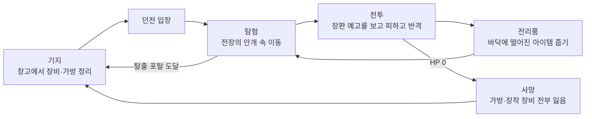

# 100 Bags Back 게임 기획서 (GDD)

> 이 폴더의 문서는 **현재 구현된 게임**을 기준으로 작성합니다.
> 아직 구현하지 않은 기획은 [Roadmap.md](Roadmap.md)에 따로 모읍니다.

## 1. 개요

| 항목 | 내용 |
| --- | --- |
| 장르 | 익스트랙션 실시간 타일 액션 RPG |
| 플랫폼 | PC (Unity 2D) |
| 조작 | 키보드 이동(WASD) + 마우스 조준·공격 |
| 개발 단계 | 1인 개발. 수작업 고정 맵으로 핵심 루프를 먼저 검증하는 MVP 단계 |

## 2. 핵심 루프

- 던전에서 죽으면 가져간 아이템을 모두 잃습니다. 창고에 맡긴 아이템은 남습니다.
- 가방은 칸 수가 제한되어 있어, 무엇을 챙기고 언제 돌아갈지 판단하는 것이 핵심입니다.

## 3. 핵심 규칙 요약

| 영역 | 규칙 | 상세 문서 |
| --- | --- | --- |
| 이동 | 타일 1칸씩 4방향 이동 | [Combat.md](Combat.md) |
| 전투 | 마우스 8방향 조준. 이동 중에는 공격 불가, 행동 중 누른 입력은 선입력으로 이어짐 | [Combat.md](Combat.md) |
| 몬스터 | 모든 공격을 바닥 장판·조준선으로 먼저 예고하고, 공격 후 후딜레이(반격 타이밍)를 보장 | [Monsters.md](Monsters.md), [Monster_AI.md](Monster_AI.md) |
| 던전 | 수작업 고정 맵 + 구역 기반 배치. 시작 지점에서 가장 먼 곳에 탈출 포탈 | [Dungeon.md](Dungeon.md) |
| 시야 | 3단계 전장의 안개. 벽 너머는 보이지 않음 | [Dungeon.md](Dungeon.md) |
| 아이템 | 1아이템 1칸, 칸 수만 제한. 가방 장비로 칸 수 증가 | [Items.md](Items.md) |
| 기지 | 걸어 다니지 않고 오브젝트를 클릭하는 로비 | [Hub.md](Hub.md) |

## 4. 문서 목록

| 문서 | 내용 |
| --- | --- |
| [Combat.md](Combat.md) | 조작, 플레이어 전투 규칙, 스탯 |
| [Monsters.md](Monsters.md) | 몬스터 등급, 감지·어그로, 특성, 구현된 몬스터 목록 |
| [Monster_AI.md](Monster_AI.md) | 몬스터 행동 루프, 이동 성향, 공격 패턴 명세 |
| [Dungeon.md](Dungeon.md) | 맵 구성, 스폰 규칙, 전장의 안개, 탈출과 사망 |
| [Items.md](Items.md) | 가방, 아이템 분류, 획득·버리기, 사망 시 처리 |
| [Hub.md](Hub.md) | 기지 구성과 창고 |
| [Roadmap.md](Roadmap.md) | 아직 구현하지 않은 기획 |

코드 구조는 [ARCHITECTURE.md](../ARCHITECTURE.md)를 참고하세요.
