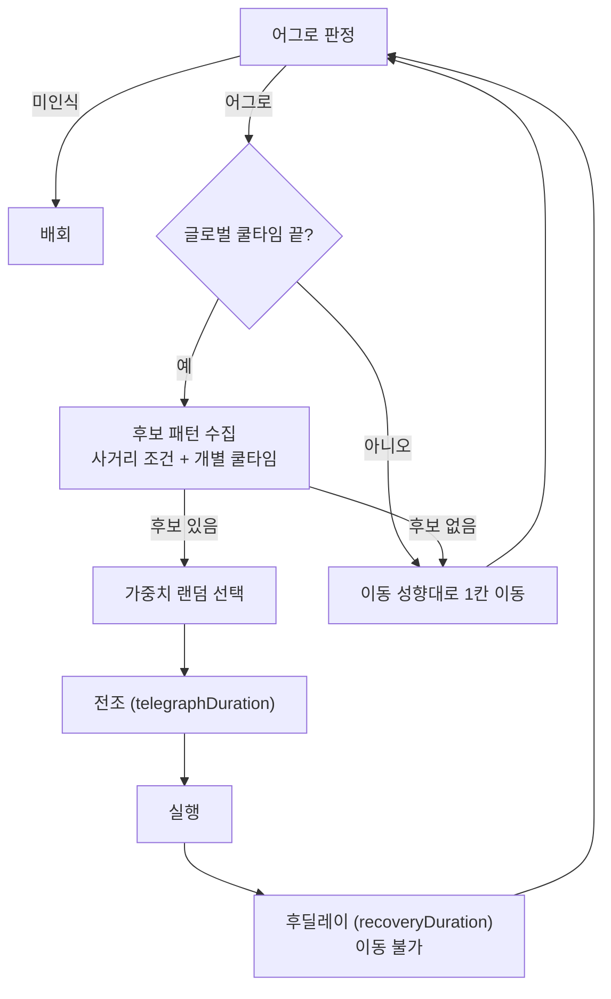

# 몬스터 AI (Monster AI)

몬스터의 행동 루프, 이동 성향, 공격 패턴 명세입니다. 코드는 `Assets/01_Scripts/Monster/`에 있습니다.

## 1. 구조

- 몬스터 1마리는 `MonsterController`가 관리합니다.
- 공격은 `MonsterPatternSO`를 상속한 패턴 에셋으로 분리되어 있고, `MonsterDataSO`의 `patterns` 목록에 조합해 넣습니다.
- 이동은 `MonsterLocomotion`이 이동 성향(`movementStyle`)에 따라 처리합니다.
- 몬스터는 프레임 애니메이션이 없는 단일 스프라이트이므로, 공격 예고는 몸동작 대신 **바닥 장판·조준선·돌진 경로** 같은 공간 표시로 합니다.

## 2. 행동 루프

| 값 | 위치 | 의미 |
| --- | --- | --- |
| `moveDuration` | `MonsterDataSO` | 타일 1칸 이동에 걸리는 시간 |
| `moveInterval` | `MonsterDataSO` | 한 걸음 후 다음 걸음까지 대기 시간 |
| `globalPatternCooldown` | `MonsterDataSO` | 패턴 사이 최소 간격. 이 시간 동안에도 이동은 계속함 |
| `weight` | `MonsterPatternSO` | 가중치 랜덤 선택 비율 |
| `minRange` / `maxRange` | `MonsterPatternSO` | 패턴을 쓸 수 있는 플레이어와의 타일 거리 |
| `orthogonalOnly` | `MonsterPatternSO` | 체크 시 거리를 대각선 없이 상하좌우(맨해튼) 거리로 잼 |
| `patternCooldown` | `MonsterPatternSO` | 패턴별 재사용 대기 |
| `telegraphDuration` | `MonsterPatternSO` | 공격 전 예고 시간 |
| `recoveryDuration` | `MonsterPatternSO` | 공격 후 멈춰 있는 시간 (플레이어의 반격 타이밍) |
| `damageMultiplier` | `MonsterPatternSO` | 몬스터 공격력에 곱하는 배율 |

- **패턴 선택**: 조건을 통과한 후보들의 `weight` 합 위에서 난수를 뽑는 룰렛 휠 방식입니다.
- **쿨타임 등록 시점**: 패턴을 시작할 때 먼저 등록합니다. 패턴이 기절 등으로 중간에 끊겨도 쿨타임이 적용됩니다.

## 3. 이동 성향

| 성향 | 동작 |
| --- | --- |
| `HeavyChase` | A* 경로로 플레이어를 향해 1칸씩 직진. 위험 칸은 경로 비용을 높여 돌아감 |
| `AgileFlank` | 플레이어의 정면을 피해 측면·후방 인접 칸을 노림. 플레이어 공격을 옆 칸으로 피하는 회피 스텝(쿨타임 `evasiveStepCooldown`) |
| `RangedKiting` | 적정 사거리를 유지. 가까워지면 후퇴하거나 옆으로 이동. 피격 시 뒤로 물러나는 후방 탈출(쿨타임 `escapeOnHitCooldown`) |

## 4. 상태와 인터럽트

| 상태 | 의미 |
| --- | --- |
| `Patrol` | 미인식, 배회 |
| `Aggro` | 추적·전투 |
| `Evading` | 회피 스텝 또는 후방 탈출 중 |
| `Stunned` | 돌진 중 벽 충돌 등으로 행동 불능 |
| `Dead` | 사망 |

- 회피·후방 탈출·기절은 진행 중인 행동을 끊는 인터럽트입니다.
- 행동 루프에서 시작한 하위 코루틴(패턴, 이동)은 모두 `StartActionCoroutine()`으로 시작해 추적하고, 인터럽트·사망 시 `StopActionCoroutines()`로 한꺼번에 멈춥니다.
- 타일 이동 도중 멈추면 이미 점유한 목적지 칸으로 위치를 정렬합니다.
- 피격 연출은 행동 루프와 별개라 인터럽트로 끊기지 않습니다.
- 후방 탈출은 패턴 시전 중이거나 후딜레이 중에는 발동하지 않습니다. 플레이어의 반격 타이밍을 지키기 위한 규칙입니다.

## 5. 공격 패턴

모든 공격은 예고 후 실행되고, 실행 후 후딜레이가 있습니다.

단일 근접과 치고 빠지기는 상하좌우 인접 칸에서만 시작합니다(`orthogonalOnly`, 사거리 1). 대각선에서는 광역 내려치기만 닿습니다. 근거는 [09 문서](../Architecture/09_Crowd_Combat_And_Dash_Design.md)입니다.

| 패턴 | 예고 방식 | 피하는 법 |
| --- | --- | --- |
| `SingleMeleePatternSO` (단일 근접) | 대상 칸에 빨간 장판 | 예고 시간 안에 장판 밖으로 이동 |
| `AoESlamPatternSO` (광역 내려치기) | 3x3 정사각형 / 마름모 / 전방 박스 장판 | 장판 밖으로 이동 |
| `ChargePatternSO` (직선 돌진) | 돌진 경로 직선 장판 | 옆 칸으로 피함. 몬스터가 벽에 부딪히면 1.5초 기절 |
| `HitAndRunPatternSO` (치고 빠지기) | 짧은 예고 후 1칸 찌르기 | 찌른 뒤 몬스터가 뒤·옆으로 빠짐 |
| `RangedProjectilePatternSO` (원거리 투사체) | 바닥 장판 대신 조준선(`LineRenderer`). 단발 / 예측 사격 / 부채꼴 | 조준선 밖으로 비켜서거나 탄을 보고 피함 |
| `MortarAoEPatternSO` (곡사 포격) | 착탄 칸에만 장판. 플레이어 이동 방향을 예측 | 착탄 칸에서 벗어남 |

새 패턴은 `MonsterPatternSO`를 상속한 클래스 하나로 추가하며, `MonsterController`는 수정하지 않습니다.
