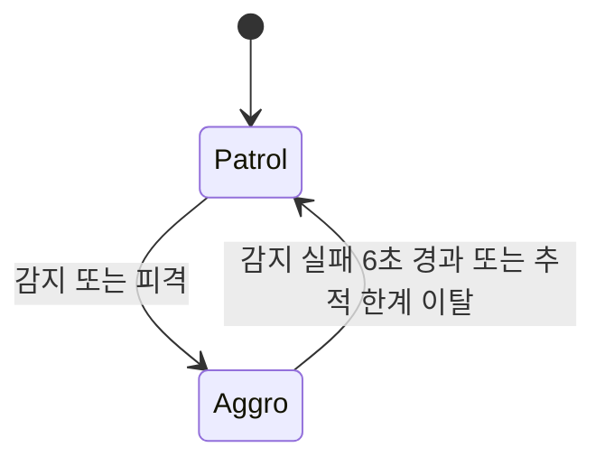

# 몬스터 (Monsters)

몬스터의 분류, 감지 규칙, 특성, 구현된 몬스터 목록입니다.
행동 루프와 공격 패턴은 [Monster_AI.md](Monster_AI.md)를 참고하세요.

## 1. 등급

| 등급 | 역할 | 상태 |
| --- | --- | --- |
| `Normal` (일반) | 방과 복도를 배회하는 기본 몬스터 | 구현 (임시 보스를 뺀 현재 몬스터 4종 모두 일반 등급) |
| `Elite` (정예) | 패턴 2개 이상 + 특성 1개 이상인 강한 개체. 배치는 층 디자인에서 정함 | 데이터 분류만 존재, 별도 규칙은 [Roadmap](Roadmap.md) |
| `Boss` (보스) | 5층 중간 보스, 10층 보스. 보스층은 Boss를 모두 잡으면 클리어 | 보스층 규칙 구현([Dungeon.md](Dungeon.md) 5절). 지금은 임시 보스만 있음(4절). 전용 패턴·여러 칸 크기는 [Roadmap](Roadmap.md) |

- **소환수**: 다른 몬스터가 불러낸 개체. 체력이 낮고, 전리품을 떨어뜨리지 않으며, 소환자가 죽어도 남습니다. 일반층 클리어에는 포함됩니다. (소환 패턴은 아직 없고, 코드에 소환수 표시만 있음)

## 2. 감지와 어그로

| 규칙 | 내용 |
| --- | --- |
| 배회 | 미인식 상태에서는 주변 4방향 타일을 돌아다니거나 대기 |
| 감지 범위 (ZOC) | 몬스터마다 `zocRadius` 칸 (5~7칸) |
| 감지 조건 | ZOC 안에 있고, 2칸 이내이거나 몬스터와 플레이어 사이에 벽이 없을 때. 방향 구분 없이 360도 (감지 각도는 [Roadmap](Roadmap.md)) |
| 피격 | 감지 여부와 관계없이 즉시 어그로 |
| 어그로 유지 | 마지막 감지 후 6초 |
| 추적 한계 | `zocRadius + 4`칸 밖으로 벗어나면 즉시 해제 |
| 표시 | 어그로 시 머리 위에 `!`, 해제 시 `?` |

- 여러 몬스터의 감지 범위에 동시에 들어가면 1:N 전투가 됩니다.

## 3. 특성 (Traits)

`MonsterDataSO`의 `traits` 목록에 이름을 넣어 부여합니다.

| 특성 | 효과 |
| --- | --- |
| `LIFESTEAL` | 공격이 맞으면 준 피해의 30%만큼 회복 |
| `SHIELD` | 최대 HP의 50%만큼 보호막을 가지고 시작. 보호막이 HP보다 먼저 깎임. 보호막이 남아 있으면 피격 시 후방 탈출을 하지 않음 |
| `FAST` | 이동 시간·이동 간격·공격 전조 시간이 30% 짧아짐 |
| `EXPLOSIVE` | 죽으면 짧은 시간 뒤 주변 3x3 칸에 폭발 피해 |

## 4. 구현된 몬스터

현재 몬스터는 모두 특성이 없고 이동 성향과 패턴 조합만 다릅니다. 임시 보스 외에는 일반 등급입니다.

| 이름 | HP | 공격력 | 방어력 | ZOC | 출현 층 | 이동 성향 | 공격 패턴 |
| --- | --- | --- | --- | --- | --- | --- | --- |
| Bramble Hog (고슴도치, 탱커) | 100 | 8 | 6 | 5 | 1~5 | `HeavyChase` (직진 추적) | 단일 근접, 광역 내려치기, 직선 돌진 |
| Leaf Mantis (사마귀, 암살자) | 40 | 7 | 3 | 6 | 3~7 | `AgileFlank` (측면 우회) | 치고 빠지기, 단일 근접. 플레이어 공격을 옆으로 피하는 회피 스텝 |
| Pinecone Owl (부엉이, 원거리) | 45 | 10 | 3 | 7 | 5~10 | `RangedKiting` (거리 유지) | 원거리 투사체, 곡사 포격. 맞으면 뒤로 물러나는 후방 탈출 |
| Amber Snail (달팽이, 탱커) | 100 | 8 | 6 | 5 | 1~10 | `HeavyChase` (직진 추적) | Bramble Hog와 같음(임시) |

- **이름·외형** (2026-11-20 유저 결정): 일반 몬스터 4종은 고슴도치·사마귀·부엉이·달팽이입니다. 예전 이름 Heavy Brute·Shadow Spider·Arcane Wizard를 외형에 맞게 바꿨고, 에셋 파일명과 ID(101~103)는 그대로입니다. 플레이어처럼 4방향(S/W/E/N) 정지 이미지를 쓰고, 마지막 행동 방향을 봅니다: 이동 중에는 이동 방향, 패턴(공격)을 시작하면 그 순간의 플레이어 쪽. 예고·공격 중이나 서 있을 때 플레이어를 따라 돌지 않습니다.
- **Amber Snail(104)**: 컨셉은 지나간 칸에 둔화 점액을 남기는 탱커지만, 점액 패턴이 없어 지금은 Bramble Hog의 스탯·패턴을 복사했습니다. 출현 층은 일단 1~10층, 드랍은 Bramble Hog 드랍 풀(101)을 같이 씁니다. 이 때문에 1~2층 몬스터의 절반이 달팽이가 되고 층마다 몬스터 종류가 하나 늘어, [밸런스 점검](../Balance/balance-check-economy-2026-11-19.md)의 층별 몬스터 구성 계산과 달라집니다. 출현 층·전용 드랍은 밸런스 테스트 때 `SnailMonster.asset` 수치로 정합니다.

- **Temp Boss**: 5·10층 공용 임시 보스(`Boss` 등급). Heavy Brute(현 Bramble Hog)를 복사해 HP를 195로 올렸고(당시 HP 65의 3배), 1칸 크기에 전용 패턴이 없습니다. 보스 몬스터 제작(07 문서 F6b)에서 교체합니다.
- 표의 HP·공격력은 1층 기준입니다. 층이 오르면 배율이 붙습니다([Dungeon.md](Dungeon.md) 2절). 방어력은 고정입니다.
- **출현 층**: 몬스터마다 `MonsterDataSO`의 출현 층 범위가 있고, 층을 만들 때 지역 몬스터 풀에서 그 층에 나올 수 있는 몬스터만 고릅니다([Dungeon.md](Dungeon.md) 2절). 표의 범위는 초기 디자인 몬스터의 시험값입니다. 높은 단계 제작 재료는 깊은 층 몬스터의 전리품이라, 출현 층으로 재료 수급 속도가 정해집니다([Hub.md](Hub.md) 2절).
- **드랍**: 일반 몬스터는 처치 시 65% 확률로 자기 전리품 5종 중 1개를 떨어뜨리고, 등급은 층 비율로 정합니다. Temp Boss는 희귀 이상 2개를 확정으로 떨어뜨립니다(첫 처치 전설 1개는 세이브 구현 후).
- **설계도 드랍**(전리품과 따로 1번 굴림, 초기값): Leaf Mantis 1%로 2단계 검 설계도, Pinecone Owl 1%로 3단계 검 설계도, Temp Boss 30%로 2단계 검 설계도([Items.md](Items.md) 2.2절). 확률은 플레이 테스트 뒤 조정합니다([밸런스 점검](../Balance/balance-check-economy-2026-11-19.md)).
  - **임시 보스 예외**: 5·10층이 같은 Temp Boss(같은 드랍 풀)를 쓰므로, 5층에서 3단계 설계도를 얻어 진행을 건너뛰지 않게 2단계만 떨어뜨립니다. 보스를 나눌 때(07 문서 F6b) 5층 보스 = 2단계, 10층 보스 = 3단계로 드랍 풀을 나눕니다.
- 방어력은 [Combat.md](Combat.md) 2.6절 공식으로 받는 피해를 줄입니다.
- 수치는 `Assets/Resources/Data_SO/MonsterSO/`의 에셋 값입니다.

새 몬스터는 코드 수정 없이 `MonsterDataSO`에 이동 성향과 패턴 SO를 조합해 만듭니다.
