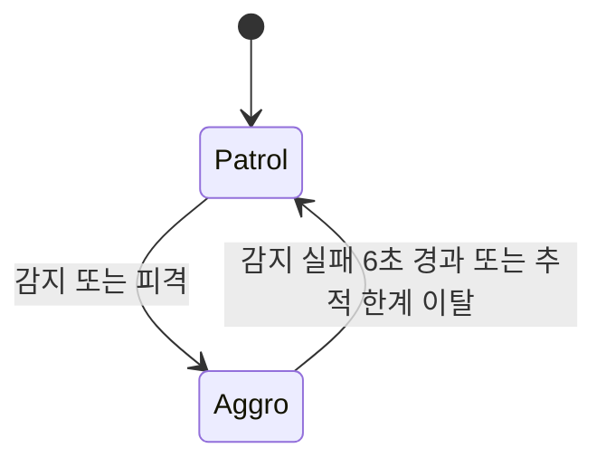

# 몬스터 (Monsters)

몬스터의 분류, 감지 규칙, 특성, 구현된 몬스터 목록입니다.
행동 루프와 공격 패턴은 [Monster_AI.md](Monster_AI.md)를 참고하세요.

## 1. 등급

| 등급 | 역할 | 상태 |
| --- | --- | --- |
| `Normal` (일반) | 방과 복도를 배회하는 기본 몬스터 | 구현 (현재 몬스터 3종 모두 일반 등급) |
| `Elite` (정예) | 패턴 2개 이상 + 특성 1개 이상인 강한 개체. 배치는 층 디자인에서 정함 | 데이터 분류만 존재, 별도 규칙은 [Roadmap](Roadmap.md) |
| `Boss` (보스) | 5층 중간 보스, 10층 보스 | 데이터 분류만 존재, 보스층 규칙은 [Roadmap](Roadmap.md) |

## 2. 감지와 어그로

| 규칙 | 내용 |
| --- | --- |
| 배회 | 미인식 상태에서는 주변 4방향 타일을 돌아다니거나 대기 |
| 감지 범위 (ZOC) | 몬스터마다 `zocRadius` 칸 (5~7칸) |
| 감지 조건 | ZOC 안에 있고, 2칸 이내이거나 몬스터와 플레이어 사이에 벽이 없을 때. 방향 구분 없이 360도 (감지 각도는 [Roadmap](Roadmap.md)) |
| 피격 | 감지 여부와 관계없이 즉시 어그로 |
| 어그로 유지 | 마지막 감지 후 6초 |
| 추적 한계 | `zocRadius + 4`칸 밖으로 벗어나면 즉시 해제 |
| 표시 | 어그로 시 머리 위에 `!`, 해제 시 `?` |

- 여러 몬스터의 감지 범위에 동시에 들어가면 1:N 전투가 됩니다.

## 3. 특성 (Traits)

`MonsterDataSO`의 `traits` 목록에 이름을 넣어 부여합니다.

| 특성 | 효과 |
| --- | --- |
| `LIFESTEAL` | 공격이 맞으면 준 피해의 30%만큼 회복 |
| `SHIELD` | 최대 HP의 50%만큼 보호막을 가지고 시작. 보호막이 HP보다 먼저 깎임. 보호막이 남아 있으면 피격 시 후방 탈출을 하지 않음 |
| `FAST` | 이동 시간·이동 간격·공격 전조 시간이 30% 짧아짐 |
| `EXPLOSIVE` | 죽으면 짧은 시간 뒤 주변 3x3 칸에 폭발 피해 |

## 4. 구현된 몬스터

현재 몬스터는 모두 특성 없이 일반 등급이며, 이동 성향과 패턴 조합만 다릅니다.

| 이름 | HP | 공격력 | 방어력 | ZOC | 이동 성향 | 공격 패턴 |
| --- | --- | --- | --- | --- | --- | --- |
| Heavy Brute | 65 | 8 | 6 | 5 | `HeavyChase` (직진 추적) | 단일 근접, 광역 내려치기, 직선 돌진 |
| Shadow Spider | 40 | 7 | 3 | 6 | `AgileFlank` (측면 우회) | 치고 빠지기, 단일 근접. 플레이어 공격을 옆으로 피하는 회피 스텝 |
| Arcane Wizard | 45 | 10 | 3 | 7 | `RangedKiting` (거리 유지) | 원거리 투사체, 곡사 포격. 맞으면 뒤로 물러나는 후방 탈출 |

- 방어력은 [Combat.md](Combat.md) 2.6절 공식으로 받는 피해를 줄입니다.
- 수치는 `Assets/Resources/Data_SO/MonsterSO/`의 에셋 값입니다.

새 몬스터는 코드 수정 없이 `MonsterDataSO`에 이동 성향과 패턴 SO를 조합해 만듭니다.
